<div align="center">


## **Universidad Peruana de Ciencias Aplicadas**
### Facultad de Ingeniería
### Carrera de Ingeniería de Software
### Ciclo 2026-20
<br>

**Curso: 1ASI0729 - Desarrollo de Aplicaciones Open Source**

**NRC: 7760**

**Profesor: Flores Moroco, Juan Antonio**
<br>

### **Informe de Trabajo Final**

**Nombre de la Startup:** AgriDron Solutions

**Nombre del Producto:** AgriDron
<br>

### **Integrantes**

</div>

<table align="center" style="border-collapse: collapse; border: none; margin-left: auto; margin-right: auto;">
    <tr>
        <th style="border: none; padding: 0 18px 6px 0; text-align: center;">Código</th>
        <th style="border: none; padding: 0 0 6px 0; text-align: center;">Apellidos y Nombres</th>
    </tr>
    <tr>
        <td style="border: none; padding: 0 18px 4px 0; text-align: center;">U202421392</td>
        <td style="border: none; padding: 0 0 4px 0; text-align: center;">Damacen Galindo, Italo Gianfranco</td>
    </tr>
    <tr>
        <td style="border: none; padding: 0 18px 4px 0; text-align: center;">U20241G306</td>
        <td style="border: none; padding: 0 0 4px 0; text-align: center;">Nicho Huillcañahui, Edwin Noe</td>
    </tr>
    <tr>
        <td style="border: none; padding: 0 18px 4px 0; text-align: center;">U202416053</td>
        <td style="border: none; padding: 0 0 4px 0; text-align: center;">Ramírez Gutiérrez, Gabriel</td>
    </tr>
    <tr>
        <td style="border: none; padding: 0 18px 4px 0; text-align: center;">U202422642</td>
        <td style="border: none; padding: 0 0 4px 0; text-align: center;">Sayago Vidal, Sebastián Leonardo</td>
    </tr>
    <tr>
        <td style="border: none; padding: 0 18px 4px 0; text-align: center;">U202222473</td>
        <td style="border: none; padding: 0 0 4px 0; text-align: center;">Vásquez Roncal, Alexander Felipe</td>
    </tr>
</table>
<br>
<div align="center">
<b><i>Octubre, 2026</i></b>
</div>
<br>

<div style="page-break-after: always;"></div>

---

## Registro de Versiones del Informe

| Versión | Fecha | Autor | Descripción de modificación |
|:--|:--|:--|:--|
| 0.1.0 | 05/09/2026 | Sayago Vidal, Sebastián Leonardo | Creación inicial del documento y de la plantilla del informe. |
| 0.2.0 | 06/09/2026 | Sayago Vidal, Sebastián Leonardo | Estructura del informe, carpeta de assets y avance inicial del Capítulo I. |
| 0.3.0 | 07/09/2026 | Damacen Galindo, Italo Gianfranco | Startup Profile, Solution Profile, Segmentos objetivo y Lean UX Canvas (1.1 a 1.3). |
| 0.4.0 | 09/09/2026 | Vásquez Roncal, Alexander Felipe | Avance inicial de los Capítulos III y IV. |
| 0.5.0 | 10/09/2026 | Sayago Vidal, Sebastián Leonardo | Software Configuration Management (5.1). |
| 0.6.0 | 11/09/2026 | Nicho Huillcañahui, Edwin Noe | Registro y análisis de entrevistas (2.2.2 y 2.2.3). |
| 0.7.0 | 13/09/2026 | Vásquez Roncal, Alexander Felipe | User Journey Mapping y Mock-ups de las aplicaciones. |
| 0.8.0 | 13/09/2026 | Sayago Vidal, Sebastián Leonardo | Database Design (4.8). |
| 0.9.0 | 14/09/2026 | Ramírez Gutiérrez, Gabriel | Avance del Sprint 1 y Landing Page (5.2.1). |
| 0.10.0 | 15/09/2026 | Damacen Galindo, Italo Gianfranco | Student Outcome, perfil de integrante y registro de entrevistas. |
| 0.11.0 | 16/09/2026 | Nicho Huillcañahui, Edwin Noe | Artefactos UX, Ubiquitous Language, User Stories, Technical Stories e Impact Mapping. |
| 0.12.0 | 16/09/2026 | Vásquez Roncal, Alexander Felipe | Nuevas User Stories, enlaces de Miro y LucidChart y descripción del User Flow. |
| 0.13.0 | 17/09/2026 | Vásquez Roncal, Alexander Felipe | Reestructuración del Capítulo IV, enlaces de Figma y Trello y evidencia del Sprint Review. |
| 1.0.0 | 17/09/2026 | Sayago Vidal, Sebastián Leonardo | Domain flow, User Flow Diagram y tabla de contenido. Versión de entrega AV1. |
| 1.1.0 | 30/09/2026 | Vásquez Roncal, Alexander Felipe | Corrección y ampliación de User Stories según feedback de AV1. |
| 1.2.0 | 30/09/2026 | Sayago Vidal, Sebastián Leonardo | Actualización de Class Diagrams y Database Diagrams. |
| 1.2.1 | 05/10/2026 | Sayago Vidal, Sebastián Leonardo | Corrección del formato del Sprint Backlog 1. |
| 1.3.0 | 06/10/2026 | Damacen Galindo, Italo Gianfranco | Ampliación del Análisis competitivo (2.1.1) y de Herramientas del proyecto (5.1.1.2). |
| 1.4.0 | 06/10/2026 | Sayago Vidal, Sebastián Leonardo | Sprint 2 (5.2.2). |
| 2.0.0 | 06/10/2026 | Nicho Huillcañahui, Edwin Noe | Project Report Collaboration Insights, videos de exposición y Student Outcome. Versión de entrega TB1. |
| 2.1.0 | 17/10/2026 | Damacen Galindo, Italo Gianfranco | Corrección de la carátula, el Registro de Versiones, Project Report Collaboration Insights, Student Outcome, Startup Profile, Solution Profile y Segmentos objetivo según el enunciado, y unificación del segundo segmento como Operadores Técnicos de Drones. |
| 2.2.0 | 18/10/2026 | Damacen Galindo, Italo Gianfranco | Corrección del Capítulo II según el enunciado (Competidores, Entrevistas, Needfinding, Big Picture Event Storming y Ubiquitous Language), sustento estadístico de los Segmentos objetivo con citas enlazadas a sus fuentes, saltos de página al inicio de los Capítulos I y II y actualización de la tabla de contenido de ambos capítulos. |
| 2.3.0 | 20/10/2026 | Damacen Galindo, Italo Gianfranco | Corrección del Capítulo III según el enunciado: introducciones, User Stories con varios criterios de aceptación en formato Gherkin, Technical Stories para los recursos del RESTful API, explicación del Impact Mapping y Product Backlog rehecho con los IDs del 3.1, orden por valor de negocio y enlace de Trello. |

## Project Report Collaboration Insights

El informe se elabora de forma colaborativa en el repositorio [1ASI0729-2620-7760-G3-Agridron-Report](https://github.com/Opensource-UPC/1ASI0729-2620-7760-G3-Agridron-Report), que pertenece a la organización Opensource-UPC en GitHub. A continuación se describe, para cada entrega, cómo se desarrollaron las actividades de elaboración del informe, junto con los analíticos de colaboración del repositorio.

### Entrega AV1

El informe se elaboró entre el 05/09/2026 y el 17/09/2026. Sayago Vidal, Sebastián Leonardo creó la plantilla base del README y la estructura de carpetas de assets. A partir de ella, cada integrante asumió capítulos específicos. Damacen Galindo, Italo Gianfranco elaboró el Capítulo I. Nicho Huillcañahui, Edwin Noe desarrolló el Capítulo II, con las entrevistas, el Needfinding y el Ubiquitous Language. Vásquez Roncal, Alexander Felipe trabajó los Capítulos III y IV, incluyendo las User Stories, el Impact Mapping y los Mock-ups. Sayago Vidal, Sebastián Leonardo documentó la arquitectura, el diseño de base de datos y el Software Configuration Management. Por último, Ramírez Gutiérrez, Gabriel elaboró la sección del Sprint 1 y la Landing Page.

Siguiendo GitFlow, los aportes se desarrollaron en ramas feature por capítulo o sección, como feature/capitulo-3, feature/chapter4, feature/database-design y feature/software-configuration-management. Estas ramas se integraron en develop mediante pull requests y se publicaron en main a través de la rama release-1.0, como la versión 1.0.0 del informe.

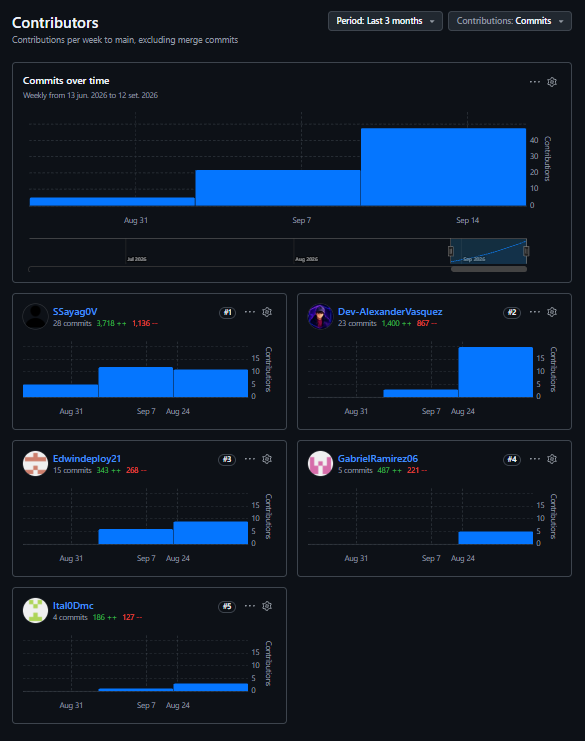

*Figura: Analíticos de contribución del repositorio del informe al cierre de AV1 (Insights > Contributors, rama main). Se observa la participación de los cinco integrantes del equipo, con la mayor actividad concentrada en la semana previa a la entrega.*

### Entrega TB1

Entre el 30/09/2026 y el 06/10/2026, el equipo incorporó las correcciones derivadas de la retroalimentación de AV1. Vásquez Roncal, Alexander Felipe corrigió y amplió las User Stories. Sayago Vidal, Sebastián Leonardo actualizó los Class Diagrams y Database Diagrams, corrigió el formato del Sprint Backlog 1 y documentó el Sprint 2. Damacen Galindo, Italo Gianfranco amplió el Análisis competitivo y la tabla de herramientas del proyecto. Nicho Huillcañahui, Edwin Noe actualizó esta sección, los enlaces de los videos de exposición y el Student Outcome. El trabajo se integró en develop mediante pull requests y luego se publicó en main como la versión 2.0.0 del informe.

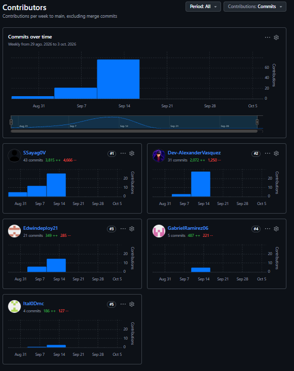

*Figura: Analíticos de contribución del repositorio del informe durante TB1 (Insights > Contributors, rama main). Se evidencia la participación continua de los cinco integrantes en la elaboración del informe.*

<div style="page-break-after: always;"></div>

# Contenido

## Tabla de Contenido

- [Contenido](#contenido)
  - [Tabla de Contenido](#tabla-de-contenido)
- [Student Outcome](#student-outcome)
- [Capítulo I: Introducción](#capítulo-i-introducción)
  - [1.1. Startup Profile](#11-startup-profile)
    - [1.1.1. Descripción de la Startup](#111-descripción-de-la-startup)
    - [1.1.2. Perfiles de integrantes del equipo](#112-perfiles-de-integrantes-del-equipo)
  - [1.2. Solution Profile](#12-solution-profile)
    - [1.2.1. Antecedentes y problemática](#121-antecedentes-y-problemática)
    - [1.2.2. Lean UX Process](#122-lean-ux-process)
      - [1.2.2.1. Lean UX Problem Statements](#1221-lean-ux-problem-statements)
      - [1.2.2.2. Lean UX Assumptions](#1222-lean-ux-assumptions)
      - [1.2.2.3. Lean UX Hypothesis Statements](#1223-lean-ux-hypothesis-statements)
      - [1.2.2.4. Lean UX Canvas](#1224-lean-ux-canvas)
  - [1.3. Segmentos objetivo](#13-segmentos-objetivo)
    - [1.3.1. Pequeños y Medianos Agricultores (PyMAs)](#131-pequeños-y-medianos-agricultores-pymas)
    - [1.3.2. Operadores Técnicos de Drones](#132-operadores-técnicos-de-drones)
- [Capítulo II: Requirements Elicitation \& Analysis](#capítulo-ii-requirements-elicitation--analysis)
  - [2.1. Competidores](#21-competidores)
    - [2.1.1. Análisis competitivo](#211-análisis-competitivo)
    - [2.1.2. Estrategias y tácticas frente a competidores](#212-estrategias-y-tácticas-frente-a-competidores)
  - [2.2. Entrevistas](#22-entrevistas)
    - [2.2.1. Diseño de entrevistas](#221-diseño-de-entrevistas)
    - [2.2.2. Registro de entrevistas](#222-registro-de-entrevistas)
    - [2.2.3. Análisis de entrevistas](#223-análisis-de-entrevistas)
  - [2.3. Needfinding](#23-needfinding)
    - [2.3.1. User Personas](#231-user-personas)
    - [2.3.2. User Task Matrix](#232-user-task-matrix)
    - [2.3.3. User Journey Mapping](#233-user-journey-mapping)
    - [2.3.4. Empathy Mapping](#234-empathy-mapping)
  - [2.4. Big Picture Event Storming](#24-big-picture-event-storming)
  - [2.5. Ubiquitous Language](#25-ubiquitous-language)
- [Capítulo III: Requirements Specification](#capítulo-iii-requirements-specification)
  - [3.1. User Stories](#31-user-stories)
  - [3.2. Impact Mapping](#32-impact-mapping)
  - [3.3. Product Backlog](#33-product-backlog)
- [Capítulo IV: Product Design](#capítulo-iv-product-design)
  - [4.1. Style Guidelines](#41-style-guidelines)
    - [4.1.1. General Style Guidelines](#411-general-style-guidelines)
  - [4.2. Information Architecture](#42-information-architecture)
    - [4.2.1. Organization Systems](#421-organization-systems)
    - [4.2.2. Labeling Systems](#422-labeling-systems)
    - [4.2.3. SEO Tags and Meta Tags](#423-seo-tags-and-meta-tags)
    - [4.2.4. Searching Systems](#424-searching-systems)
    - [4.2.5. Navigation Systems](#425-navigation-systems)
  - [4.3. Landing Page UI Design](#43-landing-page-ui-design)
    - [4.3.1. Landing Page Wireframe](#431-landing-page-wireframe)
    - [4.3.2. Landing Page Mock-up](#432-landing-page-mock-up)
  - [4.4. Web Applications UX/UI Design](#44-web-applications-uxui-design)
    - [4.4.1. Web Applications Wireframes](#441-web-applications-wireframes)
    - [4.4.2. Web Applications Wireflow Diagrams](#442-web-applications-wireflow-diagrams)
    - [4.4.3. Web Applications Mock-ups](#443-web-applications-mock-ups)
    - [4.4.4. Web Applications User Flow Diagrams](#444-web-applications-user-flow-diagrams)
  - [4.5. Web Applications Prototyping](#45-web-applications-prototyping)
  - [4.6. Domain-Driven Software Architecture](#46-domain-driven-software-architecture)
    - [4.6.1. Design-Level Event Storming](#461-design-level-event-storming)
      - [4.6.1.1. Bounded Contexts](#4611-bounded-contexts)
    - [4.6.2. Software Architecture Context Diagram](#462-software-architecture-context-diagram)
    - [4.6.3. Software Architecture Container Diagrams](#463-software-architecture-container-diagrams)
    - [Trazabilidad entre dominio y arquitectura](#trazabilidad-entre-dominio-y-arquitectura)
    - [4.6.4. Software Architecture Components Diagrams](#464-software-architecture-components-diagrams)
      - [4.6.4.1. RESTful API](#4641-restful-api)
      - [4.6.4.2. Web Application](#4642-web-application)
      - [4.6.4.3. Weather Integration Component](#4643-weather-integration-component)
  - [4.7. Software Object-Oriented Design](#47-software-object-oriented-design)
    - [4.7.1. Class Diagrams](#471-class-diagrams)
  - [4.8. Database Design](#48-database-design)
    - [4.8.1. Database Diagrams](#481-database-diagrams)
    - [4.8.2. Normalizacion](#482-normalizacion)
- [Capítulo V: Product Implementation, Validation \& Deployment](#capítulo-v-product-implementation-validation--deployment)
  - [5.1. Software Configuration Management](#51-software-configuration-management)
    - [5.1.1. Software Development Environment Configuration](#511-software-development-environment-configuration)
      - [5.1.1.1. Propósito](#5111-propósito)
      - [5.1.1.2. Herramientas del proyecto](#5112-herramientas-del-proyecto)
      - [5.1.1.3. Configuración base](#5113-configuración-base)
      - [5.1.1.4. Estructura de repositorios](#5114-estructura-de-repositorios)
    - [5.1.2. Source Code Management](#512-source-code-management)
      - [5.1.2.1. Plataforma y repositorios](#5121-plataforma-y-repositorios)
      - [5.1.2.2. GitFlow Workflow](#5122-gitflow-workflow)
      - [5.1.2.3. Convención para Feature Branches](#5123-convención-para-feature-branches)
      - [5.1.2.4. Convención para Release Branches](#5124-convención-para-release-branches)
      - [5.1.2.5. Convención para Hotfix Branches](#5125-convención-para-hotfix-branches)
      - [5.1.2.6. Pull Requests](#5126-pull-requests)
      - [5.1.2.7. Conventional Commits](#5127-conventional-commits)
      - [5.1.2.8. Semantic Versioning](#5128-semantic-versioning)
    - [5.1.3. Source Code Style Guide \& Conventions](#513-source-code-style-guide--conventions)
      - [5.1.3.1. Principios generales](#5131-principios-generales)
      - [5.1.3.2. HTML](#5132-html)
      - [5.1.3.3. CSS](#5133-css)
      - [5.1.3.4. JavaScript](#5134-javascript)
      - [5.1.3.5. TypeScript / Angular](#5135-typescript--angular)
      - [5.1.3.6. Java / Spring Boot](#5136-java--spring-boot)
      - [5.1.3.7. API REST](#5137-api-rest)
      - [5.1.3.8. Documentación y lenguaje](#5138-documentación-y-lenguaje)
    - [5.1.4. Software Deployment Configuration](#514-software-deployment-configuration)
      - [5.1.4.1. Objetivo](#5141-objetivo)
      - [5.1.4.2. Arquitectura de despliegue](#5142-arquitectura-de-despliegue)
      - [5.1.4.3. Ambientes](#5143-ambientes)
      - [5.1.4.4. Integración continua](#5144-integración-continua)
      - [5.1.4.5. Variables y secretos](#5145-variables-y-secretos)
      - [5.1.4.6. Configuración de base de datos](#5146-configuración-de-base-de-datos)
      - [5.1.4.7. Configuración de la API meteorológica](#5147-configuración-de-la-api-meteorológica)
      - [5.1.4.8. Estrategia de deployment](#5148-estrategia-de-deployment)
      - [5.1.4.9. Trazabilidad del deployment](#5149-trazabilidad-del-deployment)
  - [5.2. Landing Page, Services \& Applications Implementation](#52-landing-page-services--applications-implementation)
    - [5.2.1. Sprint 1](#521-sprint-1)
      - [5.2.1.1. Sprint Planning 1](#5211-sprint-planning-1)
      - [5.2.1.2. Aspect Leaders and Collaborators](#5212-aspect-leaders-and-collaborators)
      - [5.2.1.3. Sprint Backlog 1](#5213-sprint-backlog-1)
      - [5.2.1.4. Development Evidence for Sprint Review](#5214-development-evidence-for-sprint-review)
      - [5.2.1.5. Execution Evidence for Sprint Review](#5215-execution-evidence-for-sprint-review)
      - [5.2.1.6. Services Documentation Evidence for Sprint Review](#5216-services-documentation-evidence-for-sprint-review)
      - [5.2.1.7. Software Deployment Evidence for Sprint Review](#5217-software-deployment-evidence-for-sprint-review)
      - [5.2.1.8. Team Collaboration Insights during Sprint](#5218-team-collaboration-insights-during-sprint)
  - [5.2.2. Sprint 2](#521-sprint-2)
      - [5.2.2.1. Sprint Planning 2](#5221-sprint-planning-2)
      - [5.2.2.2. Aspect Leaders and Collaborators](#5222-aspect-leaders-and-collaborators)
      - [5.2.2.3. Sprint Backlog 2](#5223-sprint-backlog-2)
      - [5.2.2.4. Development Evidence for Sprint Review](#5224-development-evidence-for-sprint-review)
      - [5.2.2.5. Execution Evidence for Sprint Review](#5225-execution-evidence-for-sprint-review)
      - [5.2.2.6. Services Documentation Evidence for Sprint Review](#5226-services-documentation-evidence-for-sprint-review)
      - [5.2.2.7. Software Deployment Evidence for Sprint Review](#5227-software-deployment-evidence-for-sprint-review)
      - [5.2.2.8. Team Collaboration Insights during Sprint](#5228-team-collaboration-insights-during-sprint)
  - [5.3. Validation Interviews](#53-validation-interviews)
    - [5.3.1. Interview Design](#531-interview-design)
    - [5.3.2. Interview Registry](#532-interview-registry)
    - [5.3.3. Heuristic Evaluations](#533-heuristic-evaluations)
  - [5.4. Video About-the-Product](#54-video-about-the-product)
  - [Conclusiones y recomendaciones](#conclusiones-y-recomendaciones)
- [Bibliografía](#bibliografía)
- [Anexos](#anexos)
  - [Anexo A: Evidencias adicionales](#anexo-a-evidencias-adicionales)
  - [Anexo B: Videos de Exposiciones](#anexo-b-videos-de-exposiciones)
  - [Anexo C: Otros](#anexo-c-otros)

<div style="page-break-after: always;"></div>

# Student Outcome

El curso contribuye al cumplimiento del Student Outcome ABET:<br>
ABET – EAC - Student Outcome 3

Criterio: Capacidad de comunicarse efectivamente con un rango de audiencias.

En el siguiente cuadro se describe las acciones realizadas y enunciados de conclusiones por parte del grupo, que permiten sustentar el haber alcanzado el logro del ABET – EAC - Student Outcome 3.

<table>
  <thead>
    <tr>
      <th>Criterio específico</th>
      <th>Acciones realizadas</th>
      <th>Conclusiones</th>
    </tr>
  </thead>
  <tbody>
    <tr>
      <td><b>Comunica oralmente con efectividad a diferentes rangos de audiencia.</b></td>
      <td>
        <p><b>Damacen Galindo, Italo Gianfranco</b></p>
        <p><b><i>AV1</i></b><br>Expuse el Capítulo I, presentando el perfil de la startup, la problemática y el proceso Lean UX con un lenguaje sencillo y apoyado en diapositivas con esquemas visuales. Al cierre de mi parte respondí las preguntas del docente para confirmar que la relación entre la problemática y la propuesta de valor se había comprendido.</p>
        <p><b><i>TB1</i></b><br>Expuse la primera parte de la presentación, que abarcó la carátula, la Landing Page y la arquitectura de la solución, y luego el Bounded Context Weather Integration. Adapté la explicación técnica al público usando los diagramas de diseño como guía y verifiqué con preguntas que se entendiera cómo la plataforma consulta el servicio meteorológico externo.</p>
        <p><b>Nicho Huillcañahui, Edwin Noe</b></p>
        <p><b><i>AV1</i></b><br>Participé en el video de exposición explicando los hallazgos del Capítulo II. Presenté los User Personas y sus necesidades con un lenguaje sencillo para una audiencia no técnica, apoyándome en las capturas de UXPressia en lugar de leer texto. En las entrevistas de Needfinding apliqué escucha activa, dejando hablar al entrevistado antes de repreguntar.</p>
        <p><b><i>TB1</i></b><br>Expuse el diseño del Bounded Context Inventory & Resource Management, explicando sus entidades (drones, agroquímicos, boquillas y mantenimiento), su organización en cuatro capas y sus endpoints. Usé los diagramas como apoyo visual y respondí las preguntas del docente para validar que la lógica de negocio del contexto había quedado clara.</p>
        <p><b>Ramírez Gutiérrez, Gabriel</b></p>
        <p><b><i>AV1</i></b><br>Presenté la propuesta de valor y el funcionamiento de la Landing Page, explicando la organización de sus secciones, los recursos visuales y la experiencia planteada para cada segmento de usuarios.</p>
        <p><b><i>TB1</i></b><br>Presenté la versión actualizada de la Landing Page mediante una demostración en vivo, mostrando cómo los call-to-action dirigen a cada segmento hacia la Web Application. Antes de la exposición ensayé la demostración con el equipo e incorporé sus observaciones para que el recorrido fuera claro para un público no técnico.</p>
        <p><b>Sayago Vidal, Sebastián Leonardo</b></p>
        <p><b><i>AV1</i></b><br>Presenté las decisiones técnicas de AgriDron Solutions, explicando la arquitectura de software, el diseño y la configuración del entorno de desarrollo mediante diagramas, y ajusté el nivel de detalle técnico según las preguntas recibidas.</p>
        <p><b><i>TB1</i></b><br>Expliqué el Bounded Context Analytics & Reporting, comunicando sus responsabilidades, operaciones, eventos y su relación con la arquitectura general. Utilicé los diagramas de diseño para facilitar la comprensión y confirmé con las preguntas del docente que el flujo de reportes había sido entendido.</p>
        <p><b>Vásquez Roncal, Alexander Felipe</b></p>
        <p><b><i>AV1</i></b><br>Expuse los Capítulos III y IV, explicando las User Stories, el Impact Mapping y los Mock-ups de la Landing Page y de la Web Application, con las pantallas como apoyo visual para que la audiencia relacionara cada requisito con su diseño.</p>
        <p><b><i>TB1</i></b><br>Expuse el Bounded Context Field Management, explicando cómo se registran fincas y parcelas, y escuché las observaciones del equipo sobre la integración de ramas antes de proponer una solución consensuada.</p>
      </td>
      <td>
        <p><b><i>AV1</i></b><br>Como equipo, durante AV1 desarrollamos nuestra capacidad de comunicación oral mediante la presentación de los diferentes componentes de AgriDron Solutions. Cada integrante comunicó los resultados y decisiones de su parte del proyecto, empleando recursos audiovisuales como diapositivas, diagramas, mockups y demostraciones para facilitar la comprensión de la información. Esto permitió presentar de manera organizada la propuesta, el diseño y la arquitectura de la solución, adaptando la explicación al objetivo de cada sección.</p>
        <p><b><i>TB1</i></b><br>En esta entrega cada integrante expuso el Bounded Context a su cargo con apoyo de diagramas, adaptando el lenguaje técnico para que la arquitectura fuera comprensible para el docente y el resto del equipo. A diferencia de AV1, el equipo ensayó la exposición en conjunto y usó las preguntas recibidas para comprobar que cada mensaje había llegado de forma clara, lo que fortaleció la coherencia de la presentación.</p>
      </td>
    </tr>
    <tr>
      <td><b>Comunica por escrito con efectividad a diferentes rangos de audiencia.</b></td>
      <td>
        <p><b>Damacen Galindo, Italo Gianfranco</b></p>
        <p><b><i>AV1</i></b><br>Elaboré el Capítulo I del informe, desarrollando el Startup Profile, el Solution Profile, los antecedentes, la problemática y los componentes del proceso Lean UX. Organicé la información de forma sintetizada y revisé la redacción antes de cada commit para comunicar con claridad el propósito y la propuesta de valor de la solución.</p>
        <p><b><i>TB1</i></b><br>Amplié el Análisis competitivo (2.1.1) y la tabla de Herramientas del proyecto (5.1.1.2), siguiendo la estructura de tablas exigida por el enunciado. Verifiqué que la información fuera consistente con el resto del informe y corregí ortografía y formato antes de integrarla.</p>
        <p><b>Nicho Huillcañahui, Edwin Noe</b></p>
        <p><b><i>AV1</i></b><br>Redacté las secciones de Análisis competitivo, diseño y registro de entrevistas y Needfinding, describiendo las respuestas de los entrevistados y sustentando con porcentajes las características de cada segmento. Seguí la estructura de tablas exigida y revisé ortografía y gramática antes de publicar.</p>
        <p><b><i>TB1</i></b><br>Redacté la documentación técnica del Bounded Context Inventory & Resource Management, especificando sus entidades y sus cuatro capas siguiendo los principios de DDD. Mantuve la nomenclatura en inglés para facilitar la integración con el código del equipo.</p>
        <p><b>Ramírez Gutiérrez, Gabriel</b></p>
        <p><b><i>AV1</i></b><br>Diseñé y desarrollé la Landing Page, definiendo su estructura, su contenido visual y la distribución de sus secciones para comunicar el valor de la solución de forma clara y atractiva.</p>
        <p><b><i>TB1</i></b><br>Redacté los textos actualizados de la Landing Page (propuesta de valor, planes y llamados a la acción) con un lenguaje breve y orientado a cada segmento. Antes de publicarlos verifiqué su ortografía y su coherencia con la información del informe.</p>
        <p><b>Sayago Vidal, Sebastián Leonardo</b></p>
        <p><b><i>AV1</i></b><br>Desarrollé la documentación técnica de arquitectura, diseño y Software Configuration Management, con un lenguaje técnico, preciso y organizado para comunicar las decisiones de la solución.</p>
        <p><b><i>TB1</i></b><br>Documenté el Bounded Context Analytics & Reporting, incluyendo responsabilidades, conceptos, operaciones, eventos y componentes, manteniendo coherencia con los demás artefactos de arquitectura. Además, organicé la documentación del Sprint 2 para esta entrega.</p>
        <p><b>Vásquez Roncal, Alexander Felipe</b></p>
        <p><b><i>AV1</i></b><br>Creé la organización en GitHub para el trabajo colaborativo del equipo y redacté la documentación de los Capítulos III y IV, organizando las User Stories y la descripción de los Mock-ups.</p>
        <p><b><i>TB1</i></b><br>Coordiné la integración de las ramas del proyecto y revisé el README completo antes de la entrega, verificando que la estructura y los enlaces fueran correctos.</p>
      </td>
      <td>
        <p><b><i>AV1</i></b><br>Como equipo, durante AV1 elaboramos y consolidamos la documentación de AgriDron Solutions, distribuyendo la redacción de los diferentes capítulos y componentes del proyecto. Se empleó un lenguaje técnico y estructurado para documentar la propuesta de solución, así como los aspectos de diseño, arquitectura, implementación y gestión del desarrollo. La integración de los aportes de los integrantes permitió mantener una estructura coherente en el informe y comunicar de forma clara las decisiones y resultados obtenidos.</p>
        <p><b><i>TB1</i></b><br>En esta entrega el equipo corrigió el informe a partir de la retroalimentación de AV1 y documentó los Bounded Contexts con nomenclatura en inglés, manteniendo la coherencia de términos entre el informe, los diagramas y el código. Cada sección se revisó en ortografía, formato y enlaces antes de integrarse mediante pull requests, lo que permitió validar la calidad del informe antes de su presentación.</p>
      </td>
    </tr>
  </tbody>
</table>

<div style="page-break-after: always;"></div>

# Capítulo I: Introducción

## 1.1. Startup Profile

### 1.1.1. Descripción de la Startup

**AgriDron Solutions** es una startup tecnológica que busca mejorar la protección de cultivos mediante el uso de drones de fumigación y una plataforma web de monitoreo. Su propósito es que agricultores y personal técnico puedan planificar, ejecutar y supervisar sus operaciones de fumigación desde una sola aplicación, de forma más rápida y fácil de controlar.

La plataforma permite registrar fincas y parcelas, seleccionar la zona de fumigación sobre un mapa, crear misiones, consultar las condiciones meteorológicas, monitorear los drones durante la operación y revisar el historial y los reportes de las operaciones realizadas.

**Misión:** Mejorar la gestión de cultivos mediante drones y una plataforma accesible que permita reducir costos y tiempo en las operaciones de fumigación.

**Visión:** Convertirnos en una solución tecnológica de confianza para el sector agrícola, ayudando a modernizar la forma en que se gestionan y supervisan las operaciones de fumigación.

**Valores:**

- **Innovación:** utilizamos nuevas tecnologías, como los drones aplicados a la agricultura, para mejorar las operaciones agrícolas.
- **Eficiencia:** buscamos reducir el tiempo, los costos y el uso de recursos frente a los métodos tradicionales de fumigación.
- **Confiabilidad:** buscamos que las operaciones y los datos de la plataforma sean claros, precisos y estén disponibles durante y después de cada operación.
- **Compromiso:** ofrecemos una solución útil y accesible para agricultores y personal técnico, que además reduce los riesgos para los trabajadores y el impacto ambiental de la fumigación.

### 1.1.2. Perfiles de integrantes del equipo

<table>
  <tr>
    <td rowspan="4" align="center" width="200">
      
    </td>
  </tr>
  <tr>
    <td><b>Nombre:</b> Damacen Galindo, Italo Gianfranco</td>
  </tr>
  <tr>
    <td><b>Código:</b> U202421392 | <b>Carrera:</b> Ingeniería de Software</td>
  </tr>
  <tr>
    <td>
      <b>Descripción:</b><br>
      Soy estudiante de Ingeniería de Software. Cuento con conocimientos en C++, HTML y CSS, además de conocimientos básicos de JavaScript y Java. Me considero una persona responsable, organizada y comprometida con el trabajo, con interés en el desarrollo de software y la organización de proyectos.
      <br><br>
      <b>Aporte y función dentro del equipo:</b><br>
      Participé principalmente en la elaboración del Capítulo I de AgriDron Solutions, incluyendo el Startup Profile, el Solution Profile, los antecedentes, la problemática y el proceso Lean UX. También apoyé en la organización de las entrevistas, separando la información de cada entrevistado, colocando los timestamps y ordenando las evidencias para facilitar su documentación y presentación.
    </td>
  </tr>
  <tr>
    <td rowspan="4" align="center" width="200">
      
    </td>
  </tr>
  <tr>
    <td><b>Nombre:</b> Nicho Huillcañahui, Edwin Noe</td>
  </tr>
  <tr>
    <td><b>Código:</b> U20241G306 | <b>Carrera:</b> Ingeniería de Software</td>
  </tr>
  <tr>
    <td>
      <b>Descripción:</b><br>
      Soy estudiante de quinto ciclo de Ingeniería de Software. Cuento con conocimientos en C++ y nociones de Python, HTML y CSS. Durante el proyecto aprendí a trabajar con GitHub y UXPressia para el control de versiones y la elaboración de artefactos de investigación de usuarios. Destaco en las labores de documentación, cuidando la claridad y el orden de la información.
      <br><br>
      <b>Aporte y función dentro del equipo:</b><br>
      Como integrante del equipo, mi función principal se centró en la investigación correspondiente al Capítulo II del proyecto, encargándome del análisis de competidores, el diseño y registro de entrevistas, y el proceso de Needfinding. A partir de esta investigación, elaboré los artefactos necesarios para sustentar los hallazgos: User Personas, User Task Matrix, User Journey Maps y Empathy Maps, además del Big Picture Event Storming y el Ubiquitous Language del dominio del problema.
    </td>
  </tr>
  <tr>
    <td rowspan="4" align="center" width="200">
      
    </td>
  </tr>
  <tr>
    <td><b>Nombre:</b> Ramírez Gutiérrez, Gabriel</td>
  </tr>
  <tr>
    <td><b>Código:</b> U202416053 | <b>Carrera:</b> Ingeniería de Software</td>
  </tr>
  <tr>
    <td>
      <b>Descripción:</b><br>
      Soy estudiante de Ingeniería de Software con interés en el desarrollo frontend y la experiencia de usuario. Cuento con conocimientos en HTML, CSS y JavaScript para la implementación de páginas web responsive, con enfoque en usabilidad y comunicación visual. Me considero una persona organizada, responsable y comprometida con la calidad del trabajo entregado.
      <br><br>
      <b>Aporte y función dentro del equipo:</b><br>
      Me encargué principalmente del desarrollo de la Landing Page de AgriDron, definiendo la estructura visual, la propuesta de valor, los elementos de navegación y la experiencia inicial del usuario. Además, colaboré con la coordinación del contenido y la presentación del producto para asegurar que la primera impresión del sistema fuera clara, atractiva y alineada con la solución propuesta.
    </td>
  </tr>
  <tr>
    <td rowspan="4" align="center" width="200">
      
    </td>
  </tr>
  <tr>
    <td><b>Nombre:</b> Sayago Vidal, Sebastián Leonardo</td>
  </tr>
  <tr>
    <td><b>Código:</b> U202422642 | <b>Carrera:</b> Ingeniería de Software</td>
  </tr>
  <tr>
    <td>
      <b>Descripción:</b><br>
      Soy estudiante de quinto ciclo de Ingeniería de Software en la UPC. Cuento con conocimientos en Git y GitHub, diseño de arquitectura de software, modelado de bases de datos relacionales y documentación técnica en Markdown. Me considero una persona responsable, que cumple con el trabajo asignado en el plazo establecido y prioriza la calidad y la buena presentación de los resultados.
      <br><br>
      <b>Aporte y función dentro del equipo:</b><br>
      Mi participación incluyó la definición y documentación de las prácticas que utilizará el equipo para mantener la consistencia del proyecto durante su desarrollo, considerando la configuración del entorno de desarrollo, la gestión del código fuente, las convenciones de programación y el despliegue.
    </td>
  </tr>
  <tr>
    <td rowspan="4" align="center" width="200">
      
    </td>
  </tr>
  <tr>
    <td><b>Nombre:</b> Vásquez Roncal, Alexander Felipe</td>
  </tr>
  <tr>
    <td><b>Código:</b> U202222473 | <b>Carrera:</b> Ingeniería de Software</td>
  </tr>
  <tr>
    <td>
      <b>Descripción:</b><br>
      Soy estudiante de cuarto ciclo de Ingeniería de Software. Cuento con conocimientos en Python y C++, además de experiencia en diseño de interfaces con Figma y en la gestión de repositorios en GitHub. Me considero una persona disciplinada, con capacidad para trabajar en equipo y contribuir activamente al desarrollo del proyecto.
      <br><br>
      <b>Aporte y función dentro del equipo:</b><br>
      Mi participación incluyó la documentación de los Capítulos III y IV, además del diseño de los mock-ups de la Web Application y de la Landing Page. Por otro lado, también elaboré la guía de estilos de ambos productos para mantener un orden y una presentación consistentes.
    </td>
  </tr>
</table>

## 1.2. Solution Profile

### 1.2.1. Antecedentes y problemática

**Antecedentes**

La agricultura enfrenta pérdidas recurrentes por plagas y enfermedades. Según la [Organización de las Naciones Unidas para la Alimentación y la Agricultura \[FAO\] (s. f.)](https://www.fao.org/plant-production-protection/about/es), hasta un 40 % de la producción agrícola mundial se pierde cada año por esta causa. Tradicionalmente, el control fitosanitario se realiza con fumigadoras de mochila o con tractores, métodos que demandan mucha mano de obra y tiempo, aplican producto donde no siempre es necesario y exponen a los trabajadores a agroquímicos. En los últimos años, los drones de fumigación se han convertido en una alternativa más precisa y segura. Sin embargo, su adopción por pequeños y medianos agricultores aún es limitada, y la coordinación de estos servicios se gestiona de forma manual, mediante mensajes y registros dispersos.

**Problemática (5W + 2H)**

| Pregunta | Descripción |
|:--|:--|
| **Who** (¿Quién?) | Pequeños y medianos agricultores y cooperativas, que contratan o gestionan las fumigaciones, y los operadores técnicos de drones, que planifican y ejecutan las operaciones. |
| **What** (¿Qué?) | La presencia recurrente de plagas reduce el rendimiento y la calidad de la cosecha, y los métodos tradicionales de fumigación son lentos, costosos, imprecisos y riesgosos para los trabajadores. |
| **Where** (¿Dónde?) | En terrenos agrícolas donde no existe una gestión ni un monitoreo formal de las operaciones, como los fundos de los valles costeros donde trabajan los entrevistados (Cañete, Huaral e Ica). |
| **When** (¿Cuándo?) | Principalmente durante las temporadas de crecimiento de los cultivos, cuando se realizan aplicaciones preventivas o curativas ante signos de infestación. |
| **Why** (¿Por qué?) | No existe un sistema que permita gestionar y monitorear las fumigaciones de forma centralizada. Esto provoca pérdidas económicas, desacuerdos sobre el área tratada y mayor exposición de los trabajadores a riesgos. |
| **How** (¿Cómo?) | Mediante una plataforma web que permita gestionar fincas y parcelas, delimitar la zona de fumigación en un mapa, crear misiones, consultar el clima, monitorear los drones y revisar reportes e historial. |
| **How Much** (¿Cuánto?) | Hasta un 40 % de la producción agrícola mundial se pierde cada año por plagas y enfermedades [(FAO, s. f.)](https://www.fao.org/plant-production-protection/about/es). |

**Enunciado del problema**

Los pequeños y medianos agricultores y los operadores técnicos de drones no cuentan con una herramienta que les permita planificar, coordinar y supervisar estas operaciones de forma centralizada. Como consecuencia, la información de las parcelas, las condiciones climáticas y los servicios realizados se gestiona de manera manual y dispersa, lo que genera pérdidas de tiempo, un uso ineficiente de insumos, desacuerdos sobre el área fumigada y una mayor exposición de los trabajadores a riesgos.

**Puntos que debe resolver la solución**

- Centralizar la información de fincas, parcelas y misiones en una sola plataforma.
- Permitir la delimitación precisa de la zona de fumigación sobre un mapa interactivo.
- Validar las condiciones meteorológicas antes de ejecutar una misión.
- Ofrecer el seguimiento del estado y la ubicación del dron durante la operación.
- Conservar el historial y los reportes de las operaciones como respaldo para agricultores y operadores.

**Objetivos**

*Objetivo general:* Desarrollar una plataforma web responsive que permita a agricultores y operadores técnicos de drones planificar, ejecutar y supervisar operaciones de fumigación con drones de forma centralizada.

*Objetivos específicos:*

1. Implementar el registro de fincas y la delimitación de parcelas sobre un mapa interactivo.
2. Integrar un servicio meteorológico externo para validar las condiciones antes de cada misión.
3. Implementar el monitoreo de misiones mediante datos de telemetría simulados.
4. Generar el historial y los reportes de las operaciones realizadas.
5. Desarrollar una Landing Page que presente la propuesta de valor y dirija a cada segmento hacia la Web Application.

**Restricciones**

- La telemetría del dron se simula. El proyecto no incluye integración con hardware real de drones.
- La información meteorológica depende de un servicio externo de terceros.
- La solución se compone de una Landing Page, una Web Application responsive y un RESTful API, y no incluye una aplicación móvil nativa.
- Se utilizan las tecnologías definidas por el curso: HTML, CSS y JavaScript para la Landing Page, Angular para la Web Application y Spring Boot para el RESTful API.
- El alcance se limita al ciclo académico 2026-20 y a los sprints planificados.

### 1.2.2. Lean UX Process

#### 1.2.2.1. Lean UX Problem Statements

El estado actual de **la gestión de la fumigación de cultivos en el sector agrícola peruano** se ha centrado principalmente en **métodos manuales y con tractor, realizados por pequeños y medianos agricultores y sus trabajadores de campo, que coordinan los servicios de fumigación mediante llamadas, mensajes de WhatsApp y registros escritos a mano**.

Lo que los productos y servicios existentes no logran abordar es **una forma accesible para que estos agricultores y los operadores técnicos de drones planifiquen, coordinen y supervisen las operaciones con drones en un solo lugar, ya que plataformas como DroneDeploy, Climate FieldView y Agrivi están dirigidas a grandes agroindustrias, con soluciones de alto costo y dependientes de hardware**.

Nuestro producto abordará esta brecha mediante **una plataforma web responsive que permita registrar fincas y parcelas, delimitar zonas de fumigación en un mapa interactivo, validar las condiciones meteorológicas con un servicio externo, monitorear las misiones en tiempo real y consultar el historial y los reportes de cada operación**.

Nuestro enfoque inicial será **los pequeños y medianos agricultores con predios de 5 a 50 hectáreas y los operadores técnicos de drones que realizan las fumigaciones para ellos**.

Sabremos que hemos tenido éxito cuando veamos **a los agricultores programando sus misiones de fumigación a través de la plataforma, a los operadores llegando al campo con la parcela ya delimitada y ahorrando entre 20 y 30 minutos por servicio, y misiones reprogramadas a partir de la validación climática de la plataforma, en lugar de después de visitas fallidas al campo**.

#### 1.2.2.2. Lean UX Assumptions

**Business Assumptions**

- Los pequeños y medianos agricultores están dispuestos a pagar una suscripción mensual accesible por planificar y supervisar sus fumigaciones.
- Los operadores técnicos de drones adoptarán la plataforma si les permite recibir las parcelas ya delimitadas y reducir el tiempo de coordinación con sus clientes.
- Un modelo freemium, con gestión básica de parcelas gratuita, facilitará la adopción y la conversión hacia planes de pago.
- Las alianzas con cooperativas agrarias serán un canal efectivo para llegar a nuevos agricultores.
- Al no depender de hardware propietario, la plataforma podrá competir en precio con DroneDeploy, Climate FieldView y Agrivi.

**Business Outcome Assumptions**

- La retención de clientes aumentará en un 25 % después del primer ciclo de cultivo.
- La adopción de funciones premium aumentará en un 40 % tras el periodo de prueba gratuito.
- El número de misiones de fumigación programadas mensualmente a través de la plataforma aumentará en un 30 % durante los primeros 6 meses de operación.
- El costo de adquisición de clientes disminuirá en un 20 % gracias a las alianzas con cooperativas agrarias.

**User Assumptions**

- Los usuarios principales son pequeños y medianos agricultores con predios de 5 a 50 hectáreas y los operadores técnicos de drones.
- Los agricultores priorizan las soluciones que les ahorran tiempo y reducen la incertidumbre en el manejo de plagas.
- Los usuarios adoptarán nuevas tecnologías si la interfaz es intuitiva y requiere una capacitación mínima.
- La falta de datos en tiempo real sobre las fumigaciones dificulta la toma de decisiones de los usuarios.
- Los agricultores y los operadores técnicos de drones prefieren supervisar las operaciones desde el celular, debido a la distancia de las zonas de cultivo.

**User Outcome and Benefit Assumptions**

- Los agricultores quieren evitar pérdidas económicas causadas por plagas.
- Los usuarios quieren tener control sobre sus campos y parcelas desde un solo lugar.
- Los usuarios quieren acceder a información en tiempo real sobre sus operaciones.
- Los agricultores buscan mejorar la productividad y la rentabilidad de sus cultivos.
- Los usuarios quieren reducir la exposición de los trabajadores a químicos peligrosos.
- Los operadores quieren contar con un respaldo formal del trabajo realizado para evitar desacuerdos con sus clientes.
- Los usuarios quieren reducir el tiempo y el costo de aplicación de pesticidas frente a los métodos tradicionales.
- Los usuarios quieren responder con mayor rapidez ante una infestación de plagas.

**Feature Assumptions**

1. Un mapa interactivo para registrar fincas y delimitar parcelas permitirá definir con precisión la zona de fumigación antes de llegar al campo.
2. Una validación climática basada en un servicio meteorológico externo permitirá decidir si una misión es viable antes de programarla.
3. Un módulo de monitoreo de misiones con telemetría simulada permitirá seguir el estado y la ubicación del dron durante la operación.
4. Los reportes automáticos y el historial de operaciones servirán como respaldo del trabajo realizado y apoyarán la gestión.
5. Una interfaz web responsive con un flujo guiado de creación de misiones será adoptada incluso por usuarios con baja alfabetización digital.

#### 1.2.2.3. Lean UX Hypothesis Statements

**Hypothesis Statement 1**

Creemos que lograremos un aumento del 30 % en el número de misiones de fumigación programadas mensualmente a través de la plataforma durante los primeros 6 meses de operación\
si los pequeños y medianos agricultores y los operadores técnicos de drones\
obtienen una zona de fumigación delimitada con precisión antes de llegar al campo\
con la funcionalidad de mapa interactivo de fincas y parcelas.

**Hypothesis Statement 2**

Creemos que lograremos un aumento del 30 % en el número de misiones de fumigación programadas mensualmente a través de la plataforma durante los primeros 6 meses de operación\
si los pequeños y medianos agricultores y los operadores técnicos de drones\
obtienen una decisión confiable sobre la viabilidad de una misión antes de programarla\
con la funcionalidad de validación climática con un servicio externo.

**Hypothesis Statement 3**

Creemos que lograremos un aumento del 25 % en la retención de clientes después del primer ciclo de cultivo\
si los agricultores y los operadores técnicos de drones\
obtienen visibilidad en tiempo real del avance de cada misión\
con la funcionalidad de monitoreo de misiones.

**Hypothesis Statement 4**

Creemos que lograremos un aumento del 40 % en la adopción de funciones premium tras el periodo de prueba gratuito\
si los agricultores y los operadores técnicos de drones\
obtienen evidencia lista para usar de cada operación realizada\
con la funcionalidad de reportes automáticos e historial de operaciones.

**Hypothesis Statement 5**

Creemos que lograremos un aumento del 25 % en la retención de clientes después del primer ciclo de cultivo\
si los agricultores con baja alfabetización digital\
obtienen una experiencia intuitiva y fácil de aprender\
con la plataforma web responsive y su flujo guiado de creación de misiones.

#### 1.2.2.4. Lean UX Canvas


*Figura: Lean UX Canvas de AgriDron Solutions.*

El Lean UX Canvas resume el modelo de negocio de AgriDron Solutions. El **Business Problem** describe la necesidad de mejorar la forma en que los agricultores y los operadores técnicos de drones gestionan las operaciones de fumigación. Las **Solutions** propuestas incluyen la fumigación con drones, el monitoreo en tiempo real y una plataforma web responsive. Los **Business Outcomes** esperados incluyen reducir el tiempo y el costo de fumigación, disminuir el tiempo de respuesta ante infestaciones y aumentar la retención de clientes.

En cuanto a los **Users & Customers**, los principales segmentos son los pequeños y medianos agricultores (PyMAs) y los operadores técnicos de drones. Sus **User Outcomes & Benefits** incluyen tener mayor control de sus campos, acceder a información de sus operaciones y reducir su exposición a productos químicos. Las **Hypotheses** buscan validar si los usuarios están dispuestos a pagar por el servicio y si las funciones de planificación, validación climática, monitoreo y reportes generan valor. El siguiente paso es validar la disposición de pago y el valor percibido mediante entrevistas y pruebas piloto.

## 1.3. Segmentos objetivo

### 1.3.1. Pequeños y Medianos Agricultores (PyMAs)

Este es el segmento principal de AgriDron Solutions. Está conformado por productores agrícolas con extensiones de 5 a 50 hectáreas, que cultivan principalmente para el mercado local y regional. Pueden trabajar de forma independiente o agrupados en cooperativas y buscan reducir costos y proteger el rendimiento de sus cultivos.

**Características cuantitativas:** edad entre 20 y 60 años, extensión de cultivo de 5 a 50 hectáreas, nivel educativo variado desde educación básica hasta técnica, familiaridad tecnológica media-baja, con adopción creciente de smartphones.

**Características cualitativas:** su principal motivación es reducir costos y mejorar el rendimiento de sus cultivos. Sus principales problemas son las pérdidas por plagas, los costos de mano de obra y la falta de información para tomar decisiones.

**Información estadística de sustento:** según los resultados de la Encuesta Nacional Agropecuaria (ENA) 2022 del INEI:

- El 97.6 % de las unidades agropecuarias del país se emplea para la agricultura familiar [(Agencia Andina, 2023)](https://andina.pe/agencia/noticia-inei-334-productores-agropecuarios-del-pais-son-mujeres-948645.aspx).
- Las explotaciones con menos de 5 hectáreas representan el 78.5 % del total [(Redacción Gestión, 2023)](https://gestion.pe/economia/encuesta-nacional-agropecuaria-asi-se-configura-el-sector-en-el-peru-noticia/), mientras que el 21.4 % supera las 5 hectáreas [(Agencia Andina, 2023)](https://andina.pe/agencia/noticia-inei-334-productores-agropecuarios-del-pais-son-mujeres-948645.aspx). El segmento objetivo, con predios de 5 a 50 hectáreas, forma parte de este último grupo.
- El 60 % de los productores emplea fertilizantes o plaguicidas [(Agencia Andina, 2023)](https://andina.pe/agencia/noticia-inei-334-productores-agropecuarios-del-pais-son-mujeres-948645.aspx), lo que evidencia la necesidad del control fitosanitario.
- El 35.9 % de los productores tiene entre 45 y 59 años y el 21.9 % entre 30 y 44 años [(Agencia Andina, 2023)](https://andina.pe/agencia/noticia-inei-334-productores-agropecuarios-del-pais-son-mujeres-948645.aspx).

**Relación con la solución:** este segmento utilizará la plataforma para gestionar fincas y parcelas, seleccionar zonas de fumigación en el mapa, crear misiones, consultar el clima y revisar reportes e historial de sus operaciones.

### 1.3.2. Operadores Técnicos de Drones

Este segmento está conformado por operadores de drones de fumigación y por técnicos e ingenieros agrónomos que realizan o supervisan estos servicios. Son usuarios de la plataforma que se encargan de revisar la información, planificar las operaciones y supervisar las misiones de fumigación.

**Características cuantitativas:** edad entre 22 y 45 años, formación técnica o universitaria en agronomía, ingeniería agrícola o carreras afines, experiencia de 1 a 15 años en campo, a cargo de la supervisión de múltiples parcelas o unidades productivas de forma simultánea.

**Características cualitativas:** cuentan con mayor familiaridad tecnológica que el agricultor promedio y valoran herramientas que les ayuden a ahorrar tiempo. Su principal motivación es contar con información precisa para planificar las operaciones. Su principal problema es la dificultad para supervisar varios campos al mismo tiempo.

**Información estadística de sustento:** según los resultados de la Encuesta Nacional Agropecuaria (ENA) 2022 del INEI, solo el 3.8 % de los productores agropecuarios tuvo asistencia técnica y solo el 6.6 % recibió capacitación [(Agencia Andina, 2023)](https://andina.pe/agencia/noticia-inei-334-productores-agropecuarios-del-pais-son-mujeres-948645.aspx). Estas cifras muestran una amplia brecha de acompañamiento técnico en el campo, que este segmento busca cubrir.

**Relación con la solución:** este segmento utilizará la plataforma para revisar la información de las operaciones, planificar las misiones de fumigación, hacer seguimiento a su ejecución y supervisar varias unidades productivas a la vez.

---

<div style="page-break-after: always;"></div>

# Capítulo II: Requirements Elicitation & Analysis

## 2.1. Competidores

Para validar la propuesta de valor de AgriDron Solutions y asegurar un posicionamiento estratégico diferenciado en el sector agro-tecnológico, se ha realizado una investigación exhaustiva de las soluciones digitales existentes en el mercado. A continuación, se detallan los tres principales competidores identificados, analizando su modelo operativo, funcionalidades clave y alcance en el soporte a las labores agrícolas:

*   **DroneDeploy:** Plataforma en la nube especializada en la captura, procesamiento y análisis de datos geoespaciales mediante drones. En el sector agrícola, opera permitiendo la planificación automatizada de vuelos sobre campos de cultivo y el procesamiento de mapas ortomosaicos e índices de vegetación (NDVI) para la detección de anomalías en los lotes. Su funcionamiento se basa en la sincronización de hardware comercial con su software web para generar reportes analíticos de salud vegetal y coordinar cuadrillas de trabajo.
*   **Climate FieldView:** Plataforma digital integral de gestión agronómica desarrollada por The Climate Corporation (división digital de Bayer). Funciona mediante la recopilación e integración de datos generados por sensores climáticos, satélites y maquinaria terrestre conectada al puerto de diagnóstico (FieldView Drive). Su software permite a los productores monitorear el desarrollo de sus campos, generar prescripciones variables de siembra y fertilizantes, y consultar datos meteorológicos hiperlocales para la toma de decisiones preventivas en campo.
*   **Agrivi:** Software integral de gestión de explotaciones agrícolas (Farm Management Software - FMS) basado en el modelo SaaS en la nube. Su funcionamiento abarca la planificación completa de labores agrícolas, administración de inventarios de insumos químicos, trazabilidad de cosechas y registro de costos de producción. Además, integra alertas meteorológicas basadas en modelos predictivos para advertir sobre el riesgo de plagas y enfermedades, permitiendo llevar una bitácora detallada de las actividades de campo.

También se identificó DJI SmartFarm, la aplicación complementaria de los drones de fumigación DJI Agras [(FAO AgriTech Observatory, s. f.)](https://agritechobservatory.review.fao.org/ar/dji-smartfarm-app). No se incluye en el Competitive Analysis Landscape porque está ligada a los drones de un solo fabricante, mientras que AgriDron Solutions se dirige a operadores que trabajan con distintas marcas de dron. Se considera en las estrategias como referencia de un ecosistema cerrado.

### 2.1.1. Análisis competitivo

A continuación, se presenta el Competitive Analysis Landscape, cuyo objetivo es contrastar objetivamente las capacidades, fortalezas, debilidades y modelos comerciales de AgriDron Solutions frente a los competidores analizados:

<table>
  <thead>
    <tr>
      <th colspan="6" align="center">Competitive Analysis Landscape</th>
    </tr>
  </thead>
  <tbody>
    <tr>
      <td colspan="2"><b>¿Por qué llevar a cabo este análisis?</b></td>
      <td colspan="4">
        El objetivo de este análisis es evaluar las soluciones digitales agropecuarias actuales para identificar brechas de mercado, validar nuestra ventaja competitiva en la planificación y monitoreo de fumigación con drones, y estructurar una oferta accesible para pequeños y medianos agricultores.<br><br>
        <b>DroneDeploy:</b> Analizar al referente global en gestión de operaciones y mapas con drones en la nube.<br>
        <b>Climate FieldView:</b> Evaluar al líder en analítica agronómica, clima y prescripción digital de insumos.<br>
        <b>Agrivi:</b> Analizar al líder SaaS en gestión administrativa, trazabilidad y control fitosanitario de campos.
      </td>
    </tr>
    <tr>
      <th colspan="2"></th>
      <th align="center">AgriDron Solutions<br></th>
      <th align="center">DroneDeploy<br></th>
      <th align="center">Climate FieldView<br>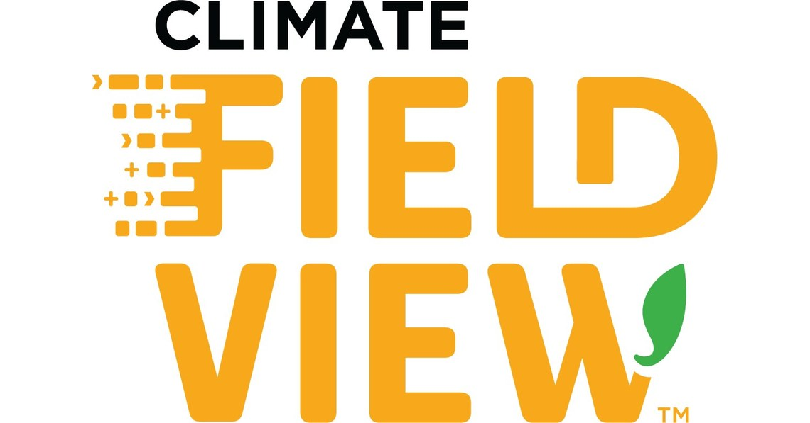</th>
      <th align="center">Agrivi<br>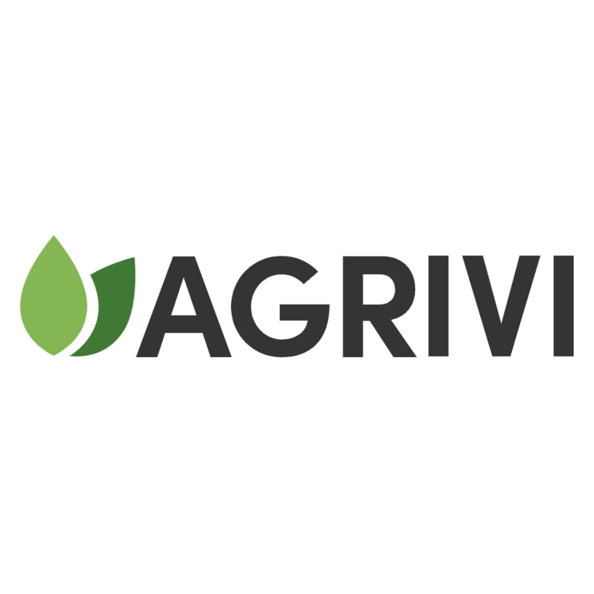</th>
    </tr>
    <tr>
      <td rowspan="2" align="center"><b>Perfil</b></td>
      <td><b>Overview</b></td>
      <td>Plataforma web distribuida e interoperable diseñada para la planificación sobre mapas interactivos, validación climática vía API externa y simulación de telemetría para operaciones de fumigación con drones.</td>
      <td>Plataforma empresarial de software para mapeo aéreo, fotogrametría 3D y análisis multiespectral con drones.</td>
      <td>Plataforma digital corporativa enfocada en la recolección masiva de datos agronómicos terrestres y satelitales.</td>
      <td>Sistema integral de planificación de recursos agrícolas (Farm ERP) en la nube enfocado en gestión y cumplimiento normativo.</td>
    </tr>
    <tr>
      <td><b>Ventaja competitiva</b><br><i>¿Qué valor ofrece a los clientes?</i></td>
      <td>Plataforma web abierta e intuitiva que integra delimitación de polígonos, consulta meteorológica en tiempo real y seguimiento de drones sin ataduras a hardware propietario.<br><br>Automatización accesible del flujo de fumigación, reducción del desperdicio de insumos químicos, prevención por clima adverso y visibilidad operativa en tiempo real.</td>
      <td>Algoritmos líderes de procesamiento rápido de ortomosaicos y amplia compatibilidad con marcas de drones comerciales.<br><br>Información visual de alta resolución del estado del campo y herramientas de medición de áreas y elevación.</td>
      <td>Respaldo y validación agronómica global de Bayer, con integración directa a maquinaria pesada y satélites.<br><br>Optimización del rendimiento de la cosecha mediante decisiones basadas en datos climáticos e históricos del suelo.</td>
      <td>Módulo exhaustivo de trazabilidad agrícola, cumplimiento de certificaciones internacionales y gestión financiera del cultivo.<br><br>Centralización administrativa de la finca, control estricto de inventarios y reducción de costos operativos generales.</td>
    </tr>
    <tr>
      <td rowspan="2" align="center"><b>Perfil de Marketing</b></td>
      <td><b>Mercado objetivo</b></td>
      <td>Pequeños y medianos agricultores (PyMAs), cooperativas agrarias y operadores técnicos de drones de fumigación.</td>
      <td>Grandes corporaciones agrícolas, empresas de ingeniería, construcción e inspección aérea.</td>
      <td>Medianos y grandes productores agrícolas con maquinaria mecanizada y tecnificada.</td>
      <td>Medianas y grandes empresas agroexportadoras, consultores agrícolas y cadenas agroalimentarias.</td>
    </tr>
    <tr>
      <td><b>Estrategias de marketing</b></td>
      <td>Marketing digital educativo, demostraciones en cooperativas locales, esquema freemium para visualización de parcelas y alianzas con técnicos de campo.</td>
      <td>Venta directa enterprise, marketing de contenidos B2B global, eventos del sector aeroespacial y certificaciones técnicas.</td>
      <td>Distribución a través de redes de concesionarios de insumos Bayer, patrocinios agrícolas y pruebas de campo a gran escala.</td>
      <td>Marketing inbound, presencia en conferencias globales AgTech, certificaciones digitales y canal de consultoría especializada.</td>
    </tr>
    <tr>
      <td rowspan="3" align="center"><b>Perfil de Producto</b></td>
      <td><b>Productos &amp; Servicios</b></td>
      <td>Aplicación web responsive para registrar fincas y delimitar parcelas en un mapa, solicitar misiones de fumigación, validar el clima antes del vuelo, monitorear el avance de la misión y consultar reportes e historial. Landing Page informativa.</td>
      <td>Software en la nube, aplicación móvil de control de vuelo, módulo de análisis NDVI y visor de ortofotos 2D/3D.</td>
      <td>Aplicación web y móvil, dispositivo FieldView Drive para tractores, mapas satelitales y prescripciones de siembra.</td>
      <td>Plataforma web/móvil FMS, módulo de control de plagas, gestión de bodegas, reportes de auditoría y app de tareas de campo.</td>
    </tr>
    <tr>
      <td><b>Precios &amp; Costos</b></td>
      <td>Esquema de suscripción modular mensual/anual económico, adaptado por cantidad de hectáreas gestionadas.</td>
      <td>Modelo de suscripción SaaS anual de costo elevado (desde cientos hasta miles de USD anuales por usuario).</td>
      <td>Suscripción anual base más costos adicionales por dispositivos de conexión física y hectáreas monitoreadas.</td>
      <td>Suscripción SaaS por niveles basada en el número de hectáreas y módulos empresariales contratados (alto costo).</td>
    </tr>
    <tr>
      <td><b>Canales de distribución (Web y/o Móvil)</b></td>
      <td>Aplicación web responsive (Desktop y Mobile) accesible desde cualquier navegador estándar y Landing Page oficial.</td>
      <td>Plataforma web SaaS, aplicación móvil (iOS/Android) y portal en la nube.</td>
      <td>Plataforma web, aplicaciones móviles (iOS/Android) y canal de distribución físico de hardware.</td>
      <td>Plataforma web SaaS y aplicación móvil operativa para smartphones y tablets.</td>
    </tr>
    <tr>
      <td rowspan="4" align="center"><b>Análisis SWOT</b></td>
      <td><b>Fortalezas</b></td>
      <td>• Conecta en un solo lugar al agricultor y al operador técnico de drones: la parcela delimitada, la solicitud del servicio y el reporte del trabajo realizado.<br>• Enfoque especializado en la planificación, validación climática y monitoreo de fumigación aérea sin requerir hardware cautivo.<br>• Interfaz diseñada para una curva de aprendizaje mínima, adaptable a usuarios con alfabetización digital intermedia o baja.<br>• Integración directa con servicios externos de pronóstico meteorológico para mitigar riesgos de deriva química.</td>
      <td>• Capas de salud vegetal NDVI y RGB para detectar estrés por plagas, enfermedades, riego o fertilización <a href="https://www.dronedeploy.com/agriculture.html">(DroneDeploy, s. f.)</a>.<br>• Se integra con los principales fabricantes de drones <a href="https://www.dronedeploy.com/agriculture.html">(DroneDeploy, s. f.)</a>.<br>• Se usa en 400 mil campos de 130 países <a href="https://www.dronedeploy.com/agriculture.html">(DroneDeploy, s. f.)</a>.</td>
      <td>• Respaldo de Bayer, su empresa matriz <a href="https://agritechobservatory.review.fao.org/ar/climate-fieldview">(FAO AgriTech Observatory, s. f.)</a>.<br>• Imágenes satelitales para evaluar la salud del campo <a href="https://climate.com/en-ca/pricing.html">(Climate FieldView, s. f.)</a>.<br>• FieldView Drive se conecta a la maquinaria y envía los datos de las operaciones a la plataforma <a href="https://agritechobservatory.review.fao.org/ar/climate-fieldview">(FAO AgriTech Observatory, s. f.)</a>.</td>
      <td>• Gestión de inventario, trazabilidad y gestión financiera <a href="https://www.capterra.com/p/136084/Agrivi/">(Capterra, 2026)</a>.<br>• Gestión del cumplimiento de políticas para servicios, productos, procesos o proveedores <a href="https://www.capterra.com/p/136084/Agrivi/">(Capterra, 2026)</a>.</td>
    </tr>
    <tr>
      <td><b>Debilidades</b></td>
      <td>• Startup en etapa inicial con menor músculo financiero y base de clientes reducida frente a gigantes consolidados.<br>• Dependencia inicial de simulación para los flujos de telemetría de drones antes de la integración con hardware físico masivo.<br>• Marca nueva sin reconocimiento previo en ferias o asociaciones agrarias regionales.</td>
      <td>• Planes de costo elevado: el plan Ag Lite cuesta USD 1,908 al año por piloto <a href="https://toolradar.com/tools/dronedeploy/pricing">(Toolradar, 2026)</a>.<br>• Su precio resulta alto para operaciones pequeñas <a href="https://toolradar.com/tools/dronedeploy/pricing">(Toolradar, 2026)</a>.<br>• Se centra en el mapeo y análisis de cultivos, no en coordinar servicios de fumigación entre agricultores y operadores.</td>
      <td>• Requiere hardware adicional: FieldView Drive costaba USD 399 en mayo de 2024 <a href="https://agritechobservatory.review.fao.org/ar/climate-fieldview">(FAO AgriTech Observatory, s. f.)</a>.<br>• Suscripción desde USD 499 al año, más servicios cobrados por acre, como Seed Scripts a USD 1.50 por acre <a href="https://climate.com/en-ca/pricing.html">(Climate FieldView, s. f.)</a>.<br>• Orientado a fincas medianas y grandes <a href="https://agritechobservatory.review.fao.org/ar/climate-fieldview">(FAO AgriTech Observatory, s. f.)</a>.</td>
      <td>• No publica sus precios: la cotización se solicita al proveedor <a href="https://www.capterra.com/p/136084/Agrivi/">(Capterra, 2026)</a>.<br>• Según una reseña de usuario, no es una solución barata <a href="https://www.capterra.com/p/136084/Agrivi/">(Capterra, 2026)</a>.<br>• Según una reseña de usuario, no puede usarse sin conexión a internet <a href="https://www.capterra.com/p/136084/Agrivi/">(Capterra, 2026)</a>.<br>• Según una reseña de usuario, su módulo financiero no reemplaza un software contable <a href="https://www.capterra.com/p/136084/Agrivi/">(Capterra, 2026)</a>.</td>
    </tr>
    <tr>
      <td><b>Oportunidades</b></td>
      <td>• Creciente interés de pequeños y medianos agricultores por modernizar la fumigación para reducir pérdidas económicas por plagas.<br>• Brecha de mercado desatendida por competidores de alto costo (DroneDeploy, Agrivi), que no diseñan soluciones accesibles para predios de 5 a 50 hectáreas.<br>• Necesidad de cooperativas locales de centralizar la supervisión de múltiples lotes en un solo panel colaborativo.</td>
      <td>• Creciente uso de drones en la agricultura de precisión.<br>• Ofrecer planes más accesibles para mercados emergentes.</td>
      <td>• Incorporar la fumigación con drones a su ecosistema.<br>• Usar los programas de Bayer para fidelizar productores.</td>
      <td>• Demanda de trazabilidad en la agroexportación.<br>• Incorporar la gestión de operaciones con drones.</td>
    </tr>
    <tr>
      <td><b>Amenazas</b></td>
      <td>• Resistencia cultural al cambio tecnológico por parte de productores agrícolas acostumbrados a métodos tradicionales manuales.<br>• Expansión o reducción de precios de plataformas consolidadas (como Bayer Climate FieldView) hacia segmentos de menores extensiones.<br>• Deficiencias de infraestructura de conectividad a internet en zonas rurales que dificulten el uso de plataformas web en campo.</td>
      <td>• Plataformas más económicas y especializadas para pequeños productores.<br>• Fabricantes de drones que incluyen su propio software.</td>
      <td>• Plataformas sin dependencia de hardware y de menor costo.<br>• Baja mecanización de los pequeños predios, que limita el uso de FieldView Drive.</td>
      <td>• Soluciones más simples y accesibles para pequeños productores.<br>• Baja alfabetización digital en zonas rurales.</td>
    </tr>
  </tbody>
</table>

### 2.1.2. Estrategias y tácticas frente a competidores

A partir de los hallazgos obtenidos en el análisis competitivo y la matriz SWOT, se definen las estrategias y tácticas comerciales, técnicas y operativas que AgriDron Solutions implementará para posicionarse en el mercado:

**1. Estrategia de Enfoque en Costos y Accesibilidad (Frente a DroneDeploy y Agrivi)**

Los competidores líderes manejan esquemas de precios enterprise con tarifas anuales elevadas, orientadas principalmente a grandes corporaciones o complejos agroindustriales. AgriDron Solutions capturará la cuota de mercado desatendida mediante una propuesta económica accesible para pequeños y medianos agricultores y cooperativas:
*   **Táctica de Pricing por Escala de Uso:** Implementar un modelo de suscripción flexible basado en rangos de hectáreas gestionadas o paquetes mensuales por temporada de fumigación, evitando contratos anuales forzosos.
*   **Táctica Freemium de Entrada:** Ofrecer acceso gratuito para la delimitación de parcelas y consulta de métricas básicas de terreno, incentivando la conversión a planes de pago cuando el usuario requiera la validación climática, el monitoreo de misiones y los reportes de cada operación.

**2. Estrategia de Diferenciación por Interoperabilidad Abierta**

Mientras que herramientas como Climate FieldView priorizan maquinaria terrestre con dispositivos propietarios y DJI SmartFarm es la aplicación complementaria de los drones de fumigación DJI Agras [(FAO AgriTech Observatory, s. f.)](https://agritechobservatory.review.fao.org/ar/dji-smartfarm-app), AgriDron Solutions se posiciona como una plataforma web integradora:
*   **Táctica de Gestión Abierta de Órdenes de Servicio:** Proveer una plataforma web accesible mediante APIs RESTful que permita registrar parcelas, programar órdenes de fumigación y actualizar bitácoras de trabajo de forma manual por el operador técnico, sin requerir sincronizaciones complejas ni depender de una marca específica de dron.
*   **Táctica de Validación Climática Contextual:** Integrar servicios externos de pronóstico meteorológico hiperlocal directamente en el flujo de trazado de parcelas, alertando al usuario sobre velocidades de viento y humedad que provoquen deriva química antes de ejecutar la misión.

**3. Estrategia de Adopción Digital y Curva de Aprendizaje Acelerada (Usabilidad)**

Sistemas como Agrivi presentan una alta complejidad funcional y curvas de aprendizaje pronunciadas que dificultan su uso por parte de agricultores con alfabetización digital intermedia. AgriDron Solutions prioriza una experiencia de usuario (UX) centrada en tareas críticas y visuales:
*   **Táctica de Interfaz Web Intuitiva y Guiada:** Diseñar un flujo de trabajo lineal estructurado en tres pasos simples: 1) Dibujar parcela en el mapa interactivo, 2) Validar condiciones climáticas automáticas, y 3) Solicitar y monitorear la misión de fumigación.
*   **Táctica Responsive Multidispositivo:** Garantizar que la interfaz web opere de forma fluida tanto en laptops de oficina como en navegadores de teléfonos inteligentes y tablets usados por operadores en campo.
*   **Táctica de Preparación Previa con Conexión:** Permitir que el agricultor delimite la parcela y que el operador revise la orden de servicio y el pronóstico del clima antes de salir al campo, desde la casa u oficina, para que la información crítica ya esté disponible al llegar al predio y se reduzca la dependencia de la conectividad en zonas rurales.

**4. Estrategia de Penetración de Canal y Trabajo con Comunidades Agrícolas**

Para contrarrestar la fuerza de ventas global y las redes corporativas de competidores como Bayer Climate FieldView, AgriDron Solutions ejecutará una estrategia directa y local:
*   **Táctica de Alianzas con Cooperativas Agrarias:** Realizar demostraciones en vivo y pruebas piloto colaborativas en asociaciones agrarias locales, permitiendo que varios agricultores compartan la experiencia de gestionar sus predios.
*   **Táctica de Capacitación Inicial en las Demostraciones:** Acompañar la primera delimitación de parcela de cada agricultor con un tutorial breve durante las demostraciones en las cooperativas, ya que los agricultores entrevistados señalaron que al inicio requerirían una pequeña capacitación o un video tutorial.

---

## 2.2. Entrevistas

### 2.2.1. Diseño de entrevistas

**Objetivo de la entrevista:**
El objetivo de las entrevistas es recopilar evidencia sobre los flujos operativos, limitaciones tecnológicas y necesidades críticas de los Pequeños y Medianos Agricultores (PyMAs), que gestionan la fumigación de sus cultivos, y de los Operadores Técnicos de Drones, que planifican y ejecutan estos servicios, con el fin de modelar perfiles de usuario precisos y fundamentar el diseño funcional de la plataforma web AgriDron.

Las preguntas de los Bloques A y B son las preguntas principales de la entrevista y las del Bloque C son complementarias.

**Preguntas del segmento 1: Pequeños y Medianos Agricultores (PyMAs)**

#### Bloque A: Perfil Demográfico y Tecnológico
1. ¿Cuál es su nombre, edad y en qué distrito o valle agrícola se encuentra ubicado su predio?
2. ¿Qué tipos de cultivo maneja principalmente y cuántas hectáreas tiene bajo su administración?
3. ¿Qué dispositivos utiliza con mayor frecuencia para coordinar sus labores (computadora, laptop, smartphone Android/iOS) y qué navegador web suele utilizar (Chrome, Edge, Safari)?
4. ¿Qué aplicaciones o herramientas digitales utiliza con regularidad para comunicarse o gestionar compras/ventas (WhatsApp, banca móvil, hojas de Excel, redes sociales)?

#### Bloque B: Contexto Operativo y Puntos de Dolor - (Técnica 5W + 2H)
*    **What (Qué):**
5. ¿Qué método utiliza actualmente para la fumigación y control de plagas en sus parcelas?
6. ¿Cómo detecta, delimita y registra la presencia de una plaga o enfermedad en un lote específico?

*    **Why (Por qué):**
7. ¿Por qué considera que los métodos de fumigación que utiliza hoy en día le generan sobrecostos, demoras o riesgos en su cosecha?

*    **Who (Quién):**
8. ¿Quiénes toman la decisión de programar una fumigación y cómo supervisa o verifica usted el trabajo realizado por los aplicadores en campo?


*    **When (Cuándo):**
9. ¿Con qué frecuencia y en qué momentos de la temporada agrícola requiere aplicar tratamientos a sus cultivos?
10. ¿Cuándo y por qué medio consulta el pronóstico del clima antes de fumigar, y cómo le afecta un cambio repentino de viento o lluvia durante la labor?

*    **Where (Dónde):**
11. ¿Dónde lleva el registro de los límites de sus parcelas, fechas de fumigación y tipos de insumos químicos aplicados?

*    **How (Cómo):**
12. Si una plataforma web le permitiera dibujar sus parcelas sobre un mapa satelital para ordenar un servicio de dron, ¿cómo le resultaría más fácil hacerlo y qué apoyo requeriría para utilizarla?

*    **How Much (Cuánto):**
13. ¿Cuánto consideraría razonable pagar mensualmente por un software web que le ayude a planificar y certificar los servicios de fumigación?

#### Bloque C: Percepción sobre la Propuesta de Valor AgriDron Web
14. ¿Qué tan útil le resultaría recibir una alerta meteorológica automática que le indique si es viable o no fumigar antes de contratar al operador?
15. En caso de que una fumigación se interrumpa por mal clima o imprevistos de campo, ¿cómo le gustaría recibir el reporte de avance y reprogramar las hectáreas pendientes desde la web?


**Preguntas del segmento 2: Operadores Técnicos de Drones**


#### Bloque A: Perfil Demográfico y Tecnológico (Insumo para User Persona)
1. ¿Cuál es su nombre, edad y en qué valles o zonas agrícolas presta principalmente sus servicios de fumigación o consultoría agrícola?
2. ¿Qué formación técnica o experiencia previa tiene en el manejo y operación de drones agrícolas o agronomía?
3. ¿Qué dispositivos utiliza habitualmente durante su jornada de trabajo (smartphone Android/iOS, tablet de campo, laptop) y qué navegadores web utiliza con frecuencia?
4. ¿Qué herramientas digitales utiliza actualmente para coordinar su agenda de clientes, facturación o rutas de trabajo (WhatsApp, Google Calendar, hojas de cálculo, correo electrónico)?

#### Bloque B: Contexto Operativo y Dolores de Gestión (5W + 2H)
*   **What (Qué):**
5. ¿Qué información técnica del predio necesita conocer antes de trasladar su equipo al campo (cultivo, tipo de producto, ubicación exacta de linderos, obstáculos visuales)?
6. ¿Qué modelo o capacidad de dron utiliza y qué tipo de servicios de fumigación ofrece habitualmente (preventivos, curativos)?
*   **Why (Por qué):**
7. ¿Por qué se presentan malentendidos o disputas con los agricultores respecto al área total realmente cubierta o la calidad de la aplicación?
8. ¿Por qué le resulta ineficiente o desgastante la forma en que coordina sus horarios y atiende las llamadas o mensajes de cotización hoy en día?
*   **Who (Quién):**
9. ¿Con quién coordina los detalles de la aplicación en el predio (dueño de finca, otro asesor técnico) y quién valida la conformidad del servicio al terminar la labor?
*   **When (Cuándo):**
10. ¿En qué momento y a través de qué fuentes evalúa las condiciones climáticas (velocidad de viento, humedad, temperatura) antes de autorizar el despegue?
*   **Where (Dónde):**
11. ¿Dónde y cómo registra la bitácora de servicios realizados (hectáreas tratadas, químicos descargados, incidencias o fallas en campo)?
*   **How (Cómo):**
12. ¿Cómo define o verifica actualmente el perímetro exacto que debe fumigar si el agricultor solo le da referencias verbales o ubicaciones aproximadas por WhatsApp?
13. Si surge un imprevisto en campo (cambio brusco de viento, lluvia repentina, avería de equipo o falta de producto), ¿cómo gestiona y documenta la suspensión para justificar el avance parcial ante el cliente?
*   **How Much (Cuánto):**
14. ¿Cuánto cobra habitualmente por hectárea fumigada?

#### Bloque C: Percepción sobre la Propuesta de Valor (AgriDron Web)
15. Si contara con una plataforma web donde pudiera ver las órdenes de servicio en un calendario con la parcela ya dibujada en un mapa satelital interactivo, ¿en qué medida agilizaría su trabajo previo al vuelo?
16. ¿Qué tan útil le resultaría contar con una bitácora web donde al finalizar la labor pueda registrar en un formulario rápido el total de hectáreas tratadas, el volumen aplicado y subir observaciones para que el agricultor las revise de inmediato?
17. Si la plataforma web le ofreciera alertas climáticas automáticas basadas en APIs meteorológicas para justificar técnicamente ante el agricultor por qué una labor debe pausarse o reprogramarse, ¿cómo impactaría en su relación con el cliente?
18. ¿Qué tan útil sería ver en tiempo real el estado del dron (batería, posición, avance) mientras se ejecuta la fumigación?


### 2.2.2. Registro de entrevistas
Para la recolección de requisitos y el análisis de necesidades, se llevaron a cabo entrevistas a profundidad con representantes de los dos segmentos objetivo del proyecto:  **Segmento 1 (Pequeños y Medianos Agricultores (PyMAs))** y **Segmento 2 (Operadores Técnicos de Drones)**.

La evidencia audiovisual se consolida en un solo video editado con todas las entrevistas, publicado en YouTube en el siguiente enlace:
* **Enlace al video:** [Entrevistas Needfinding - AgriDron Solutions](https://youtu.be/f4bgtmrQYxk)


A continuación, se presenta la tabla de registro que sintetiza el análisis descriptivo de cada entrevista:

| Datos del Entrevistado                                                                                                                                                                                                                                                                                                                                                                                                                                                                                                                       | Evidencia en Video                                                                                                                                                                                                     | Resumen Descriptivo de la Entrevista                                                                                                                                                                                                                                                                                                                                                                                                                                                                                                                                                                                                                                                                                                                                                                                                                                                                                                                                                                                                                                                                                                                                                                                                                                                                                                                                                                                                                                                                                                                                                                                                                                                                                                                                                                                                                                                                                                                                                                                                                                                                                                                                                                                                                                                                                                                                                                                                                                                                                                                                                                                                                                                                                                                                             |
|:---------------------------------------------------------------------------------------------------------------------------------------------------------------------------------------------------------------------------------------------------------------------------------------------------------------------------------------------------------------------------------------------------------------------------------------------------------------------------------------------------------------------------------------------|:-----------------------------------------------------------------------------------------------------------------------------------------------------------------------------------------------------------------------|:---------------------------------------------------------------------------------------------------------------------------------------------------------------------------------------------------------------------------------------------------------------------------------------------------------------------------------------------------------------------------------------------------------------------------------------------------------------------------------------------------------------------------------------------------------------------------------------------------------------------------------------------------------------------------------------------------------------------------------------------------------------------------------------------------------------------------------------------------------------------------------------------------------------------------------------------------------------------------------------------------------------------------------------------------------------------------------------------------------------------------------------------------------------------------------------------------------------------------------------------------------------------------------------------------------------------------------------------------------------------------------------------------------------------------------------------------------------------------------------------------------------------------------------------------------------------------------------------------------------------------------------------------------------------------------------------------------------------------------------------------------------------------------------------------------------------------------------------------------------------------------------------------------------------------------------------------------------------------------------------------------------------------------------------------------------------------------------------------------------------------------------------------------------------------------------------------------------------------------------------------------------------------------------------------------------------------------------------------------------------------------------------------------------------------------------------------------------------------------------------------------------------------------------------------------------------------------------------------------------------------------------------------------------------------------------------------------------------------------------------------------------------------------|
| **Nombres y Apellidos:**<br>Ana Camila Bio Farías<br><br>**Edad:**<br>25 años<br><br>**Distrito / Valle:**<br>Valleca, distrito de Pachacutec<br><br>**Segmento:**<br>Segmento 1: Pequeños y Medianos Agricultores (PyMAs)<br><br>**Ocupación:**<br>Administradora de aproximadamente 2 ha de terreno agrícola<br><br>**Fecha:**<br>10/09/2026<br><br>**Timing de Video:**<br>00:00 – 04:42 (Duración: 04:42)                                                                                                                                | <br><br>*[Ver fragmento (00:00)](https://www.youtube.com/watch?v=f4bgtmrQYxk&t=0s)*        | **Perfil Tecnológico y Dispositivos:**<br>En campo utiliza principalmente un smartphone Android por practicidad y también una laptop para tareas administrativas. En el celular utiliza principalmente Google Chrome. Utiliza WhatsApp para comunicarse con trabajadores, proveedores y compradores, banca móvil para realizar pagos y Excel para llevar cuentas de sus gastos.<br><br>**Contexto Operativo y Dolores (5W + 2H):**<br>Administra aproximadamente 2 hectáreas con cultivos principalmente de uva, arándanos y algunas parcelas de palta. Para la fumigación utiliza principalmente fumigadoras de mochila y, cuando necesita cubrir áreas grandes, contrata servicios de terceros, contratistas y maquinaria especializada. Detecta la presencia de plagas mediante recorridos de los trabajadores por las parcelas; cuando encuentran una zona afectada, la identifican de manera aproximada y a veces toman fotos que envían por WhatsApp. No cuenta con un sistema exacto para marcar en un mapa dónde se encuentra la plaga. Manifiesta problemas por la cantidad de mano de obra y tiempo requeridos por la fumigación manual, la aplicación de productos en zonas donde no siempre es necesario y los cambios del clima que pueden reducir el efecto del tratamiento. Registra los límites de las parcelas mediante la experiencia y planos, mientras que las fechas y productos se anotan en un cuaderno y algunas veces en hojas de Excel.<br><br>**Personalidad y Metas:**<br>Busca una gestión sencilla y práctica del terreno, con menos desperdicio de tiempo e insumos y sin utilizar programas complicados.<br><br>**Percepción de AgriDron Web:**<br>Considera útil una interfaz sencilla donde pueda ver el mapa de su terreno, seleccionar la parcela y marcar sus límites tocando puntos del mapa. También considera importante que el sistema muestre claramente cuánto está seleccionando. Al inicio requeriría una pequeña capacitación o tutorial. Valora mucho las alertas meteorológicas automáticas antes de contratar un servicio y, ante una suspensión, desea recibir una notificación en la página y por WhatsApp que indique qué parte de la parcela fue fumigada y cuánto quedó pendiente, para luego seleccionar los sectores pendientes y elegir una nueva fecha. También considera importante conservar el historial de lo realizado.<br><br>**Costo actual referido:**<br>Aproximadamente S/ 100 a S/ 150 por hectárea por jornada de fumigación tradicional.                                                                                                                                                                                                                                                                  |
| **Nombres y Apellidos:**<br>Santiago Vargas<br><br>**Edad:**<br>20 años<br><br>**Distrito / Valle:**<br>Valle de Huaral<br><br>**Segmento:**<br>Segmento 1: Pequeños y Medianos Agricultores (PyMAs)<br><br>**Ocupación:**<br>Técnico de apoyo en un fundo agrícola y apoyo en la gestión de un lote de aproximadamente 15 ha<br><br>**Fecha:**<br>11/09/2026<br><br>**Timing de Video:**<br>04:42 – 10:20 (Duración: 05:38)                                                                                                                 | <br><br>*[Ver fragmento (04:42)](https://www.youtube.com/watch?v=f4bgtmrQYxk&t=282s)*            | **Perfil Tecnológico y Dispositivos:**<br>Utiliza principalmente un smartphone Android y, cuando llega a casa o a la oficina del fundo, también una laptop. Usa Google Chrome en ambos dispositivos. Para comunicarse utiliza WhatsApp; para pagos utiliza BCP; para manejar datos utiliza Excel y también Google Drive para organizar información.<br><br>**Contexto Operativo y Dolores (5W + 2H):**<br>Trabaja principalmente con frutales, sobre todo mandarina y palta, y apoya la gestión de un lote de aproximadamente 15 hectáreas. Para la fumigación utiliza mochilas pulverizadoras a motor y, para cultivos altos, a veces alquila una parihuela con mangueras. Detecta plagas mediante evaluaciones caminando por el campo, registra la incidencia en un cuaderno físico y luego intenta marcar la zona mentalmente para pasarla a Excel. Señala que el proceso consume bastante trabajo y tiempo, expone al personal a agroquímicos y, si la plaga avanza, puede generar pérdidas mayores. En época de mayor incidencia realiza fumigaciones aproximadamente cada 15 o 20 días. Para el clima utiliza aplicaciones durante la madrugada o el mismo día; el viento fuerte puede provocar deriva y desperdicio del producto.<br><br>**Personalidad y Metas:**<br>Busca simplificar el trabajo operativo, reducir desperdicios y evitar procesos manuales innecesarios.<br><br>**Percepción de AgriDron Web:**<br>Considera ideal poder acceder desde la laptop a un mapa tipo Google Maps, marcar la parcela mediante clics y contar con una interfaz intuitiva. Considera útil un video tutorial o una guía digital. Para una plataforma que reemplace el mapa físico, indique los límites y permita guardar datos, considera razonable un costo aproximado de S/ 30 a S/ 40 mensuales y señala que S/ 60 o más sería elevado. Considera muy útiles las alertas meteorológicas y desea recibir notificaciones por WhatsApp, Gmail o desde la propia aplicación para reprogramar con un botón las hectáreas pendientes.<br><br>**Registro actual:**<br>Cuenta con un Excel maestro para fechas y productos; los límites de la parcela se encuentran en un mapa impreso y, en ocasiones, usa Google Maps.                                                                                                                                                                                                                                                                                                                                                                                                                                                                                                                                                             |
| **Nombres y Apellidos:**<br>Carlos Mendoza<br><br>**Edad:**<br>42 años<br><br>**Distrito / Valle:**<br>Desconocido<br><br>**Segmento:**<br>Segmento 2: Operadores Técnicos de Drones<br><br>**Ocupación:**<br>Operador técnico y proveedor de servicios de fumigación con drones (aproximadamente 10 años de experiencia)<br><br>**Fecha:**<br>12/09/2026<br><br>**Timing de Video:**<br>10:20 – 14:25 (Duración: 04:05)                                                                                        | <br><br>*[Ver fragmento (10:20)](https://www.youtube.com/watch?v=f4bgtmrQYxk&t=620s)*             | **Perfil Tecnológico y Dispositivos:**<br>Coordina sus servicios principalmente mediante WhatsApp y llamadas telefónicas. Para organizar los trabajos utiliza también anotaciones y hojas de Excel, especialmente cuando tiene varios servicios programados.<br><br>**Contexto Operativo y Dolores (5W + 2H):**<br>Realiza servicios de fumigación con drones desde hace aproximadamente 10 años para agricultores de diferentes zonas agrícolas, principalmente para aplicaciones preventivas o para controlar plagas. Cuando un agricultor solicita un servicio, necesita conocer la ubicación del terreno, el tipo de cultivo, la cantidad de hectáreas, las calles o áreas a trabajar y los productos que se aplicarán. Uno de los problemas frecuentes es recibir ubicaciones aproximadas, lo que puede generar confusión entre el área estimada y la superficie real. La coordinación de horarios, productos y cambios le toma bastante tiempo y actualmente la mayor parte de la información se gestiona mediante mensajes. Revisa principalmente el viento y la posibilidad de lluvia antes de trabajar; si las condiciones cambian, debe detenerse y coordinar nuevamente por llamada o WhatsApp. Los servicios realizados se registran de manera manual y no existe un sistema en el que el agricultor pueda consultar directamente el trabajo ejecutado. Esto también puede generar diferencias sobre cuánto se fumigó cuando una labor queda parcialmente realizada por problemas del equipo o por otras incidencias.<br><br>**Personalidad y Metas:**<br>Busca reducir el trabajo de coordinación y disponer de toda la información del servicio en un solo lugar.<br><br>**Percepción de AgriDron Web:**<br>Considera bastante útil una plataforma donde pueda registrar y organizar sus servicios en un calendario, visualizar las parcelas en un mapa y conocer el área antes de llegar al campo. También valora poder registrar las hectáreas tratadas, el volumen aplicado y las observaciones del servicio, así como consultar alertas meteorológicas para apoyar la decisión de programar o reprogramar. El principal cambio que realizaría es tener en un solo lugar la ubicación, el área, la fecha y el trabajo realizado.                                                                                                                                                                                                                                                                                                                                                                                                                                                                                                                                |
| **Nombres y Apellidos:**<br>Valeria Sofía Mendoza Ríos<br><br>**Edad:**<br>25 años<br><br>**Distrito / Valle:**<br>Valle de Cañete (Lima Provincias)<br><br>**Segmento:**<br>Segmento 2: Operadores Técnicos de Drones<br><br>**Ocupación:**<br>Estudiante de 8vo ciclo de Ingeniería Agrícola, técnica con experiencia en aplicación agrícola y responsable de operaciones en campo<br><br>**Fecha:**<br>13/09/2026<br><br>**Timing de Video:**<br>14:25 – 23:17 (Duración: 08:52)                             | <br><br>*[Ver fragmento (14:25)](https://www.youtube.com/watch?v=f4bgtmrQYxk&t=865s)* | **Perfil Tecnológico y Dispositivos:**<br>Durante las labores de campo utiliza la tablet que viene con el control del dron y su celular personal para llamadas. Para preparar planes de vuelo, revisar mapas cartográficos y pasar sus reportes técnicos utiliza una laptop con Google Chrome. Coordina solicitudes mediante WhatsApp, intenta agendar fechas en Google Calendar y lleva el control de gastos de mantenimiento y horas de vuelo en hojas de cálculo, resultándole tedioso coordinar horarios cuando se acumulan los pedidos en campaña alta.<br><br>**Contexto Operativo y Dolores (5W + 2H):**<br>Trabaja en el Valle de Cañete y ocasionalmente se desplaza al valle de Mala o Chincha para fundos de paltos, cítricos y maíz. Utiliza drones de 30 litros con boquillas para pulverización fina y realiza aplicaciones preventivas y curativas. Señala como dificultad importante la falta de ubicación exacta y linderos antes de llegar al campo, especialmente cuando existen cables de luz, árboles altos o cercas. En ocasiones debe caminar el borde del cultivo o pilotar el dron a baja altura para marcar puntos de referencia, lo que le toma entre 40 minutos y una hora antes del primer vuelo operativo. También enfrenta diferencias entre las áreas declaradas por el agricultor y el área realmente cultivable o tratada. Registra datos como fecha, fundo, lote, número de descargas, insumos y volumen de agua en un Excel de apuntes de campo. Antes de trabajar revisa pronósticos meteorológicos y en el campo verifica condiciones como viento y temperatura; menciona como referencia evitar trabajar cuando el viento supera aproximadamente 12–15 km/h o la temperatura llega a 28 °C. Las suspensiones por clima pueden generar dificultades para explicarle la decisión al agricultor.<br><br>**Personalidad y Metas:**<br>Busca profesionalizar el servicio mediante trazabilidad y mejorar la coordinación y el uso del tiempo en campo.<br><br>**Percepción de AgriDron Web:**<br>Considera que un calendario con órdenes de servicio y parcelas ya delimitadas en un mapa satelital reduciría el tiempo de reconocimiento previo. Valora una bitácora web rápida para registrar las hectáreas reales, el volumen aplicado y observaciones, y que el cliente pueda recibir un reporte técnico. También considera muy útil contar con alertas climáticas como respaldo técnico para pausar o reprogramar trabajos. Finalmente, considera muy práctico ver en tiempo real la batería, la posición y el líquido restante del dron, tanto para controlar la operación como para permitir al agricultor visualizar estos datos desde su celular.<br><br>**Tarifa referida:**<br>Aproximadamente S/ 70 a S/ 90 por hectárea fumigada. |
| **Nombres y Apellidos:**<br>Daniel Arias Dextre (en representación de su padre, Roberto Arias)<br><br>**Edad:**<br>24 años<br><br>**Distrito / Valle:**<br>Reside en Lima (operaciones familiares en el Valle de Ica y Arequipa)<br><br>**Segmento:**<br>Segmento 2: Operadores Técnicos de Drones<br><br>**Ocupación:**<br>Asistente técnico operativo y co-gestor del negocio familiar de fumigación agroaérea<br><br>**Fecha:**<br>13/09/2026<br><br>**Timing de Video:**<br>23:17 – 29:56 (Duración: 06:39) | <br><br>*[Ver fragmento (23:17)](https://www.youtube.com/watch?v=f4bgtmrQYxk&t=1397s)*       | **Perfil Tecnológico y Dispositivos:**<br>En el campo utilizan principalmente un celular Android y una tablet de apoyo para revisar fotos o información del predio. La laptop se utiliza en casa para reportes, facturas y organización de datos en Excel. Las principales herramientas de coordinación son WhatsApp y Google Calendar; los clientes envían cotizaciones, ubicaciones y confirmaciones por WhatsApp y las fechas tentativas se colocan en el calendario.<br><br>**Contexto Operativo y Dolores (5W + 2H):**<br>Prestan servicios principalmente en el Valle de Ica y ocasionalmente en Arequipa para fundos de algodón, espárrago y vid. Utilizan principalmente un DJI T10 de 10 litros y cuentan con otro dron como respaldo para trabajos preventivos y curativos, cubriendo aproximadamente 15 a 25 ha por día con una tarifa aproximada de S/ 35 a S/ 55 por hectárea. Antes de trasladarse necesitan conocer el cultivo, producto, hectáreas, ubicación exacta y obstáculos como postes, árboles o cables. Cuando el cliente solo envía una referencia aproximada, deben recorrer el perímetro con el encargado para confirmar dónde empieza y termina la parcela, lo que puede tomar más de 30 minutos. También se presentan diferencias entre las hectáreas estimadas y el área real y dudas sobre la cobertura cuando el viento dispersa el producto. No cuentan con una bitácora digital unificada: anotan los datos en una libreta, guardan fotos en el celular y luego pasan la información a Excel. Antes de autorizar el despegue revisan Google Weather y, al llegar al campo, miden el viento con un anemómetro; señalan que no trabajan por encima de 15 km/h. Ante una suspensión por lluvia o viento no cuentan con un acta o registro formal para justificar el avance parcial frente al cliente.<br><br>**Personalidad y Metas:**<br>Busca reducir la duplicidad de tareas administrativas, agilizar la llegada al campo y evitar discrepancias con los clientes mediante registros digitales más claros.<br><br>**Percepción de AgriDron Web:**<br>Considera que una plataforma con la parcela ya dibujada en un mapa satelital permitiría llegar al campo con el terreno identificado, ahorrar aproximadamente 20 a 30 minutos por servicio y planificar mejor la ruta. Valora una bitácora web para registrar directamente desde el celular las hectáreas, productos y observaciones realizadas y que el agricultor tenga un registro claro. También considera útiles las alertas climáticas para justificar técnicamente una suspensión o reprogramación y la posibilidad de tener en un solo lugar la información del servicio.                                                                                                        |


### 2.2.3. Análisis de entrevistas

| Segmento Objetivo                                                             | Análisis Estadístico y Cualitativo de Hallazgos                                                                                                                                                                                                                                                                                                                                                                                                                                                              |
|:------------------------------------------------------------------------------|:---------------------------------------------------------------------------------------------------------------------------------------------------------------------------------------------------------------------------------------------------------------------------------------------------------------------------------------------------------------------------------------------------------------------------------------------------------------------------------------------------------------------------------------------------------------------------------------------------------------------------------------------------------------------------------------------------------------------------------------------------------------------------------------------------------------------------------------------------------------------------------------------------------------------------------------------------------------------------------------------------------------------------------------------------------------------------------------------------------------------------------------------------------------------------------------------------------------------------------------------------------------------------------------------------------------------------------------------------------------------------------------------------------------------------------------------------------------------------------------------------------------------------------------------------------------------------------------------------------------------------------------------------------------------------------------------------------------------------------------------------------------------------------------------------------------------------------------------------------------------------------------------------------------------------------------------------------------------------------------------------------------------------------------------------------------------------------------------------------------------------------------------------------------------------------------------------------------------------------------------------------------------------------------------------------------------------------------------------------------------------------------------------------------------------------------------------------------------------------------------------------------------------------------------------------------------------------------------------------------------------------------------------------------------------------------------------------------------------------------------------------------------------------------------------------------------------------------------------------------------------------------------------------------------------------------------------------------------------------------------------------------------------------------------------------------------------------------------------------------------------------------------------------------------------------------------------------------------------------------------------------------------------------------------------------------------------------------------------------------------------------------------------------------------------------------------------------------------------------------------------------------------------------------------------------------------------------------------------------------------------------------------------------------------------------------|
| **Segmento 1:**<br>Pequeños y Medianos Agricultores (PyMAs)                   | **1. Variables Demográficas y Geográficas:**<br>• **Rango de edad:** La muestra presenta un espectro generacional distribuido en un 50% de jóvenes profesionales tecnificados (25 años) y un 50% de agricultores tradicionales de mayor experiencia.<br>• **Distribución geográfica:** 50% en el Valle de Ica (distrito de Subtanjalla) y 50% en valles costeros aledaños a Lima.<br>• **Tamaño de predio y cultivos:** Predominan cultivos de alta rentabilidad como frutales (uva de mesa, mandarina, palta) y hortalizas (espárrago), con áreas productivas que oscilan entre medianas (18 ha) y pequeñas parcelas familiares.<br><br>**2. Variables Tecnológicas y Canales de Interacción:**<br>• **Dispositivos móviles:** El 100% de los entrevistados utiliza smartphone Android como dispositivo primario de trabajo en campo.<br>• **Dispositivos de escritorio / Navegadores:** El 50% utiliza laptops para tareas administrativas al cierre del día, mientras que el 50% prescinde por completo de la computadora para la gestión agrícola. El 100% que navega en internet emplea Google Chrome.<br>• **Canales de comunicación y banca:** El 100% utiliza WhatsApp como herramienta prioritaria de coordinación operativa y transaccional con personal y proveedores, y el 100% recurre a aplicaciones de banca móvil para el pago de jornales y servicios.<br><br>**3. Contexto Operativo y Puntos de Dolor (5W + 2H):**<br>• **Métodos actuales y costos:** El 100% emplea métodos tradicionales combinados (tractores con barras/parihuelas y cuadrillas con mochilas manuales a motor), reportando un gasto de entre 180 a 200 soles por hectárea tratada en pasadas convencionales.<br>• **Inconvenientes fitosanitarios y de supervisión:** El 100% manifiesta frustración por la alta exposición de los operarios a agroquímicos, el excesivo consumo de agua/producto, la compactación del suelo y el daño físico a flores y ramas. La supervisión presencial resulta agotadora e ineficiente.<br>• **Registro cartográfico y administrativo:** El 100% carece de cartografía digital; los linderos se mantienen de memoria o en planos de papel antiguos, y los registros de insumos y fechas se llevan manualmente en cuadernos de campo (el 50% los traslada posteriormente a hojas de Excel).<br>• **Impacto climático:** El 100% sufre pérdidas directas de dinero por vientos imprevistos que causan deriva y evaporación del fitosanitario fuera del lote.<br><br>**4. Percepción de la Propuesta de Valor (AgriDron Web):**<br>• **Delimitación satelital interactiva:** El 100% califica positivamente el mapeo sobre imágenes satelitales, destacando que un 50% prefiere trazo por clics en pantalla y un 50% sugiere delimitación asistida mediante GPS móvil o acompañamiento inicial.<br>• **Alertas meteorológicas:** El 100% considera indispensable recibir alertas preventivas automáticas de viento y humedad para evitar preparar caldo o coordinar visitas fallidas.<br>• **Seguimiento y reprogramación:** El 100% exige reportes visuales ágiles ante cancelaciones por mal clima que detallen claramente las hectáreas tratadas frente a las pendientes, con opción de reprogramación inmediata (idealmente vinculada a notificaciones breves).<br>• **Disposición a pagar:** Presentan una disposición de suscripción mensual que varía entre los 40 y 120 soles, directamente proporcional al tamaño del predio tecnificado.                                                                                                                                                                                                              |
| **Segmento 2:**<br>Operadores Técnicos de Drones | **1. Variables Demográficas y Perfil Profesional:**<br>• **Rango de edad:** La edad promedio observada se distribuye entre jóvenes técnicos en formación (24 a 25 años, 66.7%) y operadores consolidados (38 años, 33.3%).<br>• **Ámbito de operación:** Cobertura de valles de la costa central y sur (Cañete, Mala, Chincha, Ica y Arequipa).<br>• **Nivel formativo:** El 66.7% cuenta con formación técnica o universitaria en ciencias agrícolas (Ingeniería Agrícola / Agronomía) complementada con acreditaciones de pilotaje, mientras que el 33.3% posee una trayectoria práctica especializada de hasta 6 años en operación continua.<br><br>**2. Variables Tecnológicas y Ecosistema Digital:**<br>• **Equipamiento en campo:** El 100% utiliza smartphones Android para la coordinación diaria, un 66.7% opera además con tablets (integradas en la radiocontroladora del dron o de apoyo fotográfico) y el 100% usa laptops en gabinete para consolidación administrativa mediante Google Chrome.<br>• **Canales y herramientas de gestión:** El 100% depende de WhatsApp y llamadas telefónicas para cotizaciones y acuerdos de servicio; el 66.7% recurre a Google Calendar para agendar citas tentativas y el 100% utiliza hojas de cálculo (Google Sheets / Microsoft Excel) como bitácora y control de costos.<br><br>**3. Contexto Operativo y Puntos de Dolor (5W + 2H):**<br>• **Capacidad de servicio y tarifas:** Operan drones multirrotor de 10 a 30 litros de capacidad para aplicaciones preventivas y curativas. El rendimiento diario promedio oscila entre 15 y 35 ha/día, con tarifas cobradas al cliente entre 35 y 90 soles por hectárea fumigada.<br>• **Dolor en delimitación y reconocimiento perimetral:** El 100% coincide en que la falta de coordenadas precisas o linderos satelitales formalizados genera pérdidas de 30 a 60 minutos por servicio al tener que caminar los terrenos a pie o realizar vuelos manuales previos de reconocimiento para ubicar obstáculos (postes, acequias, árboles).<br>• **Disputas de área y justificación técnica:** El 100% reporta desconfianza y fricciones frecuentes con los agricultores debido a diferencias entre el área calculada mediante mediciones referenciales y la superficie neta pulverizada que mide el GPS del dron. Asimismo, el 100% enfrenta dificultades para justificar suspensiones por ráfagas de viento mayores a 12-15 km/h al carecer de actas o sustentos meteorológicos formales ante el cliente.<br>• **Desgaste de coordinación:** El 100% califica como ineficiente y agotador el proceso de cotizar y ajustar horarios atendiendo mensajes dispersos mientras ejecutan maniobras en campo.<br><br>**4. Percepción de la Propuesta de Valor (AgriDron Web):**<br>• **Mapas y parcelas predefinidas:** El 100% valida que recibir la parcela previamente trazada por el agricultor reduciría hasta un 80% el tiempo de alistamiento de vuelo en campo.<br>• **Bitácora digital inmediata:** El 100% considera de alta utilidad emitir un acta digital rápida al culminar la labor para registrar hectáreas reales, químicos de fumigación aplicados e incidencias, evitando disputas de cobro.<br>• **Alertas meteorológicas:** El 100% señala que las alertas climáticas integradas respaldan técnicamente la decisión de pausar o posponer una labor sin deteriorar la relación con el agricultor.<br>• **Monitoreo de estado en tiempo real:** El 100% de los consultados en este aspecto califica como una función fundamental visualizar el estado del dron (batería, ubicación , quimico restante,etc.) para brindar total transparencia y hacer un mejor trabajo. |

---

## 2.3. Needfinding

En esta sección se presentan los artefactos resultantes del análisis de la información recolectada en las entrevistas (2.2): los User Personas de cada segmento objetivo, el User Task Matrix, los User Journey Maps y los Empathy Maps, elaborados en UXPressia.

### 2.3.1. User Personas

Los User Personas sintetizan las características más representativas de cada segmento objetivo identificadas en el análisis de entrevistas (2.2.3): datos demográficos, dispositivos y canales digitales, objetivos, motivaciones y frustraciones. Sus frustraciones también reflejan las brechas identificadas en el análisis competitivo (2.1), como el alto costo de las plataformas existentes y la falta de un canal único entre agricultor y operador. Se elaboró una ficha por cada segmento en UXPressia.

#### User Persona del Segmento 1, Pequeños y Medianos Agricultores (PyMAs): Laura Ramos Paucar

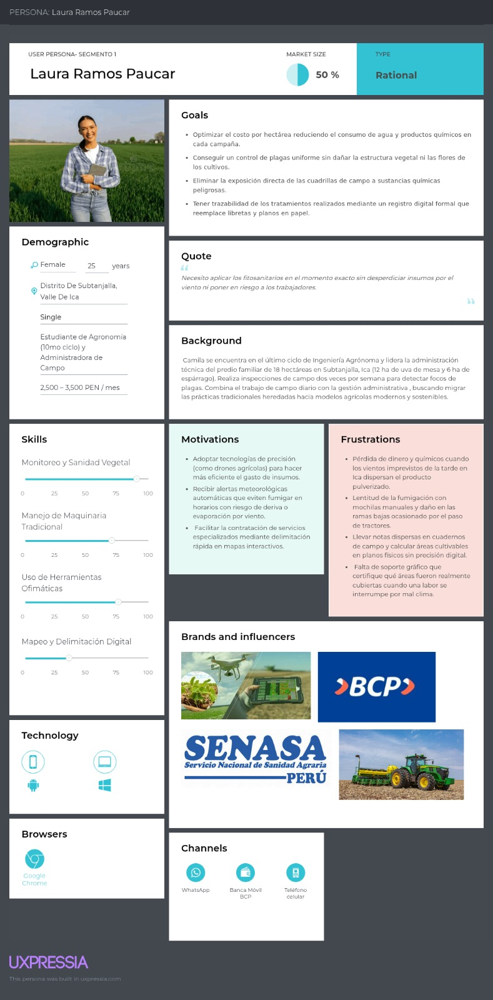

Laura cursa el 10mo ciclo de Ingeniería Agrónoma y se desempeña como administradora de campo en el distrito de Subtanjalla, Ica. Combina sus conocimientos técnicos en monitoreo y sanidad vegetal con la gestión diaria del predio agrícola familiar, buscando incorporar tecnologías de precisión para optimizar el uso de agua e insumos y mejorar el control de plagas. En su trabajo enfrenta problemas como la aplicación de productos químicos condicionada por el viento, el registro manual de tratamientos, la falta de información digital para delimitar áreas y la dificultad de coordinar labores cuando las condiciones climáticas interrumpen el trabajo.

#### User Persona del Segmento 2, Operadores Técnicos de Drones: Diego Mendoza Ríos

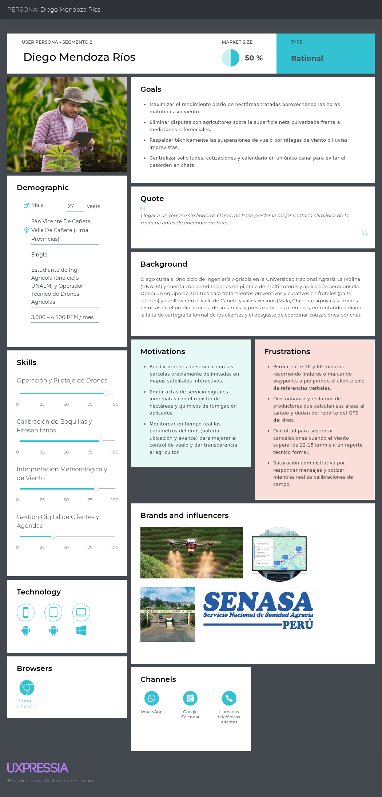

Diego cursa el 9no ciclo de Ingeniería Agrícola en la Universidad Nacional Agraria La Molina (UNALM) y cuenta con acreditaciones en pilotaje de multirrotores y aplicación aeroagrícola. Opera un dron con tanque de 30 litros para tratamientos preventivos y curativos en frutales (palto, vid, cítricos) y panllevar en el valle de Cañete y valles vecinos (Mala, Chincha). Apoya las labores técnicas en el predio agrícola de su familia y presta servicios a terceros, enfrentando a diario la falta de cartografía formal de los clientes y el desgaste de coordinar cotizaciones por chat.

### 2.3.2. User Task Matrix

El User Task Matrix considera los dos segmentos objetivo: Pequeños y Medianos Agricultores (PyMAs), representados por el User Persona Laura Ramos Paucar, y Operadores Técnicos de Drones, representados por el User Persona Diego Mendoza Ríos. Para cada segmento se identificaron nueve tareas que realizan actualmente para cumplir sus objetivos, independientemente de la existencia de la solución, junto con su frecuencia e importancia.

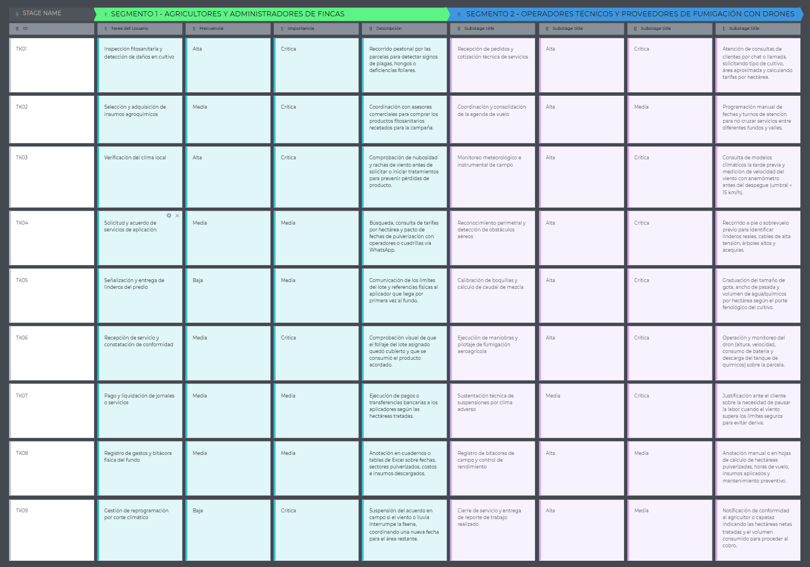

*Figura: User Task Matrix de los dos segmentos objetivo, con la frecuencia y la importancia de cada tarea.*

En el segmento de Pequeños y Medianos Agricultores (PyMAs), las tareas de mayor frecuencia e importancia son la inspección fitosanitaria y detección de daños en el cultivo y la verificación del clima local, ambas con frecuencia alta e importancia crítica. En el segmento de Operadores Técnicos de Drones, la mayoría de tareas tiene frecuencia alta e importancia crítica, en especial la recepción de pedidos y cotización de servicios, el monitoreo meteorológico, el reconocimiento perimetral, la calibración de boquillas y la ejecución del vuelo de fumigación.

Ambos segmentos coinciden en verificar las condiciones climáticas antes de fumigar y en considerar crítica la reprogramación o suspensión de una labor por mal clima. La principal diferencia está en la delimitación del área: para el agricultor, señalar los linderos del predio es una tarea de frecuencia baja e importancia media, mientras que para el operador el reconocimiento perimetral es una tarea de frecuencia alta e importancia crítica, ya que de ella depende la seguridad del vuelo.

### 2.3.3. User Journey Mapping

Los User Journey Maps representan la situación actual (As-Is) de cada segmento, sin la solución, a lo largo del proceso completo de una fumigación: desde que se detecta la necesidad o se recibe el pedido hasta el cierre y registro del servicio. Para cada etapa se muestran las acciones, pensamientos y emociones, la curva emocional, los puntos de dolor y las oportunidades.

#### Segmento 1: Pequeños y Medianos Agricultores (PyMAs)

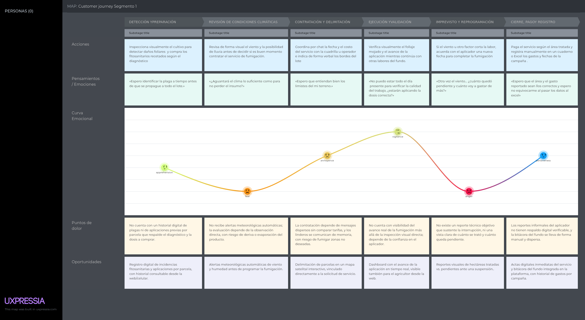

*Figura: User Journey Map As-Is del segmento de Pequeños y Medianos Agricultores (PyMAs).* El recorrido tiene seis etapas: detección y preparación, revisión de condiciones climáticas, contratación y delimitación, ejecución y validación, imprevisto y reprogramación, y cierre, pago y registro. Los puntos más bajos de la curva emocional son el miedo durante la revisión del clima y el enojo cuando un imprevisto interrumpe la fumigación, momentos en los que el agricultor no cuenta con alertas automáticas ni con un reporte objetivo de lo tratado y lo pendiente.

#### Segmento 2: Operadores Técnicos de Drones

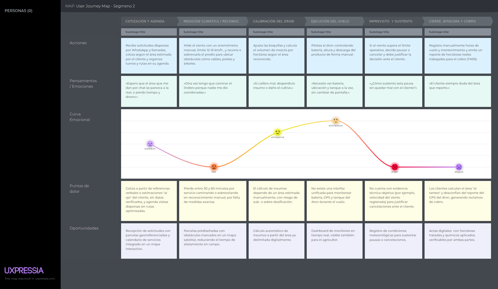

*Figura: User Journey Map As-Is del segmento de Operadores Técnicos de Drones.* El recorrido tiene seis etapas: cotización y agenda, medición climática y reconocimiento, calibración del dron, ejecución del vuelo, imprevisto y sustento, y cierre, bitácora y cobro. Los puntos más bajos de la curva emocional son el miedo durante el reconocimiento del terreno, por la falta de linderos claros, y el enojo y la frustración cuando debe justificar una pausa por clima o cobrar un área que el cliente pone en duda.

### 2.3.4. Empathy Mapping

Para elaborar los Empathy Maps, el equipo preparó un mapa en UXPressia para cada User Persona, colocándolo al centro. Luego, cada integrante ubicó sus observaciones sobre el User Persona en la sección correspondiente, respondiendo a las preguntas ¿Con quién estamos empatizando?, ¿Qué necesita hacer?, ¿Qué ve?, ¿Qué dice?, ¿Qué hace?, ¿Qué escucha? y ¿Qué piensa y siente? Finalmente, se identificaron sus Pains y Gains.

#### Segmento 1: Pequeños y Medianos Agricultores (PyMAs)

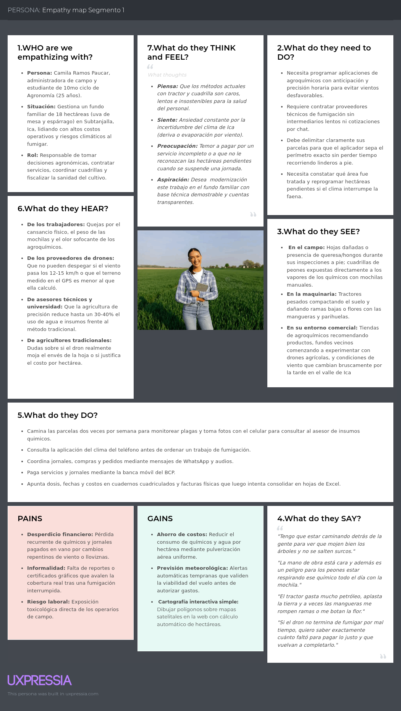

*Figura: Empathy Map del User Persona del segmento de Pequeños y Medianos Agricultores (PyMAs).* El mapa muestra la ansiedad del agricultor por la incertidumbre del clima y su temor a pagar por un servicio incompleto. Entre sus pains destacan el desperdicio de químicos y jornales por cambios repentinos de viento, la falta de reportes que avalen la cobertura real y la exposición de los operarios a agroquímicos. Entre sus gains, el ahorro de insumos, las alertas meteorológicas tempranas y la delimitación de parcelas sobre mapas satelitales.

#### Segmento 2: Operadores Técnicos de Drones

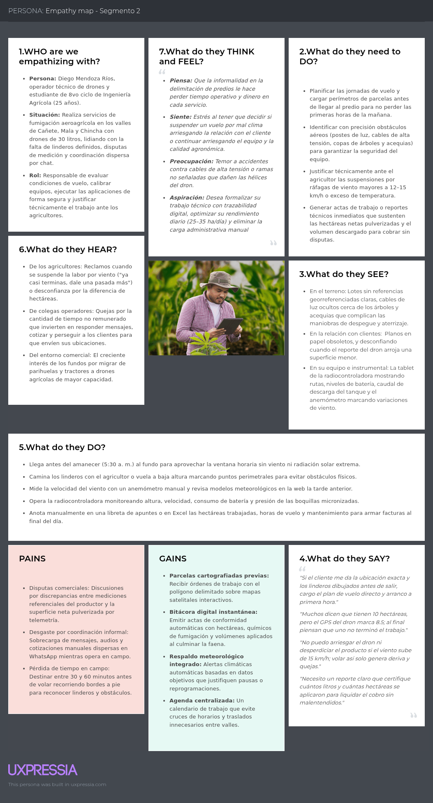

*Figura: Empathy Map del User Persona del segmento de Operadores Técnicos de Drones.* El mapa muestra el estrés del operador al decidir si suspende un vuelo por mal clima y su temor a accidentes por obstáculos no señalados. Entre sus pains destacan las disputas por la superficie pulverizada, el desgaste por la coordinación informal y el tiempo perdido reconociendo linderos. Entre sus gains, recibir parcelas ya cartografiadas, emitir una bitácora digital inmediata, contar con respaldo meteorológico y centralizar su agenda.

---

## 2.4. Big Picture Event Storming

El Big Picture Event Storming se realizó en una sesión colaborativa en Miro, con el objetivo de entender el dominio del negocio de AgriDron Solutions a alto nivel. El equipo identificó primero los eventos de dominio más relevantes, los ordenó en una línea de tiempo y luego incorporó los actores que los originan y los sistemas externos involucrados. Finalmente, marcó como hotspots las preguntas abiertas sobre reglas de negocio que surgieron durante la sesión.

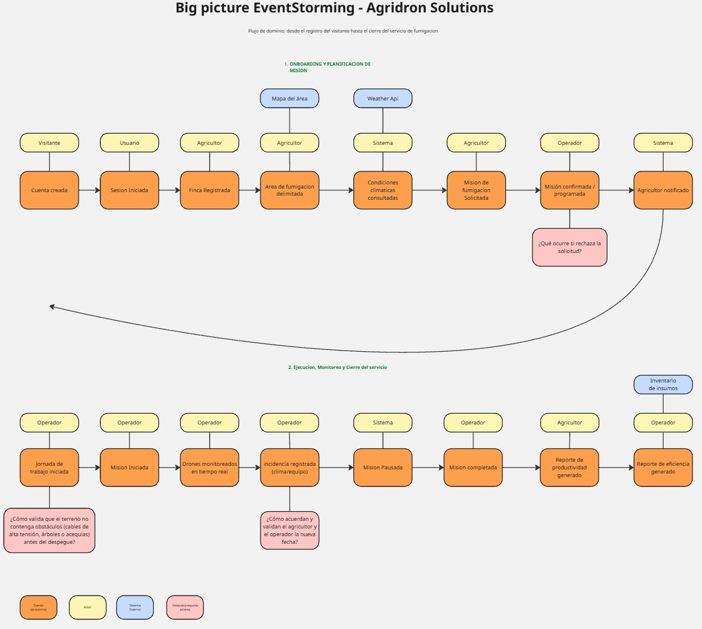

*Figura: Big Picture Event Storming del dominio de AgriDron Solutions.* El Big Picture EventStorming representa el flujo completo del dominio de **AgriDron Solutions**, desde que un visitante crea su cuenta hasta el cierre del servicio de fumigación. Se construyó agrupando los eventos de dominio (en naranja, redactados en pasado) según el actor que los origina (en amarillo) y, cuando corresponde, el sistema externo involucrado (en celeste).

El flujo se organizó en dos grandes fases. La primera, **Onboarding y Planificación de Misión**, cubre desde la creación de la cuenta y el registro de la finca/parcela/terreno por parte del *Agricultor*, hasta la delimitación de la zona de fumigación mediante el mapa interactivo, la consulta de condiciones climáticas con la *Weather API*, la solicitud de la misión y su confirmación o programación directa por parte del *Operador Técnico*. La segunda fase, **Ejecución, Monitoreo y Cierre del Servicio**, abarca el inicio de la jornada de vuelo del operador, la ejecución y monitoreo de parámetros del dron, el registro de incidencias en campo (derivando en pausas si el clima es adverso), y el cierre de la misión con la generación de reportes de productividad para el agricultor y de rendimiento operativo para el técnico.

Durante el ejercicio se identificaron tres **hotspots** (en rosado) que representan preguntas abiertas sobre reglas de negocio operativas: qué flujo alternativo sigue el sistema si el operador rechaza la fecha u orden solicitada, cómo valida técnicamente el operador que el polígono trazado por el agricultor no contenga obstáculos aéreos críticos (cables de alta tensión, árboles o acequias) antes del despegue, y cuál es el mecanismo para acordar y validar una reprogramación de las hectáreas pendientes tras una suspensión climática. Estos puntos críticos orientan directamente la especificación de requisitos en el Capítulo III.

**Link del Miro:** [Big Picture Event Storming en Miro](https://miro.com/app/board/uXjVHnbT8O4=/?share_link_id=310365063702)

---

## 2.5. Ubiquitous Language

| Término | Definición |
| :--- | :--- |
| **Farm** (Finca) | Predio agrícola de un Agricultor, identificado por su nombre y su ubicación. Puede contener una o más parcelas. |
| **Parcel** (Parcela / Lote) | Porción de una finca destinada a un cultivo y delimitada por sus linderos. Su superficie se expresa en hectáreas. |
| **Fumigation Area** (Zona de fumigación) | Superficie de una parcela que debe tratarse en una misión de fumigación. Puede abarcar toda la parcela o solo los sectores afectados por una plaga. |
| **Spraying Mission** (Misión de fumigación) | Solicitud de servicio creada por un Agricultor sobre un área y cultivo específicos. Atraviesa los estados *Programada*, *Autorizada*, *En curso*, *En pausa*, *Completada* y *Cancelada* a lo largo de su ciclo de vida. |
| **Spraying Session** (Sesión de pulverización) | Periodo continuo de vuelo y aplicación aeroagrícola ejecutado en campo por el Operador, sujeto a ventanas climáticas óptimas y disponibilidad de batería y carga de fitosanitarios. |
| **Aerial / Perimeter Obstacle** (Obstáculo aéreo / perimetral) | Elemento físico presente en el predio (postes, cables de alta tensión, copas de árboles, acequias) que el Operador debe identificar y registrar para evitar colisiones durante el vuelo. |
| **Infestation** (Infestación) | Presencia de una plaga o enfermedad en un cultivo en un nivel que requiere un tratamiento fitosanitario. |
| **Agrochemical** (Agroquímico / Fitosanitario) | Producto aplicado a los cultivos para prevenir o controlar plagas y enfermedades, como fungicidas, insecticidas o herbicidas. |
| **Spray Mix** (Caldo / Mezcla) | Preparación de agua y agroquímicos que se carga en el tanque del dron para la fumigación. |
| **Nozzle** (Boquilla) | Pieza del sistema de pulverización del dron por la que sale el caldo. Su tipo y tamaño determinan el tamaño de gota y el volumen aplicado. |
| **Calibration** (Calibración) | Ajuste de las boquillas y del caudal del dron antes del vuelo para aplicar el volumen de caldo por hectárea que requiere el cultivo. |
| **Drift** (Deriva) | Desplazamiento del producto pulverizado fuera de la zona de fumigación por acción del viento, que genera desperdicio de insumos y riesgo para cultivos y personas cercanas. |
| **Crop Season** (Campaña) | Periodo productivo de un cultivo, desde la siembra hasta la cosecha, durante el cual se programan los tratamientos fitosanitarios. |
| **Drone Technical Operator** (Operador Técnico de Drones) | Piloto acreditado que gestiona sus solicitudes de servicio, valida las parcelas, programa los vuelos, calibra los equipos y ejecuta la fumigación en campo. |
| **Farmer** (Agricultor) | Propietario o administrador de una finca, responsable de delimitar lotes, solicitar misiones de fumigación y consultar el historial de trabajo y reportes de productividad. |
| **Incident** (Incidencia) | Evento adverso imprevisto reportado por el Operador durante una misión (ráfagas de viento mayores a 12-15 km/h, lluvia repentina, fallas mecánicas), que genera la pausa del servicio. |
| **Service Record** (Acta de servicio) | Constancia digital inmediata emitida por el Operador al culminar la faena, donde se certifican las hectáreas netas tratadas, insumos fitosanitarios descargados y observaciones de campo. |
| **Productivity Report** (Reporte de productividad) | Documento consolidado que consulta el Agricultor con el histórico de áreas fumigadas, insumos utilizados, costos por hectárea y fechas de tratamiento por predio. |
| **Technical Performance Report** (Reporte de rendimiento técnico) | Resumen operativo generado por el Operador con métricas de desempeño propio (hectáreas tratadas por jornada, horas de vuelo acumuladas y volumen promedio aplicado). |
| **Weather Conditions** (Condiciones meteorológicas) | Estado del tiempo en el predio (velocidad del viento, temperatura y probabilidad de lluvia) que determina si es viable fumigar antes del despegue. |
| **Simulated Flight Monitoring** (Monitoreo de vuelo simulado) | Visualización interactiva del progreso del dron durante la misión (posición GPS, nivel de batería, volumen de químico restante y avance porcentual), con datos simulados. |

---

<div style="page-break-after: always;"></div>

# Capítulo III: Requirements Specification

En este capítulo se especifican los requisitos de los productos digitales de AgriDron Solutions a partir de la información obtenida en las entrevistas y en los artefactos del Capítulo II. La sección 3.1 presenta las Epics y las User Stories con sus criterios de aceptación, la sección 3.2 relaciona los objetivos de negocio con los User Personas mediante el Impact Mapping y la sección 3.3 presenta el Product Backlog con la estimación y la priorización de las User Stories.

## 3.1. User Stories

Las User Stories se organizan en nueve Epics, que agrupan los requisitos de la Landing Page (EP01), de la Web Application (EP02 a EP08) y del RESTful API (EP09). Cada User Story se redacta desde el rol de quien la necesita: visitante para la Landing Page, agricultor para el segmento de Pequeños y Medianos Agricultores (PyMAs), operador técnico para el segmento de Operadores Técnicos de Drones, usuario cuando aplica a ambos segmentos y Developer para las Technical Stories del RESTful API.

Los criterios de aceptación siguen la estructura Gherkin (Dado que, cuando, entonces) e incluyen el escenario principal y al menos un escenario alternativo de cada User Story. Cada escenario se presenta numerado, con las cláusulas Dado que, Cuando y Entonces en líneas separadas. En las Technical Stories, los escenarios describen la interacción de request y response con cada endpoint del RESTful API. La telemetría del dron se simula en la Web Application, como se indica en las restricciones del proyecto (1.2.1), por lo que no requiere un endpoint propio. Las Technical Stories describen los recursos del RESTful API de esta versión del producto. Las User Stories, o los datos de una User Story, que todavía no tienen un endpoint en esta versión se incorporarán al RESTful API en sprints posteriores, según la priorización del Product Backlog.

| Epic / Story ID | Título | Descripción | Criterios de Aceptación | Relacionado con (Epic ID) |
|---|---|---|---|---|
| **EP01** | **Descubrimiento e Información Comercial (Landing Page)** | Definición general de la propuesta de valor y servicios públicos de la plataforma. | -- | -- |
| LP-001 | Visualización de propuesta de valor | Como visitante, quiero visualizar la propuesta de valor de AgriDron Solutions en el portal principal, para entender los beneficios de la gestión de fumigación con drones. | **Escenario 1**<br>Dado que el visitante ingresa al sitio web<br>Cuando consulta la sección principal<br>Entonces el sistema presenta la propuesta de valor de AgriDron Solutions y los beneficios de gestionar la fumigación con drones.<br><br>**Escenario 2**<br>Dado que el visitante revisó la propuesta de valor<br>Cuando busca cómo empezar a usar la plataforma<br>Entonces el sistema le ofrece el acceso al registro de la Web Application. | EP01 |
| LP-002 | Consulta de servicios de fumigación | Como visitante, quiero conocer los servicios de precisión ofrecidos, para evaluar si responden a las necesidades de mi producción agrícola. | **Escenario 1**<br>Dado que el visitante consulta la sección de servicios<br>Cuando solicita información detallada<br>Entonces el sistema muestra los servicios de la plataforma: gestión de fincas y parcelas, solicitud de misiones, consulta del clima, monitoreo de misiones y reportes.<br><br>**Escenario 2**<br>Dado que el visitante pertenece a un segmento (agricultor u operador técnico de drones)<br>Cuando consulta los servicios<br>Entonces el sistema presenta los beneficios dirigidos a ese segmento. | EP01 |
| LP-003 | Consulta de planes de suscripción | Como visitante, quiero revisar las tarifas y planes disponibles, para seleccionar el esquema comercial adecuado. | **Escenario 1**<br>Dado que el visitante navega hacia la oferta comercial<br>Cuando consulta las tarifas<br>Entonces el sistema muestra los planes diferenciados según extensión territorial y frecuencia de uso.<br><br>**Escenario 2**<br>Dado que el visitante revisa un plan<br>Cuando consulta su detalle<br>Entonces el sistema muestra las funcionalidades incluidas en ese plan. | EP01 |
| LP-004 | Acceso al registro desde la Landing Page | Como visitante, quiero registrarme en la plataforma proporcionando mis datos básicos, para acceder a las funcionalidades de la Web Application. | **Escenario 1**<br>Dado que el visitante decide crear una cuenta<br>Cuando selecciona la opción de registro<br>Entonces el sistema lo dirige al registro de la Web Application.<br><br>**Escenario 2**<br>Dado que el visitante navega desde un dispositivo móvil<br>Cuando selecciona la opción de registro<br>Entonces el sistema lo dirige igualmente al registro de la Web Application. | EP01 |
| LP-005 | Inicio de sesión desde la Landing Page | Como visitante registrado, quiero iniciar sesión con mis credenciales, para acceder a la Web Application. | **Escenario 1**<br>Dado que el visitante ya tiene una cuenta<br>Cuando selecciona la opción de iniciar sesión<br>Entonces el sistema lo dirige al inicio de sesión de la Web Application.<br><br>**Escenario 2**<br>Dado que el visitante se encuentra en cualquier sección de la Landing Page<br>Cuando busca iniciar sesión<br>Entonces el sistema mantiene disponible el acceso al inicio de sesión. | EP01 |
| LP-006 | Acceso a términos legales y políticas de privacidad | Como visitante, quiero acceder a los términos y condiciones de servicio, para conocer las políticas de uso y privacidad. | **Escenario 1**<br>Dado que el visitante desea conocer las condiciones del servicio<br>Cuando consulta los términos y condiciones<br>Entonces el sistema presenta los términos de servicio y la política de privacidad vigentes.<br><br>**Escenario 2**<br>Dado que el visitante se encuentra en cualquier sección de la Landing Page<br>Cuando busca las políticas del servicio<br>Entonces el sistema mantiene disponible el acceso a los términos y condiciones. | EP01 |
| LP-007 | Cambio de idioma del sitio | Como visitante, quiero cambiar el idioma del sitio entre español e inglés, para navegar en mi idioma preferido. | **Escenario 1**<br>Dado que el visitante navega el sitio en español<br>Cuando elige el idioma inglés<br>Entonces el sistema presenta el contenido del sitio en inglés.<br><br>**Escenario 2**<br>Dado que el visitante cambió el idioma del sitio<br>Cuando navega a otra sección<br>Entonces el sistema mantiene el idioma elegido. | EP01 |
| LP-008 | Consulta sobre el equipo multidisciplinario | Como visitante, quiero conocer el perfil de los creadores de AgriDron Solutions, para verificar la trayectoria profesional del equipo. | **Escenario 1**<br>Dado que el visitante accede a la sección corporativa<br>Cuando revisa la trayectoria del equipo<br>Entonces el sistema despliega las competencias técnicas y de ingeniería de los miembros.<br><br>**Escenario 2**<br>Dado que el visitante revisa el perfil de un integrante<br>Cuando consulta su información<br>Entonces el sistema muestra su nombre y su función en el proyecto. | EP01 |
| LP-009 | Solicitud de demostración comercial | Como visitante del segmento Pequeños y Medianos Agricultores (PyMAs), quiero enviar un formulario de contacto, para solicitar una demostración personalizada del servicio. | **Escenario 1**<br>Dado que el visitante ingresa sus datos de contacto completos<br>Cuando envía la solicitud de demostración<br>Entonces el sistema registra la solicitud y confirma su recepción.<br><br>**Escenario 2**<br>Dado que el visitante omite un dato de contacto obligatorio<br>Cuando intenta enviar la solicitud<br>Entonces el sistema no la registra e indica el dato faltante. | EP01 |
| LP-010 | Consulta de preguntas frecuentes | Como visitante, quiero revisar la sección de preguntas frecuentes, para resolver dudas sobre la tecnología de drones y normativas. | **Escenario 1**<br>Dado que el visitante accede a la sección de ayuda pública<br>Cuando selecciona una categoría de consulta<br>Entonces el sistema despliega las respuestas sobre seguridad fitosanitaria y operatividad.<br><br>**Escenario 2**<br>Dado que el visitante no encuentra respuesta a su duda<br>Cuando termina de revisar las preguntas frecuentes<br>Entonces el sistema le ofrece un medio de contacto con el equipo. | EP01 |
| **EP02** | **Autenticación y Gestión de Usuarios** | Mecanismos de registro, acceso seguro y administración de roles dentro de la plataforma. | -- | -- |
| AU-001 | Registro de usuario agricultor | Como agricultor, quiero registrar una cuenta en la plataforma, para gestionar mis terrenos y solicitar misiones de fumigación. | **Escenario 1**<br>Dado que el usuario no posee cuenta en el sistema<br>Cuando ingresa sus datos personales y confirma el registro<br>Entonces el sistema valida los datos y genera el perfil con rol de agricultor.<br><br>**Escenario 2**<br>Dado que el usuario deja un dato obligatorio sin completar<br>Cuando intenta confirmar el registro<br>Entonces el sistema no crea la cuenta e indica el dato faltante. | EP02 |
| AU-002 | Registro de operador técnico | Como operador técnico, quiero registrarme en el sistema, para recibir asignaciones de misiones de vuelo. | **Escenario 1**<br>Dado que un nuevo operador proporciona su identificación y credenciales técnicas<br>Cuando confirma su registro<br>Entonces el sistema genera la cuenta con rol de operador técnico.<br><br>**Escenario 2**<br>Dado que el operador deja un dato obligatorio sin completar<br>Cuando intenta completar el registro<br>Entonces el sistema no crea la cuenta e indica el dato faltante. | EP02 |
| AU-003 | Inicio de sesión seguro | Como usuario registrado, quiero autenticarme mediante credenciales de acceso, para ingresar a mis funcionalidades personalizadas. | **Escenario 1**<br>Dado que el usuario ingresa su nombre de usuario y contraseña válidos<br>Cuando solicita la autenticación<br>Entonces el sistema valida la identidad y permite el acceso a las funciones correspondientes a su rol.<br><br>**Escenario 2**<br>Dado que el usuario ingresa un nombre de usuario o una contraseña incorrectos<br>Cuando solicita la autenticación<br>Entonces el sistema rechaza el acceso e indica que las credenciales no son válidas. | EP02 |
| AU-004 | Recuperación de contraseña | Como usuario registrado, quiero restablecer mi contraseña mediante correo electrónico, para recuperar el acceso ante un olvido. | **Escenario 1**<br>Dado que el usuario solicita el restablecimiento de clave indicando su correo<br>Cuando el sistema confirma la existencia de la cuenta<br>Entonces el sistema envía un enlace seguro de recuperación con tiempo de expiración.<br><br>**Escenario 2**<br>Dado que el correo indicado no pertenece a ninguna cuenta<br>Cuando el usuario solicita el restablecimiento<br>Entonces el sistema no envía el enlace de recuperación. | EP02 |
| AU-005 | Edición de perfil de usuario | Como usuario registrado, quiero actualizar mis datos de contacto y organización, para mantener la información al día. | **Escenario 1**<br>Dado que el usuario autenticado modifica sus datos de contacto<br>Cuando confirma la actualización<br>Entonces el sistema guarda los cambios y emite una notificación de éxito.<br><br>**Escenario 2**<br>Dado que el usuario deja vacío un dato obligatorio de su perfil<br>Cuando intenta guardar la actualización<br>Entonces el sistema conserva los datos anteriores e indica el dato faltante. | EP02 |
| AU-006 | Selección de rol en el registro | Como usuario nuevo, quiero elegir mi rol al registrarme, para acceder a las funciones que me corresponden. | **Escenario 1**<br>Dado que el usuario nuevo ingresa sus datos de registro<br>Cuando selecciona su rol (agricultor u operador técnico) y confirma el registro<br>Entonces el sistema crea la cuenta con el rol seleccionado.<br><br>**Escenario 2**<br>Dado que el usuario nuevo no selecciona un rol<br>Cuando intenta completar el registro<br>Entonces el sistema no crea la cuenta e indica que el rol es obligatorio. | EP02 |
| AU-007 | Cierre de sesión seguro | Como usuario autenticado, quiero finalizar la sesión de trabajo, para proteger la confidencialidad de mis datos. | **Escenario 1**<br>Dado que el usuario solicita el cierre de sesión<br>Cuando confirma la acción<br>Entonces el sistema invalida el token de acceso activo y finaliza la sesión.<br><br>**Escenario 2**<br>Dado que el usuario cerró su sesión<br>Cuando intenta acceder a una función privada de la Web Application<br>Entonces el sistema le solicita autenticarse nuevamente. | EP02 |
| **EP03** | **Gestión Territorial de Fincas y Parcelas** | Catastro, delimitación geográfica y gestión de cultivos sobre mapas interactivos. | -- | -- |
| FM-001 | Registro de finca agrícola | Como agricultor, quiero registrar las fincas de mi propiedad, para organizar geográficamente mis parcelas. | **Escenario 1**<br>Dado que el agricultor proporciona el nombre y la ubicación de su finca<br>Cuando confirma el registro<br>Entonces el sistema guarda la finca en la base de datos y la asocia a su perfil.<br><br>**Escenario 2**<br>Dado que el agricultor omite el nombre o la ubicación de la finca<br>Cuando intenta confirmar el registro<br>Entonces el sistema no guarda la finca e indica el dato faltante. | EP03 |
| FM-002 | Delimitación geográfica de parcela | Como agricultor, quiero trazar los límites poligonales de una parcela sobre el mapa, para definir el área exacta de cultivo. | **Escenario 1**<br>Dado que el agricultor delimita los vértices de un terreno<br>Cuando confirma la geometría<br>Entonces el sistema calcula el área en hectáreas y registra el polígono.<br><br>**Escenario 2**<br>Dado que el agricultor no completa el trazado del polígono<br>Cuando intenta confirmar la parcela<br>Entonces el sistema no la registra e indica que falta la geometría. | EP03 |
| FM-003 | Edición de contorno e información de parcela | Como agricultor, quiero modificar los límites y nombre de una parcela registrada, para actualizar cambios en la infraestructura del campo. | **Escenario 1**<br>Dado que el agricultor selecciona una parcela existente<br>Cuando ajusta sus vértices o cambia sus datos descriptivos y guarda<br>Entonces el sistema actualiza la geometría y recalcula la superficie total.<br><br>**Escenario 2**<br>Dado que el agricultor modifica los datos de una parcela<br>Cuando cancela la edición sin guardar<br>Entonces el sistema conserva la geometría y los datos anteriores. | EP03 |
| FM-004 | Asignación de tipo de cultivo y fenología | Como agricultor, quiero especificar el cultivo y la etapa fenológica de la parcela, para parametrizar las misiones de pulverización. | **Escenario 1**<br>Dado que el agricultor selecciona una parcela registrada<br>Cuando especifica el tipo de cultivo y su estado de desarrollo<br>Entonces el sistema almacena las características agrícolas de la parcela.<br><br>**Escenario 2**<br>Dado que la parcela ya tiene un cultivo asignado<br>Cuando el agricultor especifica un cultivo distinto<br>Entonces el sistema reemplaza el cultivo anterior en las características de la parcela. | EP03 |
| FM-005 | Consulta y filtrado de parcelas | Como agricultor, quiero filtrar mis parcelas por tipo de cultivo o superficie, para ubicar rápidamente terrenos específicos. | **Escenario 1**<br>Dado que el agricultor consulta el inventario de terrenos<br>Cuando aplica un filtro por cultivo o superficie<br>Entonces el sistema presenta únicamente las parcelas que cumplen con el criterio seleccionado.<br><br>**Escenario 2**<br>Dado que ninguna parcela cumple con el criterio seleccionado<br>Cuando el agricultor aplica el filtro<br>Entonces el sistema indica que no hay parcelas que coincidan. | EP03 |
| FM-006 | Deshabilitación de parcela agrícola | Como agricultor, quiero inactivar una parcela fuera de producción, para retirarla de la lista de terrenos operativos. | **Escenario 1**<br>Dado que el agricultor selecciona una parcela sin misiones activas<br>Cuando solicita su desactivación<br>Entonces el sistema cambia el estado del terreno a inactivo sin eliminar el historial de misiones pasadas.<br><br>**Escenario 2**<br>Dado que la parcela tiene misiones activas<br>Cuando el agricultor solicita su desactivación<br>Entonces el sistema no cambia su estado e indica que existen misiones en curso. | EP03 |
| FM-007 | Cambio de capas en mapa cartográfico | Como agricultor, quiero alternar entre vistas satelital, topográfica e híbrida, para analizar las características del terreno. | **Escenario 1**<br>Dado que el agricultor consulta el mapa de sus parcelas<br>Cuando elige una vista satelital, topográfica o híbrida<br>Entonces el sistema presenta el mapa con la vista elegida.<br><br>**Escenario 2**<br>Dado que el agricultor eligió una vista cartográfica<br>Cuando consulta otra parcela<br>Entonces el sistema mantiene la vista elegida. | EP03 |
| FM-008 | Asignación de operadores técnicos a fincas | Como agricultor, quiero asociar operadores técnicos a fincas específicas, para delegar la gestión de misiones en dichos terrenos. | **Escenario 1**<br>Dado que el agricultor trabaja con operadores técnicos<br>Cuando asigna un operador técnico a una finca registrada<br>Entonces el sistema concede al operador permisos de lectura y programación sobre las parcelas vinculadas.<br><br>**Escenario 2**<br>Dado que un operador técnico no está asociado a una finca<br>Cuando intenta programar misiones en sus parcelas<br>Entonces el sistema no le permite la programación. | EP03 |
| **EP04** | **Gestión de Flota y Equipos de Fumigación** | Control de inventario de drones, insumos agrícolas, boquillas y mantenimiento. | -- | -- |
| DR-001 | Registro de nuevo dron en inventario | Como operador técnico, quiero dar de alta un dron con sus especificaciones físicas, para integrarlo a la flota utilizable. | **Escenario 1**<br>Dado que el operador ingresa el modelo, número de serie y capacidad del tanque del equipo<br>Cuando confirma el registro<br>Entonces el sistema guarda el dron en el catálogo con estado disponible.<br><br>**Escenario 2**<br>Dado que el dron recién registrado aún no fue asignado a una misión<br>Cuando el operador consulta la flota<br>Entonces el sistema lo presenta con estado disponible. | EP04 |
| DR-002 | Consulta del estado operativo de flota | Como operador técnico, quiero visualizar el estado y disponibilidad de los drones, para planificar las asignaciones de trabajo. | **Escenario 1**<br>Dado que el operador técnico accede al inventario de equipos<br>Cuando consulta el catálogo<br>Entonces el sistema lista todos los drones indicando si están disponibles, en vuelo, en mantenimiento o fuera de servicio.<br><br>**Escenario 2**<br>Dado que el operador técnico consulta el detalle de un dron<br>Cuando lo selecciona<br>Entonces el sistema presenta su nivel de batería, su boquilla y sus fechas de último y próximo mantenimiento. | EP04 |
| DR-003 | Registro de agroquímicos e insumos | Como operador técnico, quiero registrar los productos agroquímicos autorizados, para controlar las dosis aplicadas en las misiones. | **Escenario 1**<br>Dado que el operador técnico ingresa la denominación comercial, ingrediente activo y dosis recomendada de un producto<br>Cuando guarda la información<br>Entonces el sistema habilita el insumo en la lista de opciones para misiones.<br><br>**Escenario 2**<br>Dado que el operador técnico omite el ingrediente activo o la dosis recomendada<br>Cuando intenta guardar el producto<br>Entonces el sistema no lo habilita e indica el dato faltante. | EP04 |
| DR-004 | Registro de tipos de boquillas de asperjar | Como operador técnico, quiero asociar tipos de boquillas a cada dron, para garantizar el tamaño de gota adecuado según el cultivo. | **Escenario 1**<br>Dado que el operador selecciona un dron registrado<br>Cuando especifica el modelo y caudal de las boquillas instaladas<br>Entonces el sistema actualiza la configuración técnica del equipo.<br><br>**Escenario 2**<br>Dado que el operador cambia la boquilla instalada en un dron<br>Cuando registra la nueva boquilla<br>Entonces el sistema reemplaza la configuración técnica anterior del equipo. | EP04 |
| DR-005 | Programación de mantenimiento preventivo | Como operador técnico, quiero registrar las horas de vuelo y fechas de mantenimiento de un dron, para prevenir fallas operativas. | **Escenario 1**<br>Dado que un dron acumula horas de operación<br>Cuando el operador registra un servicio de mantenimiento preventivo<br>Entonces el sistema actualiza el historial técnico y restablece el contador de horas de servicio.<br><br>**Escenario 2**<br>Dado que el operador registró un mantenimiento preventivo<br>Cuando consulta el dron<br>Entonces el sistema presenta las fechas del último y del próximo mantenimiento. | EP04 |
| DR-006 | Registro de fallas e incidentes de equipo | Como operador técnico, quiero reportar una falla mecánica en un dron, para restringir su uso en misiones hasta su reparación. | **Escenario 1**<br>Dado que un dron presenta un mal funcionamiento<br>Cuando el operador registra la incidencia técnica<br>Entonces el sistema cambia el estado del equipo a inoperativo y lo excluye de las asignaciones de misiones.<br><br>**Escenario 2**<br>Dado que un dron está marcado como inoperativo<br>Cuando se intenta asignarlo a una misión<br>Entonces el sistema no permite la asignación hasta que se registre su reparación. | EP04 |
| DR-007 | Deshabilitación de dron de la flota | Como operador técnico, quiero dar de baja un dron retirado del servicio, para mantener el inventario actualizado. | **Escenario 1**<br>Dado que un equipo queda fuera de servicio permanente<br>Cuando el operador técnico solicita la baja del dron<br>Entonces el sistema inactiva el registro impidiendo asignaciones futuras.<br><br>**Escenario 2**<br>Dado que el dron está asignado a una misión activa<br>Cuando el operador técnico solicita su baja<br>Entonces el sistema no la realiza e indica que el dron tiene una misión en curso. | EP04 |
| **EP05** | **Planificación y Programación de Misiones** | Flujo de solicitud, asignación de recursos y definición de parámetros de vuelo. | -- | -- |
| MI-001 | Solicitud de misión de fumigación | Como agricultor, quiero solicitar una misión de fumigación indicando parcela y fecha estimada, para programar la atención de mi cultivo. | **Escenario 1**<br>Dado que el agricultor selecciona una parcela activa<br>Cuando ingresa la fecha requerida y el producto a aplicar<br>Entonces el sistema crea la solicitud en estado Programada.<br><br>**Escenario 2**<br>Dado que el agricultor no indica la fecha requerida o el producto a aplicar<br>Cuando intenta crear la solicitud<br>Entonces el sistema no la registra e indica el dato faltante. | EP05 |
| MI-002 | Asignación de dron e insumos a la misión | Como operador técnico, quiero asignar un dron y la cantidad de producto requerida a una misión, para preparar la logística operativa. | **Escenario 1**<br>Dado que existe una misión en estado Programada<br>Cuando el operador técnico selecciona un dron disponible y especifica el insumo<br>Entonces el sistema reserva los recursos y vincula la orden de trabajo.<br><br>**Escenario 2**<br>Dado que no hay drones disponibles<br>Cuando el operador técnico intenta asignar un dron a la misión<br>Entonces el sistema indica que no hay equipos disponibles y mantiene la misión en estado Programada. | EP05 |
| MI-003 | Asignación de operador técnico a la misión | Como operador técnico, quiero asignarme una misión solicitada, para hacerme responsable de su ejecución en campo. | **Escenario 1**<br>Dado que una misión cuenta con recursos asignados<br>Cuando el operador técnico se asigna como responsable<br>Entonces el sistema lo registra en la misión y notifica al agricultor.<br><br>**Escenario 2**<br>Dado que la misión ya tiene un operador técnico responsable<br>Cuando otro operador intenta asignarse<br>Entonces el sistema no realiza la asignación. | EP05 |
| MI-004 | Configuración de parámetros de vuelo | Como operador técnico, quiero definir la altura de vuelo, velocidad y tasa de pulverización, para asegurar una cobertura homogénea. | **Escenario 1**<br>Dado que el operador accede al plan de vuelo de la misión<br>Cuando especifica la velocidad, altura de pulverización y traslape<br>Entonces el sistema guarda la configuración operativa para la ejecución.<br><br>**Escenario 2**<br>Dado que la misión ya tiene una configuración guardada<br>Cuando el operador modifica la velocidad, la altura o el traslape<br>Entonces el sistema reemplaza la configuración anterior. | EP05 |
| MI-005 | Consulta de calendario de misiones | Como operador técnico, quiero visualizar un calendario con las misiones programadas, para evitar conflictos de agenda y sobreposición de labores. | **Escenario 1**<br>Dado que el operador técnico consulta la programación de misiones<br>Cuando elige un periodo semanal o mensual<br>Entonces el sistema presenta las misiones programadas en ese periodo con sus estados.<br><br>**Escenario 2**<br>Dado que no hay misiones programadas en el periodo elegido<br>Cuando el operador técnico consulta la programación<br>Entonces el sistema indica que no hay misiones en ese periodo. | EP05 |
| MI-006 | Reprogramación de misión | Como agricultor, quiero solicitar el cambio de fecha de una misión que aún no inicia, para ajustarme a eventualidades del fundo. | **Escenario 1**<br>Dado que una misión se encuentra en estado Programada o Autorizada<br>Cuando el agricultor solicita una nueva fecha<br>Entonces el sistema registra la nueva fecha y libera los recursos asignados.<br><br>**Escenario 2**<br>Dado que la misión ya se encuentra en estado En curso<br>Cuando el agricultor solicita una nueva fecha<br>Entonces el sistema no la reprograma e indica que la misión está en curso. | EP05 |
| MI-007 | Aprobación formal de misión | Como operador técnico, quiero aprobar definitivamente una misión Programada, para autorizar el inicio del despliegue en campo. | **Escenario 1**<br>Dado que los parámetros y recursos están validados<br>Cuando el operador técnico confirma la aprobación<br>Entonces el sistema cambia el estado de la misión a Autorizada.<br><br>**Escenario 2**<br>Dado que la misión no tiene dron u operador asignado<br>Cuando el operador técnico intenta aprobarla<br>Entonces el sistema no cambia su estado e indica los recursos faltantes. | EP05 |
| MI-008 | Exportación de plan de vuelo | Como operador técnico, quiero descargar el plan de vuelo parametrizado de la misión, para tenerlo como referencia durante la operación en campo. | **Escenario 1**<br>Dado que la misión está aprobada y parametrizada<br>Cuando el operador solicita la exportación<br>Entonces el sistema genera un archivo con los parámetros de vuelo y la secuencia de puntos de la ruta.<br><br>**Escenario 2**<br>Dado que la misión aún no tiene parámetros de vuelo configurados<br>Cuando el operador solicita la exportación<br>Entonces el sistema no genera el archivo e indica que faltan los parámetros. | EP05 |
| **EP06** | **Ejecución y Telemetría de Vuelo en Tiempo Real** | Monitoreo interactivo, alertas operativas y registro de bitácora técnica de vuelo. | -- | -- |
| TR-001 | Visualización de posición de dron en tiempo real | Como agricultor, quiero observar la trayectoria del dron sobre el mapa durante la fumigación, para verificar la cobertura del terreno. | **Escenario 1**<br>Dado que una misión se encuentra en estado En curso<br>Cuando el sistema recibe una nueva posición de la telemetría simulada del dron<br>Entonces el sistema actualiza la posición del dron y la trayectoria recorrida.<br><br>**Escenario 2**<br>Dado que la misión no está en estado En curso<br>Cuando el agricultor consulta el seguimiento del dron<br>Entonces el sistema indica que no hay un vuelo activo para esa misión. | EP06 |
| TR-002 | Monitoreo de indicadores de vuelo | Como operador técnico, quiero supervisar el nivel de batería y volumen de tanque en tiempo real, para tomar decisiones operativas durante el vuelo. | **Escenario 1**<br>Dado que la telemetría simulada de la misión está activa<br>Cuando el sistema procesa una nueva lectura<br>Entonces el sistema presenta los porcentajes actualizados de batería y de carga fitosanitaria restante.<br><br>**Escenario 2**<br>Dado que la misión aún no se encuentra en estado En curso<br>Cuando el operador consulta los indicadores de vuelo<br>Entonces el sistema indica que no hay telemetría disponible. | EP06 |
| TR-003 | Recepción de alertas operativas en vuelo | Como operador técnico, quiero recibir notificaciones inmediatas ante anomalías de altitud o batería baja, para prevenir accidentes en campo. | **Escenario 1**<br>Dado que la telemetría simulada registra un valor fuera de los umbrales seguros<br>Cuando el sistema detecta la discrepancia<br>Entonces el sistema genera una alerta inmediata para el operador técnico.<br><br>**Escenario 2**<br>Dado que los valores de la telemetría simulada se mantienen dentro de los umbrales seguros<br>Cuando el sistema procesa una nueva lectura<br>Entonces el sistema no genera alertas. | EP06 |
| TR-004 | Pausa y reanudación de misión de emergencia | Como operador técnico, quiero registrar la interrupción temporal de un vuelo por imprevisto, para reanudar el trabajo desde el último punto tratado. | **Escenario 1**<br>Dado que el operador suspende el vuelo en campo<br>Cuando registra la pausa en el sistema<br>Entonces el sistema cambia el estado de la misión a En pausa y guarda el punto geográfico exacto de parada para la posterior reanudación.<br><br>**Escenario 2**<br>Dado que la misión está en estado En pausa<br>Cuando el operador registra la reanudación<br>Entonces el sistema cambia su estado a En curso y retoma la misión desde el punto de parada guardado. | EP06 |
| TR-005 | Registro de finalización de misión | Como operador técnico, quiero marcar una misión como completada al finalizar la aplicación, para cerrar la orden de trabajo en campo. | **Escenario 1**<br>Dado que el dron concluye el recorrido total del polígono<br>Cuando el operador confirma la finalización<br>Entonces el sistema cambia el estado de la misión a Completada y calcula el tiempo total de aplicación.<br><br>**Escenario 2**<br>Dado que el dron no completó el recorrido total del polígono<br>Cuando el operador intenta marcar la misión como completada<br>Entonces el sistema no cambia su estado a Completada e indica el área pendiente. | EP06 |
| TR-006 | Bitácora técnica de observaciones en campo | Como operador técnico, quiero adjuntar notas operativas al finalizar el vuelo, para documentar incidencias de viento o vegetación. | **Escenario 1**<br>Dado que la misión ha finalizado<br>Cuando el operador escribe las observaciones del servicio<br>Entonces el sistema guarda los comentarios vinculados al registro histórico del vuelo.<br><br>**Escenario 2**<br>Dado que el operador no registra observaciones<br>Cuando cierra la misión<br>Entonces el sistema guarda el registro histórico del vuelo sin comentarios adicionales. | EP06 |
| **EP07** | **Integración Meteorológica y Alertas** | Evaluación de condiciones ambientales para asegurar la viabilidad de la pulverización. | -- | -- |
| CL-001 | Consulta de condiciones climáticas actuales | Como agricultor, quiero ver la temperatura, humedad y velocidad de viento en mi finca, para evaluar las condiciones antes de la fumigación. | **Escenario 1**<br>Dado que el agricultor selecciona una parcela<br>Cuando solicita la información meteorológica<br>Entonces el sistema consulta las condiciones meteorológicas de la ubicación de su finca y muestra las variables ambientales del momento.<br><br>**Escenario 2**<br>Dado que el servicio de clima no responde<br>Cuando el agricultor solicita la información meteorológica<br>Entonces el sistema indica que los datos no están disponibles en ese momento. | EP07 |
| CL-002 | Alerta por exceso de velocidad de viento | Como operador técnico, quiero ser alertado si el viento supera el límite seguro de aplicación, para evitar la deriva de los productos agroquímicos. | **Escenario 1**<br>Dado que la velocidad del viento calculada supera los 15 km/h en la zona<br>Cuando el sistema evalúa las condiciones de la misión<br>Entonces el sistema emite una advertencia de riesgo alto de deriva.<br><br>**Escenario 2**<br>Dado que la velocidad del viento se mantiene en 15 km/h o menos<br>Cuando el sistema evalúa las condiciones de la misión<br>Entonces el sistema no emite la advertencia de deriva. | EP07 |
| CL-003 | Identificación de ventana óptima de pulverización | Como operador técnico, quiero visualizar una recomendación del mejor horario para fumigar, para optimizar la eficacia de la aplicación fitosanitaria. | **Escenario 1**<br>Dado que el sistema analiza el pronóstico meteorológico para las siguientes 24 horas<br>Cuando identifica rangos con viento de 15 km/h o menos y temperatura menor a 28 °C<br>Entonces el sistema indica esos rangos horarios como óptimos.<br><br>**Escenario 2**<br>Dado que el pronóstico no presenta ningún rango que cumpla esas condiciones de viento y temperatura<br>Cuando el sistema analiza las siguientes 24 horas<br>Entonces el sistema indica que no hay un horario recomendado para fumigar. | EP07 |
| CL-004 | Registro de medición climática manual | Como operador técnico, quiero ingresar mediciones de un anemómetro de campo, para validar la viabilidad cuando el servicio meteorológico no tenga cobertura local. | **Escenario 1**<br>Dado que el operador realiza una medición con instrumental de campo<br>Cuando ingresa los datos de velocidad de viento y temperatura en la plataforma<br>Entonces el sistema registra la medición local y valida la misión.<br><br>**Escenario 2**<br>Dado que la velocidad de viento medida supera el límite seguro de aplicación<br>Cuando el operador registra la medición<br>Entonces el sistema registra la medición y no valida la misión. | EP07 |
| CL-005 | Configuración de umbrales meteorológicos por cultivo | Como operador técnico, quiero ajustar los límites de viento y temperatura aceptables por tipo de cultivo, para adaptar las reglas de validación. | **Escenario 1**<br>Dado que un cultivo requiere condiciones atmosféricas específicas<br>Cuando el operador técnico modifica los parámetros meteorológicos aceptables<br>Entonces el sistema actualiza las reglas de evaluación para ese tipo de cultivo.<br><br>**Escenario 2**<br>Dado que el operador técnico modificó los límites de un tipo de cultivo<br>Cuando el sistema evalúa una misión de otro cultivo<br>Entonces el sistema no aplica esos límites. | EP07 |
| **EP08** | **Analítica, Informes y Métricas Operativas** | Tableros de control, reportes de desempeño fitosanitario y balances de insumos. | -- | -- |
| RP-001 | Generación de informe de servicio fitosanitario | Como agricultor, quiero obtener un reporte consolidado tras la misión, para verificar las hectáreas tratadas y el volumen aplicado. | **Escenario 1**<br>Dado que una misión ha sido completada<br>Cuando el agricultor solicita el reporte de servicio<br>Entonces el sistema genera un resumen estructurado con fecha, mapa de cobertura, dosis e insumos utilizados.<br><br>**Escenario 2**<br>Dado que la misión aún no ha sido completada<br>Cuando el agricultor solicita el reporte de servicio<br>Entonces el sistema indica que el reporte estará disponible al finalizar la misión. | EP08 |
| RP-002 | Exportación de informes en formato PDF | Como agricultor, quiero descargar el informe de fumigación en archivo PDF, para archivarlo en mis registros de certificación agrícola. | **Escenario 1**<br>Dado que el resumen de la misión se encuentra generado<br>Cuando el agricultor solicita la descarga en formato PDF<br>Entonces el sistema compila la información y entrega el archivo listo para impresión.<br><br>**Escenario 2**<br>Dado que el resumen de la misión aún no se ha generado<br>Cuando el agricultor solicita la descarga<br>Entonces el sistema no entrega el archivo e indica que el reporte no está disponible. | EP08 |
| RP-003 | Visualización de panel con métricas generales | Como operador técnico, quiero ver un tablero de control con el total de hectáreas tratadas y horas de vuelo, para evaluar el rendimiento global. | **Escenario 1**<br>Dado que existen misiones registradas en el sistema<br>Cuando el operador técnico consulta las métricas generales<br>Entonces el sistema presenta las métricas consolidadas por periodo de tiempo.<br><br>**Escenario 2**<br>Dado que no existen misiones registradas en el periodo elegido<br>Cuando el operador técnico consulta las métricas generales<br>Entonces el sistema indica que no hay métricas para ese periodo. | EP08 |
| RP-004 | Historial de misiones con filtros avanzados | Como agricultor, quiero realizar búsquedas en el historial por rango de fechas o parcela, para comparar intervenciones pasadas. | **Escenario 1**<br>Dado que el agricultor ingresa al historial de operaciones<br>Cuando define un rango de fechas y selecciona un predio<br>Entonces el sistema muestra la lista detallada de servicios ejecutados en ese lapso.<br><br>**Escenario 2**<br>Dado que no existen servicios ejecutados en el rango de fechas definido<br>Cuando el agricultor aplica la búsqueda<br>Entonces el sistema indica que no hay resultados para ese rango. | EP08 |
| RP-005 | Balance de consumo de productos agroquímicos | Como operador técnico, quiero consultar un reporte de insumos utilizados por finca, para controlar el gasto y stock de agroquímicos. | **Escenario 1**<br>Dado que el operador técnico selecciona una finca específica<br>Cuando solicita el informe de insumos<br>Entonces el sistema calcula y presenta el volumen acumulado de cada producto pulverizado.<br><br>**Escenario 2**<br>Dado que la finca no tiene misiones completadas<br>Cuando el operador técnico solicita el informe de insumos<br>Entonces el sistema indica que no hay consumos registrados. | EP08 |
| RP-006 | Comparativa de eficiencia operativa entre parcelas | Como operador técnico, quiero comparar el tiempo promedio de fumigación por hectárea entre distintas parcelas, para identificar oportunidades de mejora. | **Escenario 1**<br>Dado que el operador técnico selecciona dos o más parcelas<br>Cuando genera el análisis comparativo<br>Entonces el sistema presenta las tasas de avance e indicadores de rendimiento de cada terreno.<br><br>**Escenario 2**<br>Dado que el operador técnico selecciona una sola parcela<br>Cuando intenta generar el análisis comparativo<br>Entonces el sistema indica que debe seleccionar al menos dos parcelas. | EP08 |
| **EP09** | **Arquitectura, Seguridad y Servicios Backend (Technical Stories)** | Tareas técnicas de desarrollo, infraestructura, API RESTful y persistencia. | -- | -- |
| TU-001 | Configuración de arquitectura limpia base | Como Developer, quiero estructurar la solución backend en Spring Boot siguiendo principios de arquitectura limpia, para garantizar la mantenibilidad y modularidad del software. | **Escenario 1**<br>Dado que se inicia el desarrollo del backend<br>Cuando el Developer configura la estructura de paquetes por capas (Domain, Application, Infrastructure, Interfaces)<br>Entonces el proyecto compila y cada Bounded Context queda organizado en esas cuatro capas.<br><br>**Escenario 2**<br>Dado que se agrega un nuevo Bounded Context<br>Cuando el Developer crea su estructura<br>Entonces el nuevo contexto sigue la misma organización por capas que los contextos existentes. | EP09 |
| TU-002 | Implementación de seguridad y autenticación JWT | Como Developer, quiero implementar la autenticación mediante JSON Web Tokens (JWT) en Spring Security, para asegurar que los endpoints de la API RESTful requieran un token válido. | **Escenario 1**<br>Dado que un cliente realiza una solicitud HTTP a un endpoint privado de la API<br>Cuando el filtro de seguridad intercepta la petición<br>Entonces el sistema valida la firma del token JWT y autoriza el procesamiento si el token es válido.<br><br>**Escenario 2**<br>Dado que un cliente realiza una solicitud a un endpoint privado sin token o con un token expirado<br>Cuando el filtro de seguridad intercepta la petición<br>Entonces el servidor responde 401 Unauthorized. | EP09 |
| TU-005 | Integración de cliente de servicio meteorológico | Como Developer, quiero construir un cliente HTTP para consumir una API externa de clima, para abstraer las consultas meteorológicas del dominio principal. | **Escenario 1**<br>Dado que el servicio de aplicaciones requiere datos del clima para la ubicación consultada en /api/v1/weather<br>Cuando el cliente HTTP consulta la API externa<br>Entonces el sistema parsea la respuesta JSON a objetos de dominio normalizados.<br><br>**Escenario 2**<br>Dado que la API externa de clima no responde o devuelve un error<br>Cuando el cliente HTTP realiza la consulta<br>Entonces el sistema informa que los datos meteorológicos no están disponibles sin interrumpir el resto del servicio. | EP09 |
| TU-006 | Manejo global de excepciones e intercepción de errores | Como Developer, quiero implementar una clase controladora de excepciones globales, para retornar respuestas de error estandarizadas bajo el formato JSON Problem Details. | **Escenario 1**<br>Dado que ocurre una excepción no controlada o error de validación en la API RESTful<br>Cuando la petición es interceptada por el manejador global<br>Entonces el servidor responde con el código de estado HTTP adecuado y una estructura uniforme de error.<br><br>**Escenario 2**<br>Dado que un cliente envía un recurso con datos inválidos<br>Cuando la validación falla<br>Entonces el servidor responde 400 Bad Request con el detalle de los campos inválidos en el formato Problem Details. | EP09 |
| TU-007 | Pipeline de integración continua con GitHub Actions | Como Developer, quiero configurar un flujo de integración continua en GitHub Actions, para automatizar la compilación y ejecución de pruebas unitarias en cada push. | **Escenario 1**<br>Dado que un Developer sube cambios al repositorio en GitHub<br>Cuando se activa el disparador del flujo<br>Entonces el servidor de integración ejecuta las tareas de análisis estático, compilación y pruebas reportando el resultado.<br><br>**Escenario 2**<br>Dado que la compilación o alguna prueba falla<br>Cuando termina el flujo de integración continua<br>Entonces el servidor de integración marca la ejecución como fallida e informa el error. | EP09 |
| TU-008 | Documentación interactiva de API con OpenAPI/Swagger | Como Developer, quiero integrar la biblioteca Springdoc OpenAPI, para generar automáticamente la documentación interactiva de los endpoints RESTful. | **Escenario 1**<br>Dado que la aplicación backend está en ejecución<br>Cuando un Developer o cliente consulta la ruta /swagger-ui.html<br>Entonces el sistema despliega la especificación detallada de los contratos, parámetros y respuestas de la API.<br><br>**Escenario 2**<br>Dado que se agrega un nuevo endpoint a la API<br>Cuando la aplicación se vuelve a iniciar<br>Entonces la documentación incluye automáticamente el nuevo endpoint. | EP09 |
| TU-010 | Configuración de CORS | Como Developer, quiero configurar la política CORS del RESTful API, para que la Web Application pueda consumir sus endpoints desde su propio origen. | **Escenario 1**<br>Dado que la Web Application realiza una petición HTTP desde su origen permitido<br>Cuando el servidor evalúa la política CORS<br>Entonces el servidor procesa la petición.<br><br>**Escenario 2**<br>Dado que un origen no permitido realiza una petición HTTP<br>Cuando el servidor evalúa la política CORS<br>Entonces el servidor rechaza la petición. | EP09 |
| TU-011 | Endpoints de fincas | Como Developer, quiero implementar los endpoints del recurso /api/v1/farms, para que la Web Application registre, consulte, actualice y elimine fincas. | **Escenario 1**<br>Dado que existen fincas registradas<br>Cuando el cliente envía GET /api/v1/farms<br>Entonces el servidor responde 200 OK con la lista de fincas.<br><br>**Escenario 2**<br>Dado que el cliente envía POST /api/v1/farms con name, location, ownerId e image<br>Cuando la solicitud es válida<br>Entonces el servidor responde 201 Created con el registro creado y su id.<br><br>**Escenario 3**<br>Dado que no existe un registro con el id indicado<br>Cuando el cliente envía GET, PUT o DELETE /api/v1/farms/{id}<br>Entonces el servidor responde 404 Not Found. | EP09 |
| TU-012 | Endpoints de parcelas | Como Developer, quiero implementar los endpoints del recurso /api/v1/parcels, para que la Web Application registre, consulte, actualice y elimine parcelas. | **Escenario 1**<br>Dado que existen parcelas registradas<br>Cuando el cliente envía GET /api/v1/parcels<br>Entonces el servidor responde 200 OK con la lista de parcelas.<br><br>**Escenario 2**<br>Dado que el cliente envía POST /api/v1/parcels con name, area, geometry, farmId, cropId e image<br>Cuando la solicitud es válida<br>Entonces el servidor responde 201 Created con el registro creado y su id.<br><br>**Escenario 3**<br>Dado que no existe un registro con el id indicado<br>Cuando el cliente envía GET, PUT o DELETE /api/v1/parcels/{id}<br>Entonces el servidor responde 404 Not Found. | EP09 |
| TU-013 | Endpoints de cultivos | Como Developer, quiero implementar los endpoints del recurso /api/v1/crops, para que la Web Application registre, consulte, actualice y elimine cultivos. | **Escenario 1**<br>Dado que existen cultivos registrados<br>Cuando el cliente envía GET /api/v1/crops<br>Entonces el servidor responde 200 OK con la lista de cultivos.<br><br>**Escenario 2**<br>Dado que el cliente envía POST /api/v1/crops con name y variety<br>Cuando la solicitud es válida<br>Entonces el servidor responde 201 Created con el registro creado y su id.<br><br>**Escenario 3**<br>Dado que no existe un registro con el id indicado<br>Cuando el cliente envía GET, PUT o DELETE /api/v1/crops/{id}<br>Entonces el servidor responde 404 Not Found. | EP09 |
| TU-014 | Endpoints de zonas de fumigación | Como Developer, quiero implementar los endpoints del recurso /api/v1/fumigation-areas, para que la Web Application registre, consulte, actualice y elimine zonas de fumigación. | **Escenario 1**<br>Dado que existen zonas de fumigación registradas<br>Cuando el cliente envía GET /api/v1/fumigation-areas<br>Entonces el servidor responde 200 OK con la lista de zonas de fumigación.<br><br>**Escenario 2**<br>Dado que el cliente envía POST /api/v1/fumigation-areas con parcelId, geometry y area<br>Cuando la solicitud es válida<br>Entonces el servidor responde 201 Created con el registro creado y su id.<br><br>**Escenario 3**<br>Dado que no existe un registro con el id indicado<br>Cuando el cliente envía GET, PUT o DELETE /api/v1/fumigation-areas/{id}<br>Entonces el servidor responde 404 Not Found. | EP09 |
| TU-015 | Endpoint de condiciones meteorológicas | Como Developer, quiero implementar el endpoint de consulta del recurso /api/v1/weather, para que la Web Application muestre las condiciones meteorológicas y sus alertas. | **Escenario 1**<br>Dado que el servicio de clima tiene datos meteorológicos<br>Cuando el cliente envía GET /api/v1/weather<br>Entonces el servidor responde 200 OK con la lista de condiciones, cada una con location, temperature, humidity, windSpeed, precipitation y observedAt.<br><br>**Escenario 2**<br>Dado que una condición meteorológica tiene alertas<br>Cuando el cliente envía GET /api/v1/weather<br>Entonces la respuesta incluye cada alerta con su severity y su message. | EP09 |
| TU-016 | Endpoint de reportes de misión | Como Developer, quiero implementar el endpoint de consulta del recurso /api/v1/mission-reports, para que la Web Application muestre los reportes de misión. | **Escenario 1**<br>Dado que existen reportes de misión registrados<br>Cuando el cliente envía GET /api/v1/mission-reports<br>Entonces el servidor responde 200 OK con la lista de registros, cada uno con missionId, type, treatedArea, appliedVolume, observations y generatedAt.<br><br>**Escenario 2**<br>Dado que no existe un registro con el id indicado<br>Cuando el cliente envía GET /api/v1/mission-reports/{id}<br>Entonces el servidor responde 404 Not Found. | EP09 |
| TU-017 | Endpoint de historial de misiones | Como Developer, quiero implementar el endpoint de consulta del recurso /api/v1/mission-histories, para que la Web Application muestre el historial de misiones. | **Escenario 1**<br>Dado que existen registros en el historial de misiones<br>Cuando el cliente envía GET /api/v1/mission-histories<br>Entonces el servidor responde 200 OK con la lista de registros, cada uno con missionId, finalStatus y completedAt.<br><br>**Escenario 2**<br>Dado que no existe un registro con el id indicado<br>Cuando el cliente envía GET /api/v1/mission-histories/{id}<br>Entonces el servidor responde 404 Not Found. | EP09 |
| TU-018 | Endpoint de métricas operativas | Como Developer, quiero implementar el endpoint de consulta del recurso /api/v1/operational-metrics, para que la Web Application muestre las métricas operativas de cada reporte. | **Escenario 1**<br>Dado que existen métricas operativas registradas<br>Cuando el cliente envía GET /api/v1/operational-metrics<br>Entonces el servidor responde 200 OK con la lista de registros, cada uno con reportId, name, value y unit.<br><br>**Escenario 2**<br>Dado que no existe un registro con el id indicado<br>Cuando el cliente envía GET /api/v1/operational-metrics/{id}<br>Entonces el servidor responde 404 Not Found. | EP09 |
| TU-019 | Endpoint de indicadores de desempeño | Como Developer, quiero implementar el endpoint de consulta del recurso /api/v1/performance-indicators, para que la Web Application muestre los indicadores de desempeño. | **Escenario 1**<br>Dado que existen indicadores de desempeño calculados<br>Cuando el cliente envía GET /api/v1/performance-indicators<br>Entonces el servidor responde 200 OK con la lista de registros, cada uno con name, value, unit, period y calculatedAt.<br><br>**Escenario 2**<br>Dado que no existe un registro con el id indicado<br>Cuando el cliente envía GET /api/v1/performance-indicators/{id}<br>Entonces el servidor responde 404 Not Found. | EP09 |
| TU-020 | Endpoint de drones | Como Developer, quiero implementar el endpoint de consulta del recurso /api/v1/drones, para que la Web Application muestre la flota de drones. | **Escenario 1**<br>Dado que existen drones registrados<br>Cuando el cliente envía GET /api/v1/drones<br>Entonces el servidor responde 200 OK con la lista, cada registro con serialNumber, model, batteryLevel, status, nozzleId y fechas de último y próximo mantenimiento.<br><br>**Escenario 2**<br>Dado que no existe un registro con el id indicado<br>Cuando el cliente envía GET /api/v1/drones/{id}<br>Entonces el servidor responde 404 Not Found. | EP09 |
| TU-021 | Endpoint de boquillas | Como Developer, quiero implementar el endpoint de consulta del recurso /api/v1/nozzles, para que la Web Application muestre las boquillas. | **Escenario 1**<br>Dado que existen boquillas registradas<br>Cuando el cliente envía GET /api/v1/nozzles<br>Entonces el servidor responde 200 OK con la lista de registros, cada uno con type, diameterMm, stockUnits y status.<br><br>**Escenario 2**<br>Dado que no existe un registro con el id indicado<br>Cuando el cliente envía GET /api/v1/nozzles/{id}<br>Entonces el servidor responde 404 Not Found. | EP09 |
| TU-022 | Endpoint de agroquímicos | Como Developer, quiero implementar el endpoint de consulta del recurso /api/v1/agrochemicals, para que la Web Application muestre los agroquímicos. | **Escenario 1**<br>Dado que existen agroquímicos registrados<br>Cuando el cliente envía GET /api/v1/agrochemicals<br>Entonces el servidor responde 200 OK con la lista, cada registro con name, type, stockLiters, minimumStockLiters y expirationDate.<br><br>**Escenario 2**<br>Dado que no existe un registro con el id indicado<br>Cuando el cliente envía GET /api/v1/agrochemicals/{id}<br>Entonces el servidor responde 404 Not Found. | EP09 |
| TU-023 | Endpoint de registros de mantenimiento | Como Developer, quiero implementar el endpoint de consulta del recurso /api/v1/maintenance-records, para que la Web Application muestre los mantenimientos de los drones. | **Escenario 1**<br>Dado que existen registros de mantenimiento<br>Cuando el cliente envía GET /api/v1/maintenance-records<br>Entonces el servidor responde 200 OK con la lista, cada registro con droneId, date, type, description y technician.<br><br>**Escenario 2**<br>Dado que no existe un registro con el id indicado<br>Cuando el cliente envía GET /api/v1/maintenance-records/{id}<br>Entonces el servidor responde 404 Not Found. | EP09 |
| TU-024 | Endpoints de usuarios | Como Developer, quiero implementar los endpoints del recurso /api/v1/users, para que la Web Application registre usuarios con su rol. | **Escenario 1**<br>Dado que el cliente envía POST /api/v1/users con username, email, password y role (FARMER u OPERATOR)<br>Cuando la solicitud es válida<br>Entonces el servidor responde 201 Created con el usuario creado y su id, sin incluir la contraseña.<br><br>**Escenario 2**<br>Dado que no existe un usuario con el id indicado<br>Cuando el cliente envía GET /api/v1/users/{id}<br>Entonces el servidor responde 404 Not Found. | EP09 |
| TU-025 | Endpoints de misiones | Como Developer, quiero implementar los endpoints del recurso /api/v1/missions, para que la Web Application solicite, asigne, configure y actualice el estado de las misiones de fumigación. | **Escenario 1**<br>Dado que el cliente envía POST /api/v1/missions con parcelId, agrochemicalId y requestedDate<br>Cuando la solicitud es válida<br>Entonces el servidor responde 201 Created con la misión creada en estado PLANNED.<br><br>**Escenario 2**<br>Dado que existe la misión indicada<br>Cuando el cliente envía PUT /api/v1/missions/{id} con requestedDate, droneId, operatorId, flightHeight, flightSpeed, sprayRate y overlap<br>Entonces el servidor responde 200 OK con la misión actualizada.<br><br>**Escenario 3**<br>Dado que existe la misión indicada<br>Cuando el cliente envía PATCH /api/v1/missions/{id}/status con un estado válido (PLANNED, AUTHORIZED, IN_PROGRESS, PAUSED, COMPLETED o CANCELLED)<br>Entonces el servidor responde 200 OK con el nuevo estado de la misión.<br><br>**Escenario 4**<br>Dado que no existe una misión con el id indicado<br>Cuando el cliente envía GET, PUT o PATCH /api/v1/missions/{id}<br>Entonces el servidor responde 404 Not Found. | EP09 |
| TU-026 | Endpoint de inicio de sesión | Como Developer, quiero implementar el endpoint POST /api/v1/authentication/sign-in, para que los usuarios inicien sesión y obtengan un token JWT. | **Escenario 1**<br>Dado que el cliente envía POST /api/v1/authentication/sign-in con un username y una contraseña registrados<br>Cuando las credenciales son correctas<br>Entonces el servidor responde 200 OK con el id, el username, el role y el token JWT del usuario.<br><br>**Escenario 2**<br>Dado que el cliente envía POST /api/v1/authentication/sign-in con un username o una contraseña incorrectos<br>Cuando el servidor valida las credenciales<br>Entonces responde 401 Unauthorized sin generar un token. | EP09 |

## 3.2. Impact Mapping

El Impact Mapping relaciona los objetivos de negocio de AgriDron Solutions con los User Personas de cada segmento, los cambios de comportamiento que se esperan de ellos, los entregables del producto digital y las User Stories que los hacen posibles. Se elaboró un mapa por segmento en UXPressia, a partir de las fichas de User Persona del 2.3.1.

#### Segmento 1: Pequeños y Medianos Agricultores (PyMAs)

<div align="center">
   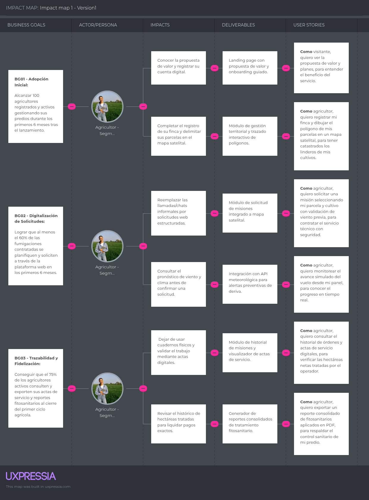
</div>

*Figura: Impact Map del segmento de Pequeños y Medianos Agricultores (PyMAs).* El mapa define tres Business Goals: alcanzar 100 agricultores registrados y activos gestionando sus predios durante los primeros 6 meses tras el lanzamiento (BG01), lograr que al menos el 60 % de las fumigaciones contratadas se planifiquen y soliciten a través de la plataforma en los primeros 6 meses (BG02) y conseguir que el 75 % de los agricultores activos consulten y exporten sus actas de servicio y reportes fitosanitarios al cierre del primer ciclo agrícola (BG03). Para lograrlos, se espera que el agricultor conozca la propuesta de valor y registre su finca y sus parcelas, que reemplace las llamadas y chats informales por solicitudes en la plataforma consultando antes el clima, y que deje los cuadernos físicos para validar el trabajo realizado con registros digitales.

#### Segmento 2: Operadores Técnicos de Drones

<div align="center">
   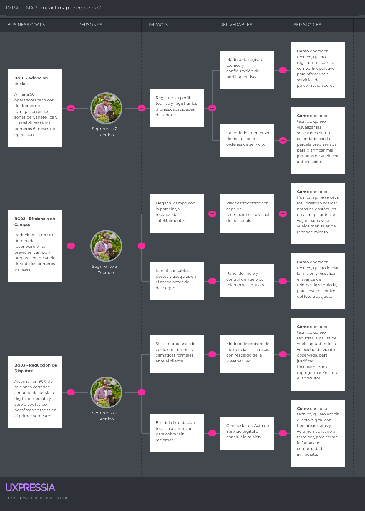
</div>

*Figura: Impact Map del segmento de Operadores Técnicos de Drones.* El mapa define tres Business Goals: afiliar a 50 operadores técnicos de drones de fumigación en las zonas de Cañete, Ica y Huaral durante los primeros 6 meses de operación (BG01), reducir en un 70 % el tiempo de reconocimiento previo en campo y de preparación de vuelo durante los primeros 6 meses (BG02) y alcanzar un 90 % de misiones cerradas con acta de servicio digital y cero disputas por hectáreas tratadas en el primer semestre (BG03). Para lograrlos, se espera que el operador registre su perfil técnico y sus drones, que llegue al campo con la parcela ya reconocida e identifique los obstáculos antes del despegue, y que sustente las pausas de vuelo con datos climáticos y cierre cada servicio con su acta.

---

## 3.3. Product Backlog

El Product Backlog reúne las User Stories y Technical Stories del 3.1, ordenadas según su valor para el negocio y estimadas en Story Points con la escala 1, 2, 3, 5 y 8. Las historias de la Landing Page van primero porque se desarrollan desde el Sprint 1. Luego se ubican las que forman el flujo principal del producto (fincas y parcelas, solicitud y seguimiento de misiones, clima y reportes) junto con las Technical Stories que las soportan, y después las de autenticación, inventario de equipos y las funcionalidades complementarias.

| # Orden | User Story Id | Título | Descripción | Story Points |
|---|---|---|---|---|
| 1 | LP-001 | Visualización de propuesta de valor | Como visitante, quiero visualizar la propuesta de valor de AgriDron Solutions en el portal principal, para entender los beneficios de la gestión de fumigación con drones. | 2 |
| 2 | LP-002 | Consulta de servicios de fumigación | Como visitante, quiero conocer los servicios de precisión ofrecidos, para evaluar si responden a las necesidades de mi producción agrícola. | 2 |
| 3 | LP-003 | Consulta de planes de suscripción | Como visitante, quiero revisar las tarifas y planes disponibles, para seleccionar el esquema comercial adecuado. | 3 |
| 4 | LP-004 | Acceso al registro desde la Landing Page | Como visitante, quiero registrarme en la plataforma proporcionando mis datos básicos, para acceder a las funcionalidades de la Web Application. | 5 |
| 5 | LP-005 | Inicio de sesión desde la Landing Page | Como visitante registrado, quiero iniciar sesión con mis credenciales, para acceder a la Web Application. | 3 |
| 6 | LP-006 | Acceso a términos legales y políticas de privacidad | Como visitante, quiero acceder a los términos y condiciones de servicio, para conocer las políticas de uso y privacidad. | 1 |
| 7 | LP-007 | Cambio de idioma del sitio | Como visitante, quiero cambiar el idioma del sitio entre español e inglés, para navegar en mi idioma preferido. | 5 |
| 8 | LP-008 | Consulta sobre el equipo multidisciplinario | Como visitante, quiero conocer el perfil de los creadores de AgriDron Solutions, para verificar la trayectoria profesional del equipo. | 1 |
| 9 | LP-009 | Solicitud de demostración comercial | Como visitante del segmento Pequeños y Medianos Agricultores (PyMAs), quiero enviar un formulario de contacto, para solicitar una demostración personalizada del servicio. | 2 |
| 10 | LP-010 | Consulta de preguntas frecuentes | Como visitante, quiero revisar la sección de preguntas frecuentes, para resolver dudas sobre la tecnología de drones y normativas. | 1 |
| 11 | FM-001 | Registro de finca agrícola | Como agricultor, quiero registrar las fincas de mi propiedad, para organizar geográficamente mis parcelas. | 5 |
| 12 | FM-002 | Delimitación geográfica de parcela | Como agricultor, quiero trazar los límites poligonales de una parcela sobre el mapa, para definir el área exacta de cultivo. | 8 |
| 13 | FM-004 | Asignación de tipo de cultivo y fenología | Como agricultor, quiero especificar el cultivo y la etapa fenológica de la parcela, para parametrizar las misiones de pulverización. | 2 |
| 14 | FM-003 | Edición de contorno e información de parcela | Como agricultor, quiero modificar los límites y nombre de una parcela registrada, para actualizar cambios en la infraestructura del campo. | 3 |
| 15 | TU-011 | Endpoints de fincas | Como Developer, quiero implementar los endpoints del recurso /api/v1/farms, para que la Web Application registre, consulte, actualice y elimine fincas. | 3 |
| 16 | TU-012 | Endpoints de parcelas | Como Developer, quiero implementar los endpoints del recurso /api/v1/parcels, para que la Web Application registre, consulte, actualice y elimine parcelas. | 3 |
| 17 | TU-013 | Endpoints de cultivos | Como Developer, quiero implementar los endpoints del recurso /api/v1/crops, para que la Web Application registre, consulte, actualice y elimine cultivos. | 2 |
| 18 | TU-014 | Endpoints de zonas de fumigación | Como Developer, quiero implementar los endpoints del recurso /api/v1/fumigation-areas, para que la Web Application registre, consulte, actualice y elimine zonas de fumigación. | 3 |
| 19 | MI-001 | Solicitud de misión de fumigación | Como agricultor, quiero solicitar una misión de fumigación indicando parcela y fecha estimada, para programar la atención de mi cultivo. | 5 |
| 20 | CL-001 | Consulta de condiciones climáticas actuales | Como agricultor, quiero ver la temperatura, humedad y velocidad de viento en mi finca, para evaluar las condiciones antes de la fumigación. | 3 |
| 21 | CL-002 | Alerta por exceso de velocidad de viento | Como operador técnico, quiero ser alertado si el viento supera el límite seguro de aplicación, para evitar la deriva de los productos agroquímicos. | 3 |
| 22 | TU-005 | Integración de cliente de servicio meteorológico | Como Developer, quiero construir un cliente HTTP para consumir una API externa de clima, para abstraer las consultas meteorológicas del dominio principal. | 3 |
| 23 | TU-015 | Endpoint de condiciones meteorológicas | Como Developer, quiero implementar el endpoint de consulta del recurso /api/v1/weather, para que la Web Application muestre las condiciones meteorológicas y sus alertas. | 2 |
| 24 | TU-025 | Endpoints de misiones | Como Developer, quiero implementar los endpoints del recurso /api/v1/missions, para que la Web Application solicite, asigne, configure y actualice el estado de las misiones de fumigación. | 8 |
| 25 | MI-002 | Asignación de dron e insumos a la misión | Como operador técnico, quiero asignar un dron y la cantidad de producto requerida a una misión, para preparar la logística operativa. | 3 |
| 26 | MI-003 | Asignación de operador técnico a la misión | Como operador técnico, quiero asignarme una misión solicitada, para hacerme responsable de su ejecución en campo. | 5 |
| 27 | MI-004 | Configuración de parámetros de vuelo | Como operador técnico, quiero definir la altura de vuelo, velocidad y tasa de pulverización, para asegurar una cobertura homogénea. | 3 |
| 28 | MI-005 | Consulta de calendario de misiones | Como operador técnico, quiero visualizar un calendario con las misiones programadas, para evitar conflictos de agenda y sobreposición de labores. | 3 |
| 29 | MI-007 | Aprobación formal de misión | Como operador técnico, quiero aprobar definitivamente una misión Programada, para autorizar el inicio del despliegue en campo. | 2 |
| 30 | TR-001 | Visualización de posición de dron en tiempo real | Como agricultor, quiero observar la trayectoria del dron sobre el mapa durante la fumigación, para verificar la cobertura del terreno. | 8 |
| 31 | TR-002 | Monitoreo de indicadores de vuelo | Como operador técnico, quiero supervisar el nivel de batería y volumen de tanque en tiempo real, para tomar decisiones operativas durante el vuelo. | 5 |
| 32 | TR-003 | Recepción de alertas operativas en vuelo | Como operador técnico, quiero recibir notificaciones inmediatas ante anomalías de altitud o batería baja, para prevenir accidentes en campo. | 3 |
| 33 | TR-004 | Pausa y reanudación de misión de emergencia | Como operador técnico, quiero registrar la interrupción temporal de un vuelo por imprevisto, para reanudar el trabajo desde el último punto tratado. | 3 |
| 34 | TR-005 | Registro de finalización de misión | Como operador técnico, quiero marcar una misión como completada al finalizar la aplicación, para cerrar la orden de trabajo en campo. | 5 |
| 35 | TR-006 | Bitácora técnica de observaciones en campo | Como operador técnico, quiero adjuntar notas operativas al finalizar el vuelo, para documentar incidencias de viento o vegetación. | 5 |
| 36 | RP-001 | Generación de informe de servicio fitosanitario | Como agricultor, quiero obtener un reporte consolidado tras la misión, para verificar las hectáreas tratadas y el volumen aplicado. | 8 |
| 37 | RP-004 | Historial de misiones con filtros avanzados | Como agricultor, quiero realizar búsquedas en el historial por rango de fechas o parcela, para comparar intervenciones pasadas. | 5 |
| 38 | RP-003 | Visualización de panel con métricas generales | Como operador técnico, quiero ver un tablero de control con el total de hectáreas tratadas y horas de vuelo, para evaluar el rendimiento global. | 3 |
| 39 | RP-002 | Exportación de informes en formato PDF | Como agricultor, quiero descargar el informe de fumigación en archivo PDF, para archivarlo en mis registros de certificación agrícola. | 3 |
| 40 | TU-016 | Endpoint de reportes de misión | Como Developer, quiero implementar el endpoint de consulta del recurso /api/v1/mission-reports, para que la Web Application muestre los reportes de misión. | 1 |
| 41 | TU-017 | Endpoint de historial de misiones | Como Developer, quiero implementar el endpoint de consulta del recurso /api/v1/mission-histories, para que la Web Application muestre el historial de misiones. | 1 |
| 42 | TU-018 | Endpoint de métricas operativas | Como Developer, quiero implementar el endpoint de consulta del recurso /api/v1/operational-metrics, para que la Web Application muestre las métricas operativas de cada reporte. | 1 |
| 43 | TU-019 | Endpoint de indicadores de desempeño | Como Developer, quiero implementar el endpoint de consulta del recurso /api/v1/performance-indicators, para que la Web Application muestre los indicadores de desempeño. | 1 |
| 44 | AU-001 | Registro de usuario agricultor | Como agricultor, quiero registrar una cuenta en la plataforma, para gestionar mis terrenos y solicitar misiones de fumigación. | 3 |
| 45 | AU-002 | Registro de operador técnico | Como operador técnico, quiero registrarme en el sistema, para recibir asignaciones de misiones de vuelo. | 2 |
| 46 | AU-006 | Selección de rol en el registro | Como usuario nuevo, quiero elegir mi rol al registrarme, para acceder a las funciones que me corresponden. | 2 |
| 47 | AU-003 | Inicio de sesión seguro | Como usuario registrado, quiero autenticarme mediante credenciales de acceso, para ingresar a mis funcionalidades personalizadas. | 3 |
| 48 | AU-007 | Cierre de sesión seguro | Como usuario autenticado, quiero finalizar la sesión de trabajo, para proteger la confidencialidad de mis datos. | 1 |
| 49 | TU-024 | Endpoints de usuarios | Como Developer, quiero implementar los endpoints del recurso /api/v1/users, para que la Web Application registre usuarios con su rol. | 2 |
| 50 | TU-026 | Endpoint de inicio de sesión | Como Developer, quiero implementar el endpoint POST /api/v1/authentication/sign-in, para que los usuarios inicien sesión y obtengan un token JWT. | 5 |
| 51 | TU-002 | Implementación de seguridad y autenticación JWT | Como Developer, quiero implementar la autenticación mediante JSON Web Tokens (JWT) en Spring Security, para asegurar que los endpoints de la API RESTful requieran un token válido. | 5 |
| 52 | DR-002 | Consulta del estado operativo de flota | Como operador técnico, quiero visualizar el estado y disponibilidad de los drones, para planificar las asignaciones de trabajo. | 2 |
| 53 | DR-001 | Registro de nuevo dron en inventario | Como operador técnico, quiero dar de alta un dron con sus especificaciones físicas, para integrarlo a la flota utilizable. | 3 |
| 54 | DR-003 | Registro de agroquímicos e insumos | Como operador técnico, quiero registrar los productos agroquímicos autorizados, para controlar las dosis aplicadas en las misiones. | 5 |
| 55 | DR-004 | Registro de tipos de boquillas de asperjar | Como operador técnico, quiero asociar tipos de boquillas a cada dron, para garantizar el tamaño de gota adecuado según el cultivo. | 2 |
| 56 | DR-005 | Programación de mantenimiento preventivo | Como operador técnico, quiero registrar las horas de vuelo y fechas de mantenimiento de un dron, para prevenir fallas operativas. | 3 |
| 57 | DR-006 | Registro de fallas e incidentes de equipo | Como operador técnico, quiero reportar una falla mecánica en un dron, para restringir su uso en misiones hasta su reparación. | 2 |
| 58 | DR-007 | Deshabilitación de dron de la flota | Como operador técnico, quiero dar de baja un dron retirado del servicio, para mantener el inventario actualizado. | 1 |
| 59 | TU-020 | Endpoint de drones | Como Developer, quiero implementar el endpoint de consulta del recurso /api/v1/drones, para que la Web Application muestre la flota de drones. | 1 |
| 60 | TU-021 | Endpoint de boquillas | Como Developer, quiero implementar el endpoint de consulta del recurso /api/v1/nozzles, para que la Web Application muestre las boquillas. | 1 |
| 61 | TU-022 | Endpoint de agroquímicos | Como Developer, quiero implementar el endpoint de consulta del recurso /api/v1/agrochemicals, para que la Web Application muestre los agroquímicos. | 1 |
| 62 | TU-023 | Endpoint de registros de mantenimiento | Como Developer, quiero implementar el endpoint de consulta del recurso /api/v1/maintenance-records, para que la Web Application muestre los mantenimientos de los drones. | 1 |
| 63 | MI-006 | Reprogramación de misión | Como agricultor, quiero solicitar el cambio de fecha de una misión que aún no inicia, para ajustarme a eventualidades del fundo. | 3 |
| 64 | MI-008 | Exportación de plan de vuelo | Como operador técnico, quiero descargar el plan de vuelo parametrizado de la misión, para tenerlo como referencia durante la operación en campo. | 3 |
| 65 | CL-003 | Identificación de ventana óptima de pulverización | Como operador técnico, quiero visualizar una recomendación del mejor horario para fumigar, para optimizar la eficacia de la aplicación fitosanitaria. | 5 |
| 66 | CL-004 | Registro de medición climática manual | Como operador técnico, quiero ingresar mediciones de un anemómetro de campo, para validar la viabilidad cuando el servicio meteorológico no tenga cobertura local. | 2 |
| 67 | CL-005 | Configuración de umbrales meteorológicos por cultivo | Como operador técnico, quiero ajustar los límites de viento y temperatura aceptables por tipo de cultivo, para adaptar las reglas de validación. | 3 |
| 68 | RP-005 | Balance de consumo de productos agroquímicos | Como operador técnico, quiero consultar un reporte de insumos utilizados por finca, para controlar el gasto y stock de agroquímicos. | 3 |
| 69 | RP-006 | Comparativa de eficiencia operativa entre parcelas | Como operador técnico, quiero comparar el tiempo promedio de fumigación por hectárea entre distintas parcelas, para identificar oportunidades de mejora. | 5 |
| 70 | FM-005 | Consulta y filtrado de parcelas | Como agricultor, quiero filtrar mis parcelas por tipo de cultivo o superficie, para ubicar rápidamente terrenos específicos. | 2 |
| 71 | FM-006 | Deshabilitación de parcela agrícola | Como agricultor, quiero inactivar una parcela fuera de producción, para retirarla de la lista de terrenos operativos. | 2 |
| 72 | FM-007 | Cambio de capas en mapa cartográfico | Como agricultor, quiero alternar entre vistas satelital, topográfica e híbrida, para analizar las características del terreno. | 3 |
| 73 | FM-008 | Asignación de operadores técnicos a fincas | Como agricultor, quiero asociar operadores técnicos a fincas específicas, para delegar la gestión de misiones en dichos terrenos. | 5 |
| 74 | AU-004 | Recuperación de contraseña | Como usuario registrado, quiero restablecer mi contraseña mediante correo electrónico, para recuperar el acceso ante un olvido. | 3 |
| 75 | AU-005 | Edición de perfil de usuario | Como usuario registrado, quiero actualizar mis datos de contacto y organización, para mantener la información al día. | 2 |
| 76 | TU-001 | Configuración de arquitectura limpia base | Como Developer, quiero estructurar la solución backend en Spring Boot siguiendo principios de arquitectura limpia, para garantizar la mantenibilidad y modularidad del software. | 5 |
| 77 | TU-006 | Manejo global de excepciones e intercepción de errores | Como Developer, quiero implementar una clase controladora de excepciones globales, para retornar respuestas de error estandarizadas bajo el formato JSON Problem Details. | 2 |
| 78 | TU-007 | Pipeline de integración continua con GitHub Actions | Como Developer, quiero configurar un flujo de integración continua en GitHub Actions, para automatizar la compilación y ejecución de pruebas unitarias en cada push. | 2 |
| 79 | TU-008 | Documentación interactiva de API con OpenAPI/Swagger | Como Developer, quiero integrar la biblioteca Springdoc OpenAPI, para generar automáticamente la documentación interactiva de los endpoints RESTful. | 1 |
| 80 | TU-010 | Configuración de CORS | Como Developer, quiero configurar la política CORS del RESTful API, para que la Web Application pueda consumir sus endpoints desde su propio origen. | 1 |

El Product Backlog se gestiona en Trello, en el siguiente enlace público:

* **Enlace al Product Backlog:** [AgriDron en Trello](https://trello.com/invite/b/6aac1a270d8f45bc33ecd592/ATTIbc784176eb8dc497a26da32a3c554ea69211FF0D/agridron)


*Figura: Product Backlog de AgriDron Solutions en Trello.*

---

# Capítulo IV: Product Design

## 4.1. Style Guidelines

### 4.1.1. General Style Guidelines

<p align="justify">
AgriDron Solutions adopta un sistema de diseño coherente, funcional y optimizado para la gestión de operaciones de fumigación agrícola con drones
y monitoreo de cultivos. En esta sección se establecen los lineamientos de estilo que garantizan la consistencia visual y de interacción en todo el
ecosistema digital, incluyendo la landing page y la aplicación web. Se detallan las decisiones de branding,
paleta de colores, tipografía, espaciado, tono y lenguaje de la plataforma. Se toma como referencia el Design System de Material Design, implementado en la Web Application con Angular Material.
</p>

<p align="justify">
Estos criterios se fundamentan en principios de diseño como jerarquía visual, legibilidad, contraste y feedback inmediato. Asimismo, responden a un
enfoque accesible e intuitivo para que los agricultores y los operadores técnicos de drones puedan interactuar con la plataforma en entornos
de alta exigencia operativa sin sobrecarga cognitiva.
</p>
 
**1. Logo:**
<p align="justify">
El isotipo y logotipo de AgriDron Solutions representan la convergencia entre la tecnología de precisión y la naturaleza agrícola.
El símbolo gráfico combina hojas estilizadas que aluden al campo y a los cultivos con una disposición simétrica que simula la estructura
y rotación de los hélices de un dron agrícola. Acompañado de la tipografía de marca, transmite innovación, orden y profesionalismo
tecnológico aplicado al sector agropecuario.
</p>


*Figura: Isotipo y logotipo de AgriDron Solutions.*

**2. Branding:**

AgriDron Solutions busca proyectar una identidad visual profesional, confiable, innovadora, cercana y sostenible. La marca combina
la eficiencia tecnológica de los drones con la calidez y el valor humano del trabajo en el campo.

El branding de AgriDron se fundamenta en los siguientes conceptos clave:
- **Arquetipo de Marca:** El Experto / El Creador, posicionando a AgriDron como un socio tecnológico confiable que empodera a los productores agrícolas mediante herramientas de precisión.
- **Precisión:** Reflejada en interfaces ordenadas, grids estructurados, bordes definidos y líneas limpias para la visualización de mapas y datos telemétricos.
- **Confianza:** Proyectada mediante colores sobrios, tipografías claras y la presentación segura de métricas de salud de cultivos, consumo de insumos y reportes.
- **Innovación:** Transmitida a través de componentes dinámicos e indicadores visuales destacados para estados en tiempo real y alertas de misiones.
- **Sostenibilidad y Cercanía:** Inspiradas en una paleta orgánica y el uso de imágenes reales de campo, conectando la tecnología directamente con la realidad del agricultor.

**3. Typography:**

El sistema tipográfico de AgriDron emplea dos familias de fuentes, una para cada producto, que equilibran la fuerza de marca con la legibilidad en pantalla:

- **Montserrat (Landing Page):** se utiliza en títulos, párrafos y botones de la Landing Page, con Segoe UI como fuente alternativa. Sus pesos de 400 a 900 permiten jerarquizar títulos y textos con una sola familia.
- **Roboto (Web Application):** es la tipografía de Material Design que aplica Angular Material en toda la Web Application. Se usa con los pesos 300, 400 y 500 en títulos, formularios, tablas y botones, y garantiza claridad en la consulta de datos operativos.

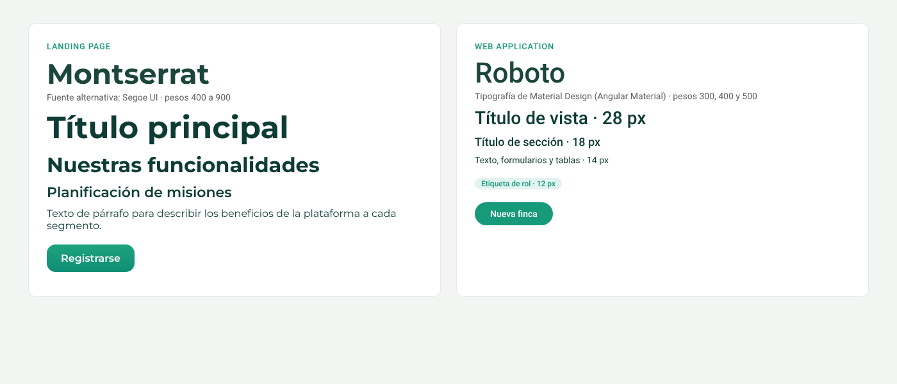

*Figura: Tipografías de AgriDron Solutions.* Montserrat se aplica en la Landing Page y Roboto en la Web Application, con la jerarquía de títulos, textos, etiquetas y botones de cada producto.

**4. Colors:**

La paleta de colores de AgriDron está inspirada en la naturaleza y el sector agrícola, complementada con colores de estado y de alerta de alto contraste:

- **Verde Bosque / Primario (#1B463C):** transmite sostenibilidad y confianza agrícola. Se utiliza en la barra lateral de navegación, el pie de página y los títulos de la Web Application.
- **Verde Teal / Secundario (#179A7A):** aporta dinamismo. Se usa en los botones principales, la opción activa de la navegación y los íconos de métricas.
- **Verdes de la Landing Page (#1DA27E a #0F8E74 y texto #0D3C35):** se aplican en los botones con degradado y en los textos de la Landing Page.
- **Colores de estado de la misión:** verde #4CAF50 (Completada), azul #42A5F5 (En curso), naranja #FFA726 (Programada o Autorizada) y rojo #EF5350 (En pausa o Cancelada).
- **Colores de alerta meteorológica:** azul #1E3A8A (severidad baja), ámbar #B45309 (severidad media) y rojo #B91C1C (severidad alta), cada uno sobre un fondo tenue.
- **Neutros y error:** blanco #FFFFFF y gris claro #F3F5F2 para fondos y tarjetas, y rojo #B3261E para los mensajes de error.

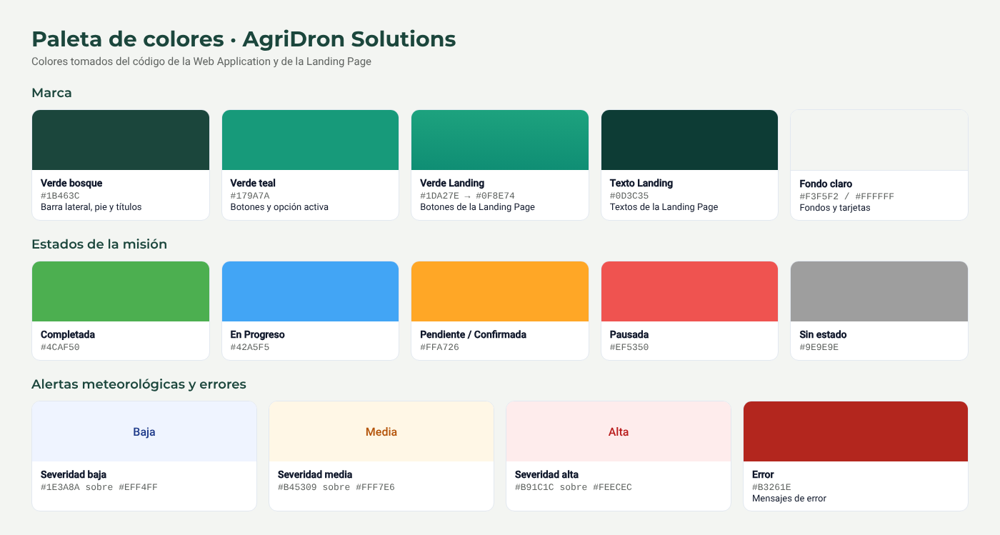

*Figura: Paleta de colores de AgriDron Solutions.* Agrupa los colores de marca, los colores de estado de la misión y los colores de las alertas meteorológicas y de error.

**5. Spacing:**

El sistema de espaciado adopta una escala base basada en múltiplos de 8 px (8px, 16px, 24px, 32px). Este patrón asegura un diseño estructurado y modular que
facilita la lectura fluida de mapas, parcelas y paneles de control, permitiendo además una fácil adaptación responsive a tablets y dispositivos móviles.

**6. Tone:**

El tono de comunicación de AgriDron es profesional, confiable, claro, transparente y accesible. Debido a que los usuarios interactúan con datos de salud
de cultivos, mapas de parcelas y programación de fumigación, el tono debe brindar seguridad y control técnico sin resultar excesivamente complejo o burocrático.   
AgriDron busca transmitir:

- **Seguridad y Control:** al presentar métricas de avance de misión, niveles de batería e insumos.   
- **Claridad y Eficiencia:** al guiar al agricultor paso a paso en la planificación de una fumigación.   
- **Cercanía:** al usar terminología conocida por el productor agrícola (finca, parcela, cultivo, insumo).

Según las dimensiones del tono de comunicación, AgriDron se ubica en:

- **Serio** (frente a Divertido): la plataforma gestiona operaciones con agroquímicos, clima y costos, por lo que transmite seguridad.
- **Formal** (frente a Casual): usa un lenguaje profesional, sin tecnicismos innecesarios.
- **Respetuoso** (frente a Irreverente): trata al agricultor y al operador técnico como expertos en su trabajo.
- **Sereno** (frente a Entusiasta): presenta alertas y estados de forma clara y calmada, sin alarmar.

**7. Language:**

El lenguaje del sistema será directo, breve y orientado a la acción. El idioma principal de la interfaz es el español, adaptado al entorno agrícola latinoamericano, con soporte para inglés.

Se priorizan etiquetas cortas y verbos de acción que reducen la carga cognitiva, como en la Web Application: Nueva finca, Nueva parcela, Ver más, Editar, Eliminar y Volver. El cambio de idioma se realiza desde un selector en la barra superior.

### 4.1.2. Web Style Guidelines

Las Web Style Guidelines de AgriDron Solutions establecen los criterios visuales y de interacción que guían el diseño de la Landing Page y la Web Application. Estas pautas aseguran consistencia entre dispositivos, favorecen la legibilidad y permiten que tanto agricultores como operadores técnicos naveguen de forma intuitiva por la plataforma.

**Estructura general**

AgriDron Solutions adopta un enfoque responsive web design, de modo que la interfaz se adapte a desktop, tablet y mobile web sin perder claridad ni coherencia visual.

- **Web Application:** la navegación se organiza con una barra lateral en verde bosque y una barra superior con el botón de menú, el nombre AgriDron y el selector de idioma. La barra lateral da acceso a Inicio, Fincas, Parcelas, Cultivos, Zonas de fumigación, Misiones, Reportes, Drones y Perfil. Las fincas, parcelas y drones se presentan en cuadrículas de tarjetas que se reacomodan según el ancho disponible.
- **Landing Page:** un menú superior lleva a las secciones Inicio, Funcionalidades, Cómo funciona, Para quién y Nuestro equipo, y los botones de acción dirigen al registro y al inicio de sesión.

**Breakpoints**

- **Web Application:** hasta 959 px la barra lateral se oculta y se abre como panel desplegable desde el botón de menú. Desde 960 px la barra lateral permanece fija.
- **Landing Page:** el diseño se reorganiza en 1024 px, donde el Hero pasa a una sola columna y los botones de acción se acomodan en varias filas.

**Componentes básicos de UI**

- **Botones primarios:** en la Web Application son botones de Angular Material con fondo verde teal #179A7A y texto blanco, como Nueva finca o Crear. En la Landing Page usan un degradado verde (#1DA27E a #0F8E74) con bordes redondeados de 12 px a 14 px.
- **Botones secundarios:** botones de Angular Material con borde o solo texto, para acciones como Volver, Ver más o Editar.
- **Campos de formulario:** campos de Angular Material con estilo outlined. Si un dato obligatorio falta, el campo se marca en rojo #B3261E y muestra el mensaje de validación debajo, por ejemplo "El área es obligatoria".
- **Cards:** tarjetas de Angular Material con esquinas redondeadas de 12 px, usadas para fincas, parcelas, drones, métricas y el clima.
- **Tablas:** tablas de Angular Material en los reportes, con el estado de cada misión en etiquetas de color.
- **Etiquetas de estado:** etiquetas redondeadas con el color de cada estado de la misión y de cada severidad de alerta meteorológica.

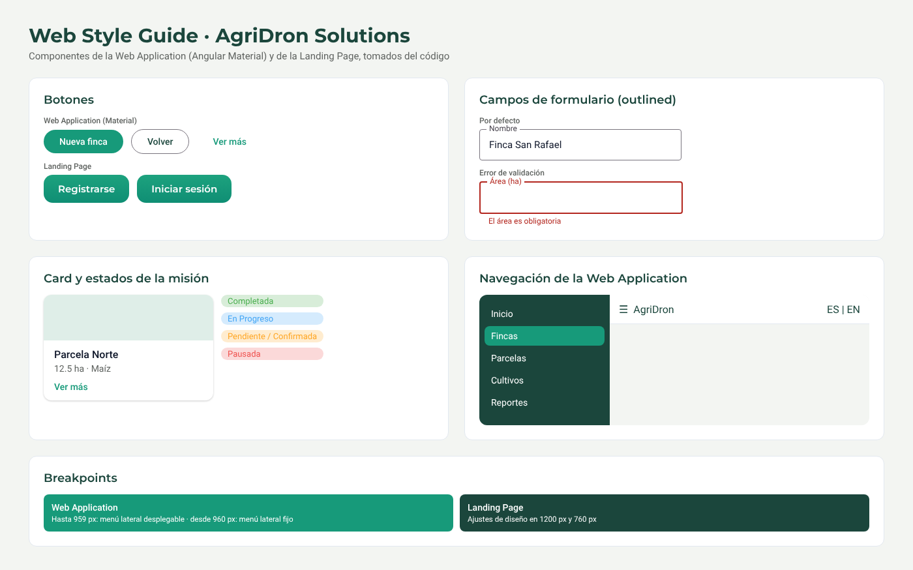

*Figura: Web Style Guide de AgriDron Solutions.* Ilustra los botones de la Web Application y de la Landing Page, los campos de formulario en estado por defecto y con error de validación, una tarjeta con las etiquetas de estado de la misión, la navegación de la Web Application y los breakpoints de cada producto.

**Tipografía en web**

- **Web Application (Roboto):** títulos de vista de 28 px, títulos de sección de 18 px, texto de formularios y tablas de 14 px, y etiquetas de 12 px.
- **Landing Page (Montserrat):** títulos principales en pesos 700 a 900, subtítulos en peso 600 y párrafos en peso 400.

**Interacción**

- **Hover:** las opciones de la barra lateral cambian su fondo al pasar el cursor.
- **Estado activo:** la opción de navegación de la vista actual se resalta en verde teal #179A7A.
- **Focus:** los componentes de Angular Material muestran un estado de foco visible, que favorece la navegación por teclado.
- **Feedback visual:** los estados de la misión y las alertas meteorológicas se distinguen por color y por texto, y los errores de formulario se muestran junto al campo.
- **Transiciones:** los cambios de color en la navegación usan transiciones breves de 0.2 segundos.

### 4.1.3. Mobile Style Guidelines

Las Mobile Style Guidelines de AgriDron Solutions adaptan la experiencia a pantallas reducidas, desde el navegador del celular, sin perder funcionalidad ni consistencia con la propuesta general del producto.

**Estructura general**

- La barra lateral de la Web Application se oculta y se abre desde el botón de menú de la barra superior.
- Las cuadrículas de tarjetas pasan a una sola columna, con el contenido apilado verticalmente.
- El detalle del dron reorganiza su contenido en una sola columna desde 700 px, y el widget de clima reduce el tamaño de la temperatura en pantallas pequeñas.
- La Landing Page apila el Hero en una sola columna desde 1024 px.

**Componentes básicos en mobile**

- Los botones, campos y tarjetas son los mismos de la versión web, con el ancho completo de la pantalla.
- Los botones de Angular Material mantienen un área táctil suficiente para la interacción en campo.
- Las etiquetas de estado conservan el mismo color y texto que en la versión web.

**Tipografía en mobile**

Se mantienen Roboto en la Web Application y Montserrat en la Landing Page. En la Landing Page, el título principal se reduce en pantallas pequeñas para conservar la legibilidad.

**Interacción en mobile**

- La navegación se abre y se cierra desde el botón de menú, y el panel lateral se superpone al contenido.
- El selector de idioma permanece visible en la barra superior.
- Los mensajes de error y los estados se muestran igual que en la versión web.

---

## 4.2. Information Architecture

La arquitectura de información de AgriDron Solutions organiza el contenido para los dos segmentos del proyecto, Pequeños y Medianos Agricultores (PyMAs) y Operadores Técnicos de Drones, de modo que puedan localizar información y ejecutar tareas de forma rápida y consistente. Abarca la Landing Page, orientada a presentar el producto y conducir al visitante hacia una acción concreta, y la Web Application, orientada a la gestión de fincas, parcelas, cultivos, zonas de fumigación, drones, misiones y reportes.

La sección describe la estructura actual de ambos productos y los elementos ya comprometidos en el Product Backlog que aún no están implementados: en la Landing Page, las secciones de planes (LP-003) y preguntas frecuentes (LP-010), los términos legales (LP-006), las páginas de inicio de sesión y de solicitud de demostración (LP-005 y LP-009) y el acceso al registro de la Web Application (LP-004), y en la Web Application, el módulo de Misiones con su calendario y el monitoreo de la misión en curso (MI y TR), los mapas de parcelas (FM-007) y los filtros adicionales de parcelas e historial (FM-005 y RP-004).

### 4.2.1. Organization Systems

**Organization Systems in the Landing Page**

La Landing Page organiza la información de forma jerárquica y secuencial. La jerarquía visual destaca primero la propuesta de valor y los llamados a la acción, y la secuencia guía al visitante desde lo que ofrece el producto hasta cómo empezar a usarlo. El recorrido de la página es el siguiente:

- Inicio (Hero): propuesta de valor "Revoluciona la salud de tus cultivos con precisión automatizada" y los botones Empieza tu prueba gratuita y Ver cómo funciona.
- Nuestras funcionalidades: Planificación de misiones, Monitoreo en tiempo real y Consulta las condiciones climáticas.
- Cómo funciona: secuencia de cuatro pasos (Planifica, Consulta el clima, Ejecuta y Analiza).
- Para quién: tarjetas por segmento de usuario.
- Disponible en: dispositivos desde los que se puede usar la plataforma (iPhone, Mac, Android y Windows).
- Planes y Preguntas frecuentes: secciones comprometidas en LP-003 y LP-010.
- Nuestro equipo: integrantes del equipo de desarrollo.
- Footer: enlaces a las secciones, datos de contacto, redes sociales y términos legales (LP-006).

**Organization Systems in the Web Application**

La Web Application organiza la información según el tipo de tarea:

- Por tópicos: el menú lateral agrupa las funcionalidades en módulos (Inicio, Fincas, Parcelas, Cultivos, Zonas de fumigación, Misiones, Reportes, Drones y Perfil).
- Jerárquica: la vista Inicio presenta primero el saludo y el resumen de la operación, luego los Indicadores y el estado del clima, y al final los Accesos rápidos. Los datos dependen entre sí en el orden Finca, Parcela y Zona de fumigación.
- Cronológica: el historial de misiones, el uso de insumos por fecha, el calendario de misiones (MI-005) y el próximo mantenimiento de cada dron.
- Matricial: las tablas de Reportes, donde el usuario compara varios atributos de cada misión al mismo tiempo.

**Organización visual del contenido**

| Tipo de organización | Aplicación en AgriDron Solutions                                                                     | Justificación                                                                                       |
|:---------------------|:-----------------------------------------------------------------------------------------------------|:----------------------------------------------------------------------------------------------------|
| **Jerárquica**       | Hero de la Landing Page, vista Inicio de la Web Application y relación Finca, Parcela y Zona de fumigación. | Destaca primero la información principal y refleja la dependencia real entre los datos del campo.   |
| **Secuencial**       | Sección Cómo funciona, registro de usuario y solicitud de misión (MI-001).                            | Guía al usuario paso a paso en las tareas que tienen un orden fijo.                                 |
| **Matricial**        | Pestañas Misiones (ID, Fecha, Estado, Área) y Uso de insumos (Misión, Tipo, Fecha, Área, Volumen, L/ha) de Reportes. | Permite comparar varios atributos de cada misión en una sola vista.                                 |

**Esquemas de categorización**

| Tipo de esquema   | Aplicación en AgriDron Solutions                                                                      | Justificación                                                                    |
|:------------------|:------------------------------------------------------------------------------------------------------|:---------------------------------------------------------------------------------|
| **Por tópicos**   | Módulos del menú lateral de la Web Application y secciones de la Landing Page.                         | Agrupa el contenido según la tarea que el usuario busca realizar.                |
| **Cronológico**   | Historial de misiones, uso de insumos, calendario de misiones y mantenimientos de drones.              | Facilita el seguimiento de las aplicaciones y del estado de los equipos en el tiempo. |
| **Por audiencia** | Sección Para quién de la Landing Page y selección de rol (agricultor u operador técnico) en el registro. | Permite que cada segmento identifique cómo lo ayuda la plataforma.                |

**Esquemas no priorizados**

AgriDron Solutions no usa el esquema alfabético como estructura principal, porque el usuario localiza la información por finca, parcela, fecha o estado, y no por el nombre del registro.

**Secciones principales de la Web Application**

| Sección                 | Descripción                                                                                                   |
|:------------------------|:--------------------------------------------------------------------------------------------------------------|
| **Inicio**              | Saludo, resumen de la operación agrícola, Indicadores (fincas, parcelas, cultivos y zonas de fumigación), estado del clima y Accesos rápidos. |
| **Fincas**              | Registro, edición y eliminación de fincas con su nombre y ubicación.                                          |
| **Parcelas**            | Registro, edición, eliminación y detalle de parcelas por finca, con área, cultivo y geometría.                |
| **Cultivos**            | Registro, edición y eliminación de cultivos con su nombre y variedad.                                         |
| **Zonas de fumigación** | Registro, edición y eliminación de zonas de fumigación por parcela, con área y geometría.                      |
| **Misiones**            | Solicitud, programación y calendario de misiones, y monitoreo de la misión en curso (MI y TR).                |
| **Reportes**            | Reportes e Historial, con las pestañas Misiones, Uso de insumos e Indicadores, y el detalle de cada reporte.  |
| **Drones**              | Flota de drones con estado, batería, boquilla, agroquímicos compatibles, próximo servicio y mantenimientos.   |
| **Perfil**              | Datos de la cuenta activa (usuario, correo electrónico y rol asignado) y cierre de sesión.                     |

### 4.2.2. Labeling Systems

El sistema de etiquetado usa términos breves y familiares para el contexto agrícola y de operación de drones. Cada concepto se nombra siempre igual en toda la plataforma, y las acciones usan verbos que indican lo que ocurrirá. La Web Application presenta todas sus etiquetas en español e inglés.

**Labeling in the Landing Page**

- Barra de navegación: Inicio, Funcionalidades, Cómo Funciona, Para Quién, Nuestro Equipo, Solicitar Demo y selector de idioma (ES y EN).
- Botones del Hero: Empieza tu prueba gratuita y Ver cómo funciona.
- Secciones: Nuestras funcionalidades, Cómo funciona, Para quién, Disponible en iPhone, Mac, Android y Windows, Planes, Preguntas frecuentes y Nuestro equipo.
- Footer: Enlaces, Contacto, Redes sociales y términos legales.
- Páginas de acceso (LP-005 y LP-009): Inicia sesión (Correo electrónico, Contraseña y Entrar) y Solicita una demo (Nombre completo, Empresa, Correo electrónico, Teléfono y Solicitar acceso).

**Labeling in the Web Application**

- Menú lateral: Inicio, Fincas, Parcelas, Cultivos, Zonas de fumigación, Misiones, Reportes, Drones y Perfil.
- Barra superior: botón de menú, nombre AgriDron y selector de idioma.
- Botones de acción: Nueva finca, Nueva parcela, Nuevo cultivo, Nueva zona de fumigación, Crear, Actualizar, Editar, Eliminar, Ver más, Ver detalles, Ver mantenimientos, Filtrar, Limpiar, Descargar reporte, Exportar JSON y Exportar CSV.
- Formularios: Nombre, Ubicación, Área (ha), Área (m²), Geometría (GeoJSON), Finca, Parcela, Cultivo, Variedad, Nombre de usuario, Correo electrónico, Contraseña y Rol en el sistema.
- Estados de dron: Disponible, En vuelo, Mantenimiento y Fuera de servicio.
- Estados de misión: Programada, Autorizada, En curso, En pausa, Completada y Cancelada.
- Niveles de alerta climática: Alto, Medio y Bajo.

**Etiquetas principales del sistema**

| Etiqueta                | Lugar de uso                              | Descripción                                                                    |
|:------------------------|:------------------------------------------|:-------------------------------------------------------------------------------|
| **Solicitar Demo**      | Barra de navegación de la Landing Page    | Lleva al visitante a solicitar una demostración del servicio.                  |
| **Iniciar Sesión**      | Landing Page y Web Application            | Permite ingresar con una cuenta existente.                                     |
| **Crear Cuenta**        | Registro de la Web Application            | Permite registrarse como agricultor u operador técnico.                        |
| **Inicio**              | Menú lateral                              | Vista inicial con el resumen de la operación, los indicadores y el clima.      |
| **Fincas / Parcelas**   | Menú lateral, títulos y formularios       | Módulos para registrar y administrar los terrenos agrícolas.                   |
| **Zonas de fumigación** | Menú lateral, títulos y formularios       | Módulo para definir las áreas de cada parcela que serán fumigadas.             |
| **Misiones**            | Menú lateral                              | Módulo para solicitar, programar y monitorear las misiones de fumigación.      |
| **Reportes**            | Menú lateral y Accesos rápidos            | Módulo de historial de misiones, uso de insumos e indicadores.                 |
| **Drones**              | Menú lateral y Accesos rápidos            | Módulo de gestión de la flota de drones y sus mantenimientos.                  |
| **Estado del clima**    | Vista Inicio                              | Condiciones actuales por ubicación y alertas con su nivel.                     |
| **Cerrar Sesión**       | Perfil                                    | Acción para salir de la cuenta activa.                                         |

### 4.2.3. SEO Tags and Meta Tags

Las etiquetas SEO y Meta Tags se definen para las páginas principales de la Landing Page y de la Web Application. Los valores siguientes son los que se asignarán a cada página. En la Landing Page mejoran la visibilidad del producto en buscadores, y en la Web Application, que es privada, identifican cada vista en la pestaña del navegador.

**Landing Page: Inicio**

- Title: AgriDron Solutions | Smart drone spraying and crop management
- Meta Description: Plan drone spraying missions, check weather conditions, and manage farms and parcels from one platform designed for farmers and drone operators.
- Meta Keywords: agricultural drone spraying, precision agriculture, parcel management, crop spraying, agritech software
- Meta Author: AgriDron Solutions

**Landing Page: Iniciar sesión**

- Title: Iniciar sesión | AgriDron Solutions
- Meta Description: Sign in to your AgriDron Solutions account to manage farms, parcels, spraying missions, and reports.
- Meta Keywords: agridron login, agritech platform access, farmer login, drone operator login
- Meta Author: AgriDron Solutions

**Landing Page: Solicitud de demo**

- Title: Solicitud de demo | AgriDron Solutions
- Meta Description: Request a personalized demo of AgriDron Solutions and see how drone spraying can be planned and monitored for your crops.
- Meta Keywords: agridron demo, drone spraying demo, precision agriculture demo, agritech request
- Meta Author: AgriDron Solutions

**Web Application: Inicio**

- Title: Inicio | AgriDron Solutions
- Meta Description: Review a summary of your agricultural operation, key indicators, and current weather conditions.
- Meta Keywords: farm operations summary, agricultural indicators, weather conditions, agritech dashboard
- Meta Author: AgriDron Solutions

**Web Application: Fincas y Parcelas**

- Title: Fincas y Parcelas | AgriDron Solutions
- Meta Description: Register and manage your farms, parcels, crops, and fumigation areas in one place.
- Meta Keywords: farm management, parcel management, crop registry, fumigation areas
- Meta Author: AgriDron Solutions

**Web Application: Misiones**

- Title: Misiones | AgriDron Solutions
- Meta Description: Request, schedule, and monitor drone spraying missions for your parcels.
- Meta Keywords: drone spraying missions, mission scheduling, mission monitoring, crop spraying software
- Meta Author: AgriDron Solutions

**Web Application: Reportes**

- Title: Reportes | AgriDron Solutions
- Meta Description: Review mission history, supply usage, and performance indicators of your spraying operations.
- Meta Keywords: mission history, supply usage report, performance indicators, spraying reports
- Meta Author: AgriDron Solutions

**Web Application: Drones**

- Title: Drones | AgriDron Solutions
- Meta Description: Check the status, battery, nozzle, and maintenance schedule of your drone fleet.
- Meta Keywords: drone fleet management, drone maintenance, agricultural drones, drone status
- Meta Author: AgriDron Solutions

### 4.2.4. Searching Systems

**Searching in the Web Application**

La Web Application no usa un buscador de texto. El usuario localiza la información mediante filtros ubicados en la parte superior de cada vista.

| Filtro                          | Ubicación                                  | Descripción                                                                                         |
|:--------------------------------|:-------------------------------------------|:----------------------------------------------------------------------------------------------------|
| **Seleccionar finca**           | Parcelas                                   | Muestra solo las parcelas de la finca elegida.                                                       |
| **Seleccionar parcela**         | Zonas de fumigación                        | Muestra solo las zonas de fumigación de la parcela elegida.                                         |
| **Desde / Hasta**               | Reportes, pestañas Misiones y Uso de insumos | Limita los registros a un rango de fechas con los botones Filtrar y Limpiar.                        |
| **Pestañas de Reportes**        | Reportes                                   | Separan los resultados en Misiones, Uso de insumos e Indicadores.                                    |
| **Cultivo o superficie**        | Parcelas                                   | Muestra solo las parcelas que cumplen el criterio elegido (FM-005).                                  |
| **Rango de fechas y parcela**   | Reportes, historial de misiones            | Muestra las misiones ejecutadas en una parcela durante un periodo (RP-004).                          |
| **Periodo semanal o mensual**   | Misiones, calendario                       | Muestra las misiones programadas en el periodo elegido con sus estados (MI-005).                     |

**Visualización de resultados**

- Fincas: tarjetas con nombre, ubicación y número de parcelas.
- Parcelas: tarjetas con nombre, cultivo, área en hectáreas y finca asociada, con acceso al detalle.
- Cultivos y zonas de fumigación: tarjetas con sus datos principales.
- Drones: tarjetas con modelo, número de serie, estado, batería, boquilla, agroquímicos compatibles y próximo servicio.
- Reportes: tablas con las columnas ID, Fecha, Estado y Área (ha) en Misiones, y Misión, Tipo, Fecha, Área (ha), Volumen (L) y L/ha en Uso de insumos. Los Indicadores se muestran en tarjetas.

**Comportamiento de los resultados**

- Mientras se cargan los datos, la vista muestra un mensaje de carga, como "Cargando parcelas...".
- Antes de elegir un filtro obligatorio, la vista indica qué debe seleccionar, como "Seleccione una finca para ver sus parcelas".
- Cuando no hay coincidencias, la vista lo indica con mensajes como "No hay parcelas registradas" o "No se encontraron registros.".

**Searching in the Landing Page**

La Landing Page no tiene buscador. El visitante llega a la información mediante los enlaces de la barra de navegación, que llevan a cada sección de la misma página.

### 4.2.5. Navigation Systems

**Navigation in the Landing Page**

| Elemento                  | Descripción                                                                                                                          |
|:--------------------------|:-------------------------------------------------------------------------------------------------------------------------------------|
| **Barra de navegación**   | Enlaces a las secciones de la página (Inicio, Funcionalidades, Cómo Funciona, Para Quién y Nuestro Equipo) y botón Solicitar Demo.   |
| **Enlaces de sección**    | Cada enlace desplaza la página hasta su sección (`#features`, `#how-it-works`, `#audiences`, `#available` y `#team-section`).          |
| **Selector de idioma**    | Cambia el contenido de la página entre español e inglés (LP-007).                                                                    |
| **Solicitar Demo**        | Lleva al formulario Solicita una demo (LP-009).                                   |
| **CTAs del Hero**         | Empieza tu prueba gratuita lleva al registro de la Web Application (LP-004) y Ver cómo funciona lleva a la sección Cómo funciona.     |
| **Footer**                | Repite los enlaces de las secciones y muestra los datos de contacto, las redes sociales y los términos legales (LP-006).             |

**Navigation in the Web Application**

| Elemento                 | Descripción                                                                                                                                     |
|:-------------------------|:------------------------------------------------------------------------------------------------------------------------------------------------|
| **Menú lateral**         | Acceso a todos los módulos, con ícono y etiqueta. El módulo activo se resalta. En pantallas menores a 960 px se oculta y se abre con el botón de menú. |
| **Barra superior**       | Botón de menú, nombre AgriDron y selector de idioma.                                                                                            |
| **Inicio como entrada**  | Tras iniciar sesión o registrarse, el usuario llega a Inicio. Desde ahí accede a Ver fincas, Ver reportes y los Accesos rápidos a cada módulo.   |
| **Botones contextuales** | Cada listado tiene su botón de creación (Nueva finca, Nueva parcela y otros) y cada tarjeta sus acciones (Ver más, Editar y Eliminar).          |
| **Vistas de detalle**    | El detalle de parcela, de reporte y de dron tiene un botón para volver al listado (Volver, Volver a reportes y Volver a drones).                 |
| **Acceso y registro**    | Iniciar Sesión y Crear Cuenta se enlazan entre sí. Al cerrar sesión desde Perfil, el usuario vuelve a Iniciar Sesión.                           |
| **Página no encontrada** | Una ruta inválida muestra un mensaje y el botón Ir a Inicio.                                                                                    |

**Recorridos principales de navegación**

- Visitante: Landing Page, Empieza tu prueba gratuita, Crear Cuenta, Inicio.
- Agricultor: Inicio, Fincas, Nueva finca, Parcelas, Nueva parcela, Zonas de fumigación.
- Agricultor: Inicio, Misiones, solicitud de misión con parcela y fecha (MI-001).
- Operador técnico: Inicio, Misiones, calendario de misiones, monitoreo de la misión en curso (MI-005 y TR).
- Operador técnico: Inicio, Drones, Ver detalles, Ver mantenimientos.
- Agricultor u operador técnico: Inicio, Reportes, Desde / Hasta, Filtrar, Ver detalle, Descargar reporte.

## 4.3. Landing Page UI Design

La propuesta de UI de la Landing Page de AgriDron Solutions traduce las decisiones previas de identidad visual, estilo y arquitectura de información en una experiencia clara, persuasiva y orientada a la conversión. Su objetivo principal es presentar la propuesta de valor del producto, explicar de manera rápida cómo ayuda a los agricultores y a los operadores técnicos de drones, y conducir al visitante hacia una acción concreta, como registrarse, iniciar sesión, solicitar una demostración o explorar el funcionamiento de la plataforma de fumigación de precisión.

El diseño de la Landing Page se estructura en bloques progresivos que responden a una lógica de descubrimiento: primero captar la atención con una promesa clara de optimización agrícola, luego mostrar las funcionalidades clave (planificación de misiones, monitoreo en tiempo real y consulta de las condiciones climáticas) y los cuatro pasos de funcionamiento, reforzar la confianza mediante componentes visuales del sistema y un equipo transparente, y finalmente cerrar con llamadas a la acción claras. Esta organización permite que el usuario entienda qué resuelve AgriDron Solutions, cómo funciona y por qué debería utilizarlo, sin tener que navegar por una interfaz compleja ni enfrentarse a una sobrecarga de información.

A nivel visual, la interfaz aprovecha la paleta cromática definida para la marca, con predominio del degradado verde de los botones (#1DA27E a #0F8E74), el verde oscuro de los textos (#0D3C35) y tonos neutros, para transmitir sostenibilidad agrícola, precisión tecnológica, innovación y confianza profesional. La jerarquía visual se apoya en titulares fuertes en tipografía Montserrat, botones de acción (CTAs) altamente visibles, tarjetas informativas modulares con bordes suavizados y bloques claramente diferenciados por un sistema de espaciado basado en 8 px, logrando que el recorrido visual sea intuitivo, accesible y consistente tanto en pantallas de escritorio como en dispositivos móviles de campo.

### 4.3.1. Landing Page Wireframe

Los wireframes de la Landing Page de AgriDron Solutions representan la fase inicial de estructuración de la experiencia pública de la plataforma web. En ellos se define la jerarquía visual, la distribución de los bloques informativos y el orden en que el visitante descubre la propuesta de valor de la fumigación automatizada con drones antes de aplicar el estilo visual definitivo. Esta etapa permitió validar que el mensaje principal sobre agricultura de precisión estuviera visible en los primeros segundos y que la secuencia del contenido guiara al usuario de forma progresiva hacia la conversión.

**Desktop**

En la versión desktop, el wireframe organiza la información en un recorrido secuencial de pantalla completa:

- Hero Section: Cabecera con el titular principal ("Revoluciona la salud de tus cultivos con precisión automatizada"), subtítulo explicativo, botones de acción (Empieza tu prueba gratuita y Ver cómo funciona), con el botón Solicitar Demo en la barra de navegación, y un elemento gráfico de soporte.
- Nuestras funcionalidades: Tarjetas horizontales dedicadas a los pilares tecnológicos del producto (Planificación de misiones, Monitoreo en tiempo real y Consulta las condiciones climáticas).
- Cómo funciona: Diagrama de proceso en 4 pasos (1. Planifica, 2. Consulta el clima, 3. Ejecuta, 4. Analiza) que explica el flujo de trabajo en campo.
- Para quién: Bloque de tarjetas por segmento de usuario (Agricultores y Operadores), especificando el valor que aporta la plataforma a cada usuario.
- Nuestro equipo: Sección de respaldo con los perfiles del equipo multidisciplinario detrás de la solución.
- Footer: Pie de página con enlaces de navegación interna, datos de contacto, ubicación y canales de redes sociales.

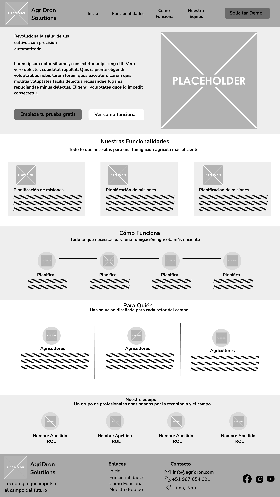

*Figura: Wireframe Desktop de la Landing Page.* El wireframe usa escala de grises, marcadores de imagen y líneas de texto de relleno para centrar la revisión en la estructura y no en el estilo. La jerarquía se marca con el tamaño de los títulos, las secciones se separan con fondos alternos y el contenido repetido (funcionalidades, pasos, segmentos y equipo) se ordena en columnas del mismo ancho.

**Mobile**

En la versión mobile, el wireframe conserva las mismas secciones y su orden, y las reorganiza en una sola columna. La barra de navegación se reduce a un botón de menú y al nombre AgriDron Solutions, los botones del Hero ocupan todo el ancho de la pantalla, las tarjetas de funcionalidades y de segmentos se apilan una debajo de otra y los cuatro pasos de Cómo funciona se presentan en vertical, unidos por flechas.

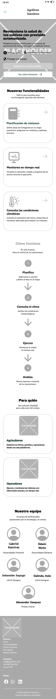

*Figura: Wireframe Mobile de la Landing Page.* La disposición en una sola columna evita el desplazamiento horizontal, los botones de ancho completo facilitan el uso con una mano y los textos se mantienen cortos para leerse en pantallas pequeñas, lo que apoya el uso desde el celular en campo.

### 4.3.2. Landing Page Mock-up

Los mock-ups finales de la Landing Page de AgriDron Solutions representan la consolidación visual de la arquitectura y estructura planteadas en los wireframes. En esta etapa de alta fidelidad se integran la paleta cromática institucional (con predominio del degradado verde #1DA27E a #0F8E74 y el texto #0D3C35), la familia tipográfica Montserrat, la escala de espaciado modular basada en 8 px, la iconografía agrícola/tecnológica y los estándares de accesibilidad visual (WCAG 2.1 AA). El resultado es una interfaz pública coherente, moderna y persuasiva, alineada con la propuesta de valor de la agricultura de precisión y la fumigación con drones.

**Desktop**

En el mock-up desktop se evidencia una jerarquía visual clara, reforzada mediante el uso del verde oscuro #0D3C35 en títulos y textos y el degradado verde en los botones de llamada a la acción (CTAs) y puntos de énfasis. La hero section captura de inmediato la atención del visitante con el mensaje principal de la plataforma, botones destacados de conversión (Empieza tu prueba gratuita y Ver cómo funciona) y un contenedor visual que muestra la interfaz telemétrica del dron sobre un mapa satelital. Las secciones posteriores organizan las funcionalidades clave, la segmentación por segmento de usuario (agricultores y operadores), la secuencia operativa de uso y el equipo multidisciplinario sobre fondos neutros claros (#FFFFFF y #F3F5F2), facilitando una lectura escaneable y fluida.

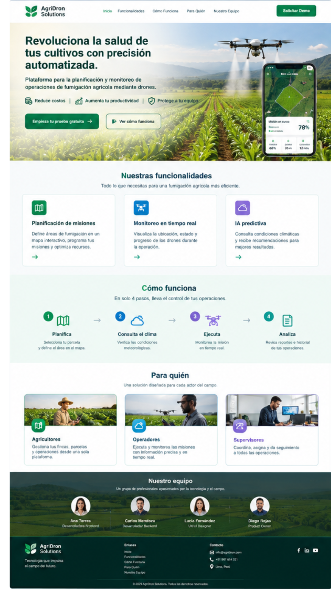

*Figura: Mock-up Desktop de la Landing Page.*

**Mobile**

En el mock-up mobile se aplican los colores y la tipografía de la versión desktop sobre la estructura del wireframe mobile. El Hero muestra una fotografía de campo detrás del titular, los beneficios (Reduce costos, Aumenta tu productividad y Protege a tu equipo) y los dos botones de acción. Las tarjetas de funcionalidades usan iconos verdes y bordes redondeados, los pasos de Cómo funciona se numeran en círculos verdes, las tarjetas de Para quién incluyen una fotografía de cada segmento (Agricultores y Operadores) y el footer en verde reúne los enlaces, el contacto y las redes sociales.

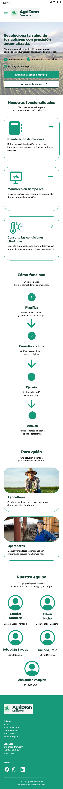

*Figura: Mock-up Mobile de la Landing Page.* El texto oscuro sobre fondo blanco y los botones verdes con texto blanco mantienen un contraste alto, los iconos acompañan siempre a una etiqueta de texto y los botones y tarjetas tienen un tamaño cómodo para tocarlos en pantallas táctiles.

## 4.4. Web Applications UX/UI Design

La propuesta UX/UI de las Web Applications de AgriDron Solutions está diseñada para responder a las necesidades principales de sus usuarios clave: permitir que los agricultores planifiquen y soliciten misiones de fumigación de precisión sobre sus parcelas con rapidez, dar a los operadores técnicos un control telemétrico detallado durante la ejecución del vuelo en campo, y proporcionar a los supervisores visibilidad clara sobre la flota de drones, personal asignado, inventario de insumos y misiones globales. A partir de ello, la interfaz prioriza el acceso directo a módulos críticos (mapas satelitales, misiones, telemetría en vivo y alertas climáticas), la visualización rápida del estado operativo en tiempo real y la reducción de pasos en las tareas más frecuentes de la jornada agrícola.

### 4.4.1. Web Applications Wireframes

Los wireframes de las Web Applications definen la estructura base de las vistas más relevantes del sistema antes de aplicar el diseño visual definitivo. En ellos se observa la distribución de dashboards interactivos, mapas satelitales, formularios de programación de misiones en pasos, tablas telemétricas, tarjetas de métricas (KPIs), paneles laterales de control de vuelo y zonas de acción principal. Esta etapa permitió validar la relación entre la jerarquía visual, la arquitectura de información y los flujos operativos por rol (agricultor, operador y supervisor).

En escritorio, los wireframes muestran una estructura con sidebar lateral persistente, header superior con notificaciones/alertas y un área central de trabajo amplia, adecuada para la interacción con mapas cartográficos, monitoreo telemétrico y reportes gráficos de rendimiento. En mobile web, la información se reorganiza en tarjetas apiladas, paneles deslizantes y listas táctiles de fácil lectura bajo luz solar directa, reduciendo la complejidad visual sin perder funcionalidad ni velocidad de respuesta en campo.

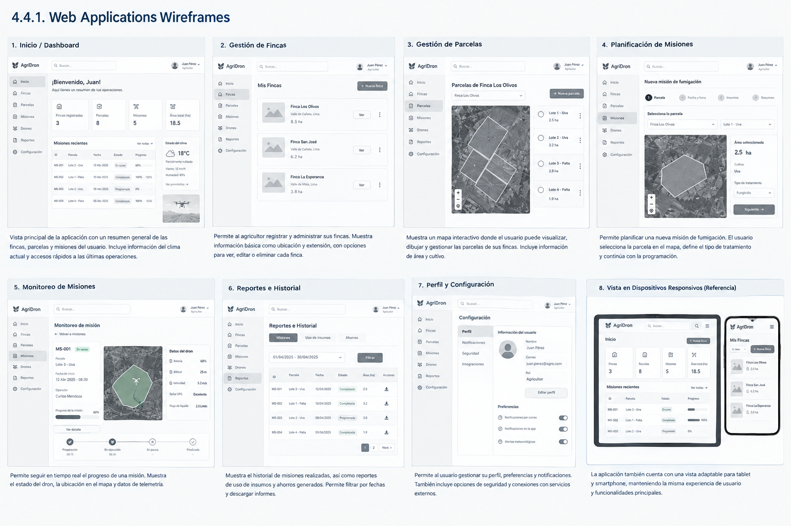

### 4.4.2. Web Applications Wireflow Diagrams

Los diagramas de wireflow de AgriDron Solutions ilustran la secuencia e interacción de las pantallas de la aplicación web para cumplir los objetivos clave del usuario dentro del sistema de fumigación con drones. Cada flujo mapea la transición entre interfaces a partir de un propósito operativo (user goal), detallando desde el ingreso a la plataforma hasta el monitoreo telemétrico en tiempo real y la gestión del perfil.

User Goal Principal: Planificar, ejecutar y monitorear una misión de fumigación de precisión

Este flujo representa el recorrido completo del usuario (agricultor u operador) a través de la interfaz web para llevar a cabo una operación de pulverización con drones:

- Acceso y Autenticación (Pantallas 1 y 2): El usuario inicia en la Landing Page pública y transiciona al Inicio de Sesión para ingresar sus credenciales (correo y contraseña).
- Panel de Control Operativo (Pantalla 3 - Dashboard): Tras autenticarse, accede al panel inicial que muestra un resumen ejecutivo de la operación: métricas generales (fincas registradas, parcelas, misiones activas, hectáreas totales), listado de misiones recientes con estado de avance y un widget de clima en tiempo real (18 °C, viento, humedad).
- Gestión de Fincas (Pantalla 4): A través del sidebar lateral, el usuario ingresa al módulo de Mis Fincas donde visualiza las propiedades registradas (Finca Los Olivos, Finca San José, Finca La Esperanza) y sus extensiones en hectáreas.
- Gestión de Parcelas (Pantalla 5): Al seleccionar una finca, la interfaz despliega sus parcelas delimitadas sobre un mapa satelital interactivo (Lote 1, Lote 2 - Uva, Lote 3 - Palta), permitiendo agregar nuevos lotes o seleccionar uno existente para operar.
- Planificación de Misiones (Pantalla 6): El flujo avanza hacia la herramienta de configuración en 4 pasos (1. Parcela, 2. Tratamiento, 3. Fecha y hora, 4. Resumen). El usuario selecciona la parcela (Lote 1 - Uva, 2.5 ha), especifica el tipo de agroquímico (Fungicida) y valida el área sobre el mapa interactivo.
- Monitoreo de Misiones en Tiempo Real (Pantalla 7 - Misión MS-001): Durante el vuelo, el sistema muestra la ruta sobre el mapa satelital y el panel de telemetría con datos críticos en vivo: nivel de batería (68%), altitud (45 m), velocidad (5.2 m/s), modo de vuelo (Automático) y flujo de líquido (2.5 L/min), junto con una barra de progreso por etapas (Preparación 08:15 ➔ En ejecución 08:30 ➔ En pausa ➔ Finalizada).
- Reportes e Historial (Pantalla 8): Concluida la misión, los datos se almacenan en el historial general, donde se pueden filtrar por rango de fechas, finca y estado para consultar el detalle de hectáreas trabajadas y descargar reportes.
- Perfil y Configuración (Pantalla 9): Espacio donde el usuario (Juan Pérez - Rol: Agricultor) gestiona sus datos personales, seguridad y preferencias de alertas meteorológicas o notificaciones en la app.
- Vista en Dispositivos Responsivos (Pantalla 10): Muestra la adaptación y equivalencia de las pantallas clave (Fincas y Monitoreo de Misión) en formato mobile/tablet para su uso directo en campo.

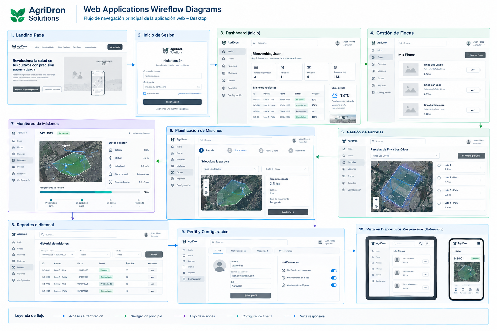

**link del figma:** https://www.figma.com/design/gIhPSpNHHNel3RMWLQSl8a/Sin-t%C3%ADtulo?node-id=0-1&t=LmubQnBsex2NasC8-1

### 4.4.3. Web Applications Mock-ups

Los mock-ups de alta fidelidad de AgriDron Solutions representan la consolidación visual y funcional de la aplicación web, construidos sobre el sistema de diseño, la paleta cromática, la jerarquía tipográfica (Inter y Roboto) y la escala de espaciado modular definidos en la solución. En estas interfaces se evidencia cómo la arquitectura de información y el diseño inclusivo con alto contraste se traducen en pantallas operativas, legibles en entornos de campo y optimizadas para el trabajo en escritorio, tablet y smartphone.

En escritorio, la aplicación estructura su área de trabajo mediante un sidebar lateral persistente con menú navegable (Inicio, Fincas, Parcelas, Misiones, Drones, Reportes, Configuración), una barra superior (header) con buscador global y selector de usuario (Juan Pérez - Agricultor), y un lienzo central con tarjetas, mapas satelitales interactivos, paneles telemétricos y tablas operativas. En dispositivos móviles y tablets, la interfaz reorganiza la información en listas táctiles apiladas y tarjetas adaptativas, preservando el acceso completo a las funciones sin saturar la pantalla.

A continuación, se detallan los 8 escenarios visuales clave presentados en la propuesta de alta fidelidad:

**1. Inicio / Dashboard**

- Propósito: Vista principal y centro de control operativo tras autenticarse en la plataforma.
 **Componentes clave:**
- Tarjetas de métricas generales (KPIs): Resumen numérico con total de Fincas registradas (3), Parcelas (8), Misiones (5) y Área total (18.5 ha).
- Misiones recientes: Tabla resumida con ID de misión (MS-001, MS-002, MS-003), parcela de destino, fecha y badges de estado con código de color (En curso, Completada, Programada).
- Widget meteorológico: Panel en tiempo real que exhibe temperatura (18 °C), condición del cielo (Parcialmente nublado), velocidad del viento (12 km/h) y humedad relativa (68%)

**2. Gestión de Fincas**

- Propósito: Administrar los predios agrícolas registrados por el usuario, su ubicación y superficie total.

**Componentes clave:**

- Botón contextual destacado + Nueva finca para el registro acelerado de campos.
- Tarjetas de finca (Finca Los Olivos, Finca San José, Finca La Esperanza) que incluyen miniatura satelital, ubicación geográfica (Valle de Cañete, Valle de Mala - Lima) y extensión en hectáreas (8.5 ha, 6.2 ha, 3.8 ha) con botón directo de inspección Ver

**3. Gestión de Parcelas**

- Propósito: Visualización y delimitación cartográfica de los lotes agrícolas pertenecientes a una finca.

**Componentes clave:**

- Contenedor de mapa satelital interactivo con herramientas de zoom y trazado poligonal en vivo.
- Menú desplegable para filtrado rápido por finca (Finca Los Olivos) y lista lateral de parcelas activas (Lote 1 - Uva 2.5 ha, Lote 2 - Uva 3.2 ha, Lote 3 - Palta 2.8 ha, Lote 4 - Palta 1.9 ha) con botones de acción contextual (+ Nueva parcela).

**4. Planificación de Misiones**

- Propósito: Flujo asistido (wizard) en 4 pasos para programar una pulverización de precisión.
**Componentes clave:**

- Indicador de progreso por etapas (1. Parcela ➔ 2. Fecha y hora ➔ 3. Insumos ➔ 4. Resumen).
- Previsualización geoespacial del área a tratar (2.5 ha), selección del tipo de cultivo (Uva) y definición del agroquímico (Fungicida), con botón primario Siguiente ➔.

**5. Monitoreo de Misiones**

- Propósito: Control telemétrico en tiempo real del estado del vuelo y descarga de insumos sobre la parcela.

**Componentes clave:**

- Badge de estado en tiempo real (MS-001 - En curso) y mapa satelital con la trayectoria del dron trazada.
- Panel telemétrico en vivo: batería (68%), altitud (25 m), velocidad (5.2 m/s), nivel de señal GPS (Excelente) y caudal de flujo (2.5 L/min).
- Barra de avance lineal de misión (60%) dividida por fases (Preparación 08:15 ➔ En ejecución 08:30 ➔ En pausa ➔ Finalizada).

**6. Reportes e Historial**

- Propósito: Consulta analítica, fiscalización del consumo de insumos y auditoría de vuelos ejecutados.

**Componentes clave:**

- Navegación por pestañas (Misiones, Uso de insumos, Ahorros).
- Selector de rango de fechas (01/04/2025 - 30/04/2025) con filtro aplicable.
- Tabla con ID de orden, parcela, fecha de aplicación, hectáreas tratadas y botón directo para descargar el acta de conformidad digital.

**7. Perfil y Configuración**
- Propósito: Gestión de la información del usuario, seguridad de la cuenta y reglas de notificación.

**Componentes clave:**

- Pestañas de navegación interna (Perfil, Notificaciones, Seguridad, Integraciones).
- Ficha de usuario con opción Editar perfil (Juan Pérez - juan.perez@agro.com) y controles deslizantes (toggle switches) para activar o desactivar notificaciones por correo, alertas en la aplicación y avisos meteorológicos preventivos.

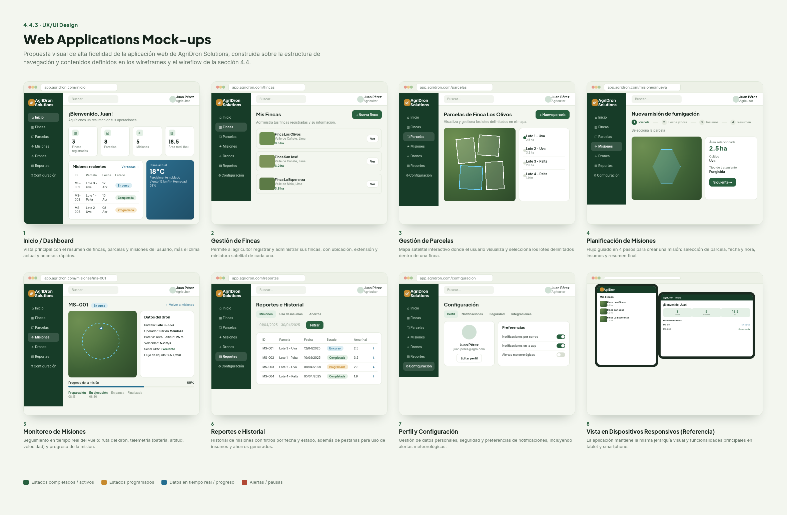

**link del figma:** https://www.figma.com/design/gIhPSpNHHNel3RMWLQSl8a/Sin-t%C3%ADtulo?node-id=0-1&t=LmubQnBsex2NasC8-1

### 4.4.4. Web Applications User Flow Diagrams

Los User Flow Diagrams de AgriDron Solutions representan los recorridos funcionales principales de los usuarios dentro de la plataforma web, detallando la lógica de navegación, las reglas de negocio, los puntos de decisión y el comportamiento del sistema ante condiciones esperadas o interrupciones operativas. A diferencia del wireflow, este diagrama se enfoca en las bifurcaciones lógicas y validaciones que determinan el avance del usuario desde el inicio hasta el cumplimiento de sus objetivos.

User Goal 1: Planificar y ejecutar una misión de fumigación de precisión.

**Happy path (Camino feliz):**

- Autenticación e inicio: El usuario inicia sesión correctamente en la aplicación web.
- Validación de infraestructura agrícola: El sistema verifica que la finca ya está registrada y que la parcela objetivo se encuentra delimitada geométricamente en el mapa satelital.
- Configuración de misión: El usuario crea la misión especificando parcela, fecha, insumos agrícolas y tipo de tratamiento fitosanitario.
- Validación meteorológica: La plataforma consulta las condiciones climáticas en tiempo real y confirma que son favorables para el vuelo.
- Asignación de personal: El sistema notifica la misión pendiente y confirma la disponibilidad de un operador técnico, asignándole la orden.
- Verificación de geocerca y campo: El operador inicia su jornada de trabajo y el sistema valida positivamente su ubicación dentro de la geocerca permitida.
- Ejecución y cierre: Se inicia el vuelo de fumigación automatizado sin incidencias, el operador completa la misión y el sistema emite automáticamente el acta digital y el reporte operativo, alcanzando el estado final Misión Completada.

**Unhappy paths y rutas alternativas (Excepciones y decisiones):**

- Finca o parcela no registrada: Si el usuario no cuenta con la finca o parcela registrada, el flujo se desvía para exigir el registro previo de los predios en la base de datos geográfica antes de continuar con la creación de la misión.
- Condición climática desfavorable: Si el análisis meteorológico detecta vientos fuertes o lluvia, el sistema bloquea la autorización y retorna al usuario a la fase de planificación para modificar la fecha o los parámetros de la misión.
- Sin operador disponible: Si no existe un operador disponible al momento de la asignación, la orden queda diferida en estado Misión pendiente de asignación.
- Fuera de la geocerca: Si al iniciar la jornada la ubicación GPS del operador no coincide con los límites de la geocerca establecida, el sistema bloquea el registro, notifica al supervisor y finaliza el intento en estado Jornada no iniciada.
- Incidencias técnicas o climáticas durante el vuelo: Si durante la pulverización surge una falla de equipo o cambio climático adverso.

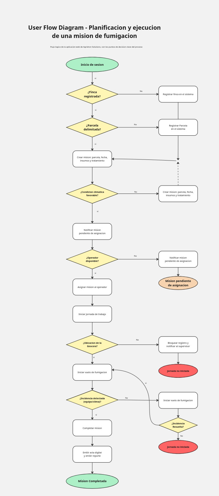

**Link del Miro:** https://miro.com/app/board/uXjVHnbT8O4=/?share_link_id=310365063702

---

## 4.5. Web Applications Prototyping

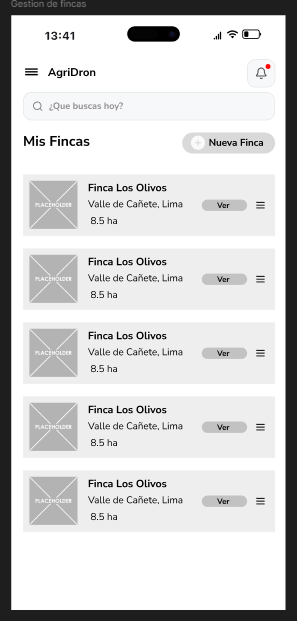

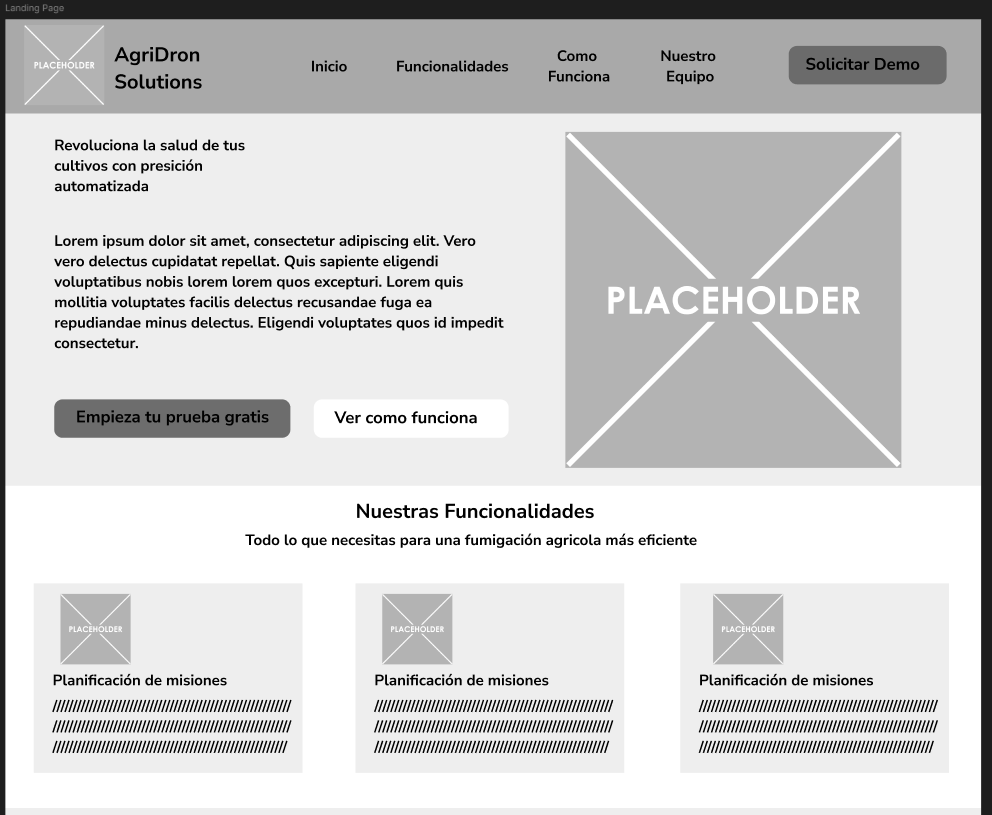

---

## 4.6. Domain-Driven Software Architecture

### 4.6.1. Design-Level Event Storming
El **Design-Level Event Storming** permite representar el flujo principal del dominio de AgriDron Solutions mediante comandos, eventos de dominio, actores, políticas y agregados. 

### Flujo principal del dominio

El flujo comienza cuando un agricultor solicita un servicio de fumigación y termina con el registro de los resultados y la generación de información histórica para consulta.

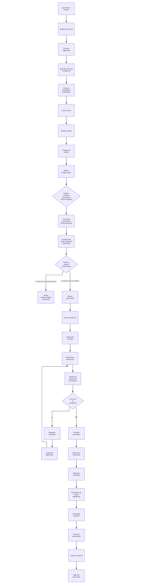

**Link de Lucidchart:** https://lucid.app/lucidchart/e8a59167-4148-4d11-ab49-19abe080e585/edit?view_items=J4zqxcoJNdUQq%2BczQQMJK5LES6g%3D&page=0_0&invitationId=inv_ac46e8d4-1e8b-4dcd-b431-e285187b3edc


### Actores principales

| Actor                             | Responsabilidad                                                                                             |
|-----------------------------------|-------------------------------------------------------------------------------------------------------------|
| **Agricultor / Cliente**          | Solicita servicios y consulta información de sus operaciones.                                               |
| **Operador técnico**              | Registra y planifica misiones, verifica condiciones, ejecuta y monitorea operaciones y registra resultados. |
| **Sistema meteorológico externo** | Proporciona información climática para apoyar la planificación.                                             |

### Comandos

| Comando                              | Origen             | Propósito                                                       |
|--------------------------------------|--------------------|-----------------------------------------------------------------|
| Registrar parcela                    | Operador           | Crear información de una parcela agrícola.                      |
| Delimitar área de fumigación         | Operador           | Definir el área que será tratada.                               |
| Crear misión                         | Operador           | Crear una operación de fumigación asociada a una parcela.       |
| Programar misión                     | Operador           | Definir fecha y hora planificadas.                              |
| Consultar condiciones meteorológicas | Sistema            | Obtener información climática de la API externa.                |
| Iniciar operación                    | Operador           | Marcar el inicio de la misión.                                  |
| Monitorear operación                 | Operador / Sistema | Actualizar estado y ubicación simulada del dron.                |
| Registrar incidente                  | Operador           | Registrar situaciones inesperadas.                              |
| Finalizar operación                  | Operador           | Marcar la finalización de la misión.                            |
| Registrar resultado                  | Operador           | Registrar hectáreas tratadas, volumen aplicado y observaciones. |
| Actualizar historial                 | Sistema            | Incorporar la misión finalizada al historial.                   |
| Generar reporte                      | Usuario / Sistema  | Generar información consolidada de la operación.                |

### Eventos de dominio

| Evento                                   | Descripción                                                          |
|------------------------------------------|----------------------------------------------------------------------|
| **Parcela registrada**                   | Se creó una parcela con su información básica.                       |
| **Área de fumigación delimitada**        | Se definió geográficamente el área que será tratada.                 |
| **Misión creada**                        | Se creó una nueva misión.                                            |
| **Misión programada**                    | La misión tiene fecha y hora planificadas.                           |
| **Condiciones meteorológicas obtenidas** | El sistema recibió información climática externa.                    |
| **Misión autorizada**                    | Las condiciones disponibles permiten continuar con la planificación. |
| **Alerta meteorológica generada**        | Las condiciones requieren advertencia, pausa o reprogramación.       |
| **Operación iniciada**                   | Comenzó la ejecución de la misión.                                   |
| **Estado de operación actualizado**      | Se actualizó el estado o ubicación simulada del dron.                |
| **Incidente registrado**                 | Se registró una situación inesperada.                                |
| **Operación finalizada**                 | Terminó la ejecución de la misión.                                   |
| **Resultado de misión registrado**       | Se registraron las métricas y observaciones finales.                 |
| **Historial actualizado**                | La misión finalizada está disponible como antecedente.               |
| **Reporte generado**                     | Se generó información consolidada.                                   |

### Políticas y reglas de negocio

| Política                              | Regla                                                                                                       |
|---------------------------------------|-------------------------------------------------------------------------------------------------------------|
| **Verificación meteorológica previa** | Antes de iniciar una misión se deben consultar las condiciones meteorológicas disponibles.                  |
| **Evaluación de condiciones**         | Si las condiciones son desfavorables, se genera una alerta para apoyar la decisión de pausar o reprogramar. |
| **Registro de incidentes**            | Una incidencia debe quedar registrada para mantener trazabilidad.                                           |
| **Registro de resultados**            | Una misión finalizada debe conservar información sobre el trabajo realizado.                                |
| **Actualización del historial**       | Los resultados de misiones finalizadas deben estar disponibles para consultas posteriores.                  |

### Agregados principales

- **Farm / Parcel:** concentra información territorial y agrícola.
- **Mission:** concentra la información principal de una operación y su ciclo de vida.
- **Drone:** representa el recurso utilizado para ejecutar una misión.
- **Mission Report:** concentra los resultados registrados al finalizar una operación.

---

# 4.6.1.1. Bounded Contexts

La partición del dominio se realiza considerando las responsabilidades y conceptos principales de la solución.

# 4.6.1.1. Bounded Contexts

La partición del dominio se realiza considerando las responsabilidades y conceptos principales de la solución, y se alinea con los seis Bounded Contexts identificados en el diagrama de EventStorming.

## Bounded Context 1: Identity & Access Management

**Responsabilidad:** gestionar el registro de usuarios, la autenticación segura, el control de acceso y la administración de roles.

**Conceptos:** usuario, credencial, rol, permiso, sesión y token de acceso.

**Operaciones:** registrar usuario, autenticar usuario, asignar/actualizar rol, controlar acceso y cerrar sesión.

**Eventos:** `UsuarioRegistrado`, `UsuarioAutenticado`, `RolAsignado`, `AccesoDenegado`, `SesionCerrada`.

## Bounded Context 2: Field Management

**Responsabilidad:** administrar la información territorial, la delimitación de parcelas en mapa y la asociación de tipos de cultivo para planificar servicios.

**Conceptos:** campo, parcela, cultivo, ubicación, área de fumigación y coordenadas.

**Operaciones:** registrar/actualizar parcela, visualizarla en mapa, delimitar área y asociar cultivo.

**Eventos:** `ParcelaRegistrada`, `AreaFumigacionDelimitada`, `InformacionCultivoRegistrada`.

## Bounded Context 3: Flight Operations (Core Domain)

**Responsabilidad:** dominio principal del negocio; gestiona la planificación, programación, seguimiento en tiempo real y registro de resultados de las misiones de fumigación.

**Conceptos:** misión, dron, programación, estado, operación, incidente y hectáreas tratadas.

**Operaciones:** crear/programar misión, iniciar operación, actualizar estado, registrar incidentes, finalizar operación y registrar resultados.

**Eventos:** `MisionCreada`, `MisionProgramada`, `OperacionIniciada`, `EstadoOperacionActualizado`, `IncidenteRegistrado`, `OperacionFinalizada`.

## Bounded Context 4: Weather Integration

**Responsabilidad:** consultar servicios meteorológicos externos, evaluar las condiciones ambientales en campo y emitir alertas climáticas.

**Conceptos:** consulta meteorológica, condición, viento, temperatura, humedad, precipitación y alerta.

**Operaciones:** consultar condiciones, consultar pronóstico, evaluar condiciones y generar alertas.

**Eventos:** `CondicionesMeteorologicasObtenidas`, `CondicionesEvaluadas`, `AlertaMeteorologicaGenerada`.

## Bounded Context 5: Analytics & Reporting

**Responsabilidad:** procesar la información histórica de las operaciones, calcular indicadores de rendimiento y generar reportes fitosanitarios.

**Conceptos:** historial, resultado, reporte fitosanitario, estadística, métrica e indicador de rendimiento.

**Operaciones:** registrar resultados, consultar historial, calcular indicadores, consolidar métricas y generar reportes.

**Eventos:** `ResultadoMisionRegistrado`, `HistorialActualizado`, `IndicadorCalculado`, `ReporteGenerado`.

## Bounded Context 6: Inventory & Resource Management

**Responsabilidad:** controlar el inventario de la flota de drones, insumos agroquímicos y boquillas, y registrar el mantenimiento preventivo.

**Conceptos:** dron, insumo agroquímico, boquilla, stock, mantenimiento preventivo y registro de mantenimiento.

**Operaciones:** registrar/actualizar dron, registrar insumo o boquilla, controlar stock, programar mantenimiento preventivo y registrar mantenimiento realizado.

**Eventos:** `DronRegistrado`, `InsumoRegistrado`, `StockActualizado`, `MantenimientoProgramado`, `MantenimientoRegistrado`.

### Relación entre Bounded Contexts

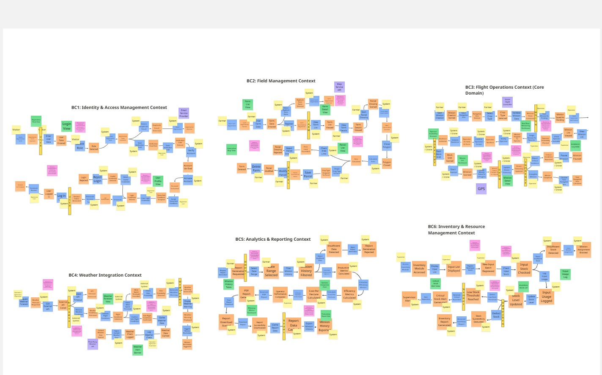
```

**link de mmiro:** https://miro.com/app/board/uXjVHl_E4nc=/?share_link_id=823387251080

### 4.6.2. Software Architecture Context Diagram
El **System Context Diagram de C4** representa el sistema como una única unidad y muestra los usuarios y sistemas externos que interactúan directamente con él. En este nivel no se detallan tecnologías internas.

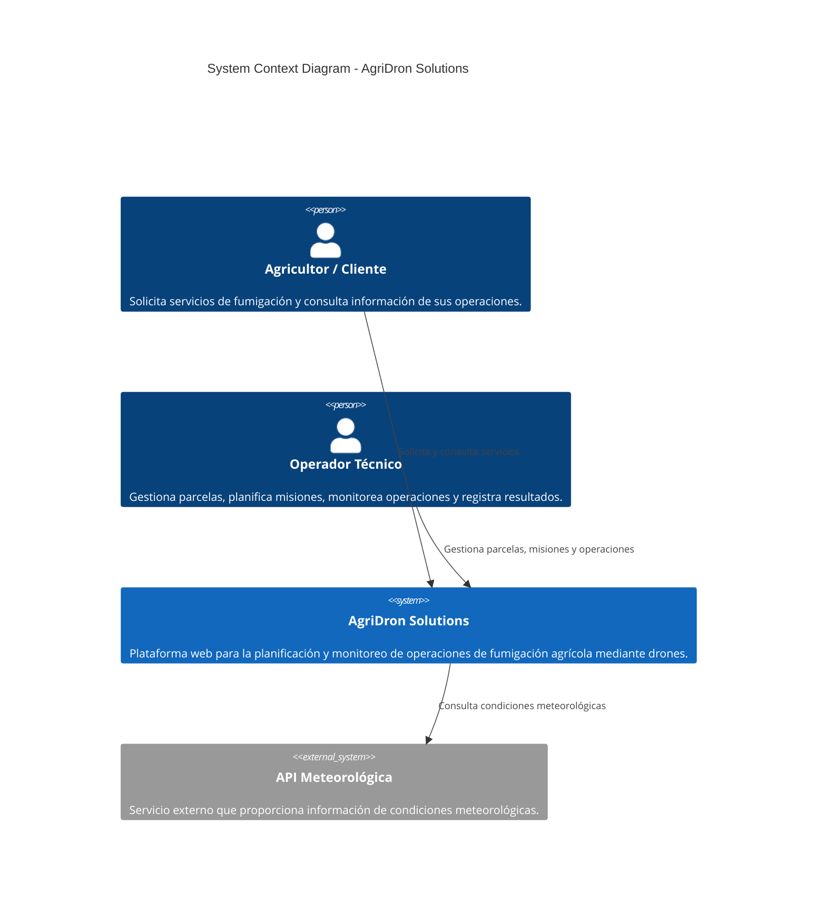

### Descripción

**AgriDron Solutions** es el sistema principal en el alcance de la solución. El **Agricultor / Cliente** interactúa con la plataforma para solicitar y consultar información relacionada con sus servicios, mientras que el **Operador Técnico** la utiliza para gestionar parcelas, planificar misiones, monitorear operaciones y registrar resultados.

La plataforma interactúa con una **API Meteorológica externa** para obtener información utilizada en la evaluación de las condiciones de operación.

### 4.6.3. Software Architecture Container Diagrams
El **Container Diagram de C4** realiza un acercamiento al sistema y muestra sus principales aplicaciones, servicios y almacenes de datos, incluyendo las tecnologías utilizadas y sus relaciones.

Los contenedores definidos son:

1. **Landing Page**
2. **Frontend Angular**
3. **Backend Spring Boot**
4. **Base de Datos Relacional**
5. **API Meteorológica Externa**

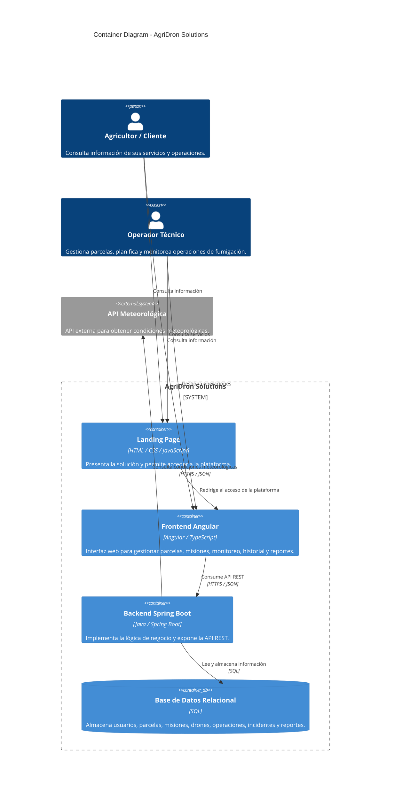

### Descripción de los contenedores

| Contenedor                   | Tecnología              | Responsabilidad                                                                                  |
|------------------------------|-------------------------|--------------------------------------------------------------------------------------------------|
| **Landing Page**             | HTML / CSS / JavaScript | Presentar AgriDron Solutions y facilitar el acceso a la plataforma.                              |
| **Frontend Angular**         | Angular / TypeScript    | Proporcionar la interfaz para gestionar parcelas, misiones, monitoreo, historial y reportes.     |
| **Backend Spring Boot**      | Java / Spring Boot      | Implementar la lógica de negocio, exponer servicios REST y coordinar datos y servicios externos. |
| **Base de Datos Relacional** | SQL                     | Persistir usuarios, parcelas, misiones, operaciones, incidentes y reportes.                      |
| **API Meteorológica**        | Servicio externo        | Proporcionar datos meteorológicos para apoyar la planificación.                                  |

### Flujo de comunicación

1. El usuario accede a la **Landing Page**.
2. El usuario utiliza el **Frontend Angular** para gestionar o consultar información.
3. El **Frontend Angular** consume el **Backend Spring Boot** mediante API REST.
4. El **Backend Spring Boot** consulta y actualiza la **Base de Datos Relacional**.
5. El **Backend Spring Boot** consulta la **API Meteorológica** cuando se requiere información climática.
6. La información procesada se presenta mediante el **Frontend Angular**.

## Trazabilidad entre dominio y arquitectura

| Bounded Context           | Responsabilidad                            | Soporte arquitectónico      |
|---------------------------|--------------------------------------------|-----------------------------|
| **Field Management**      | Campos, parcelas y áreas                   | Frontend + Backend + BD     |
| **Flight Operations**     | Misiones, drones, operaciones e incidentes | Frontend + Backend + BD     |
| **Weather Integration**   | Condiciones y alertas meteorológicas       | Backend + API Meteorológica |
| **Analytics & Reporting** | Historial, métricas y reportes             | Frontend + Backend + BD     |

La correspondencia permite mantener trazabilidad entre el análisis de dominio realizado mediante Event Storming y la arquitectura propuesta para AgriDron Solutions.

### 4.6.4. Software Architecture Components Diagrams
Esta sección presenta el diseño interno de los principales componentes de software de **AgriDron Solutions**. Se mantiene la separación entre la aplicación web, los servicios REST y las integraciones externas, alineándolos con los Bounded Contexts definidos en la arquitectura.


## 4.6.4.1. RESTful API

La API RESTful implementada con Spring Boot concentra la lógica de aplicación y dominio. Se organiza en capas de presentación, aplicación, dominio e infraestructura.

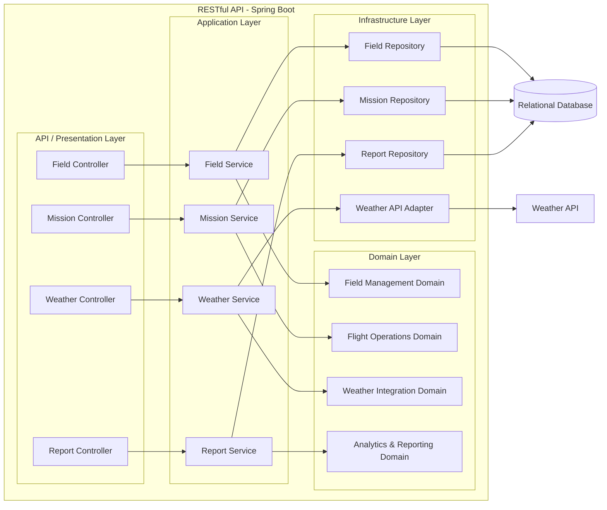

### Responsabilidades

| Capa           | Responsabilidad                                                         |
|----------------|-------------------------------------------------------------------------|
| Presentation   | Recibir solicitudes HTTP y devolver respuestas mediante endpoints REST. |
| Application    | Coordinar casos de uso y orquestar operaciones del dominio.             |
| Domain         | Contener reglas y conceptos principales de cada Bounded Context.        |
| Infrastructure | Implementar persistencia e integración con servicios externos.          |

## 4.6.4.2. Web Application

La aplicación web utiliza Angular para proporcionar las funcionalidades de operadores y clientes.

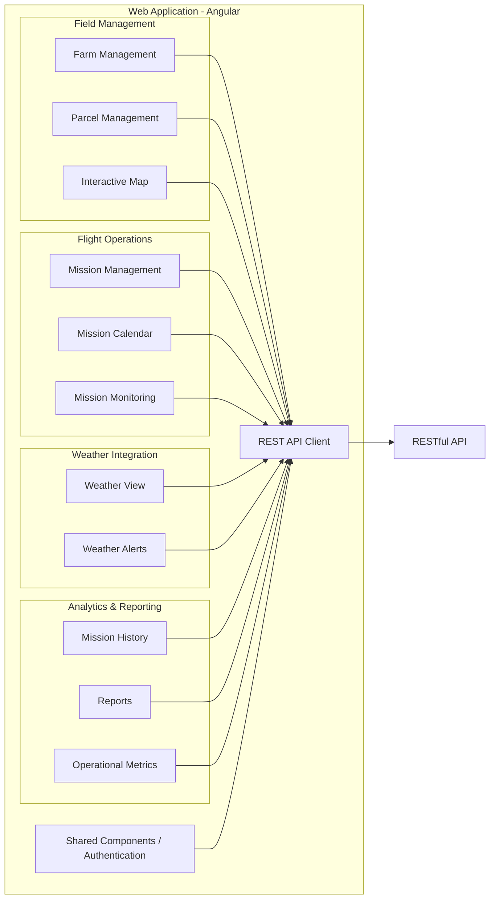

### Responsabilidades

- **Field Management:** administrar campos, parcelas y áreas de fumigación.
- **Flight Operations:** crear, programar y monitorear misiones.
- **Weather Integration:** mostrar condiciones y alertas meteorológicas.
- **Analytics & Reporting:** consultar historial y reportes.
- **Shared Components:** centralizar elementos reutilizables y autenticación.
- **REST API Client:** encapsular la comunicación con el Backend.

## 4.6.4.3. Weather Integration Component

La integración meteorológica se mantiene aislada para evitar acoplar directamente la lógica de negocio con la API externa.

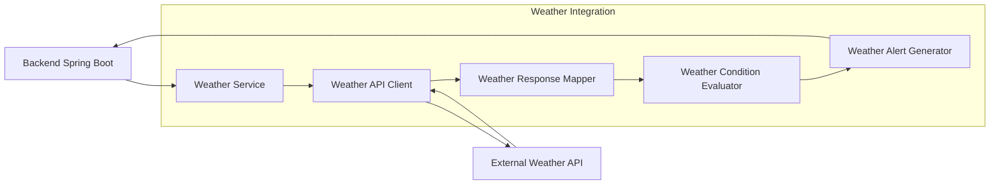

El componente permite cambiar o adaptar el proveedor meteorológico sin modificar directamente los componentes de **Flight Operations**.

---

## 4.7. Software Object-Oriented Design
El diseño orientado a objetos representa los principales elementos del dominio y sus relaciones. El Project Statement solicita que los Class Diagrams incluyan clases, interfaces, enumeraciones, atributos, métodos, visibilidad, relaciones y multiplicidades cuando correspondan. La solución se organiza en seis Bounded Contexts (Identity & Access Management, Field Management, Flight Operations, Weather Integration, Analytics & Reporting e Inventory & Resource Management), por lo que primero se presenta una vista general de las clases principales de cada contexto y luego un diagrama por cada uno de ellos, junto con los elementos compartidos (Shared).

### 4.7.1. Class Diagrams

Los Class Diagrams se presentan por Bounded Context para mantener cada modelo legible y con responsabilidades claras. Las referencias entre contextos se realizan mediante identificadores (por ejemplo, `parcelId`, `droneId` u `operatorId` en `Mission`), y no mediante asociaciones directas entre clases de contextos distintos.

### 4.7.1.1. Overview

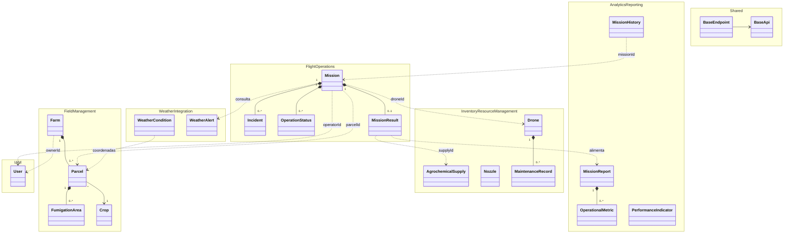

### 4.7.1.2. Identity & Access Management

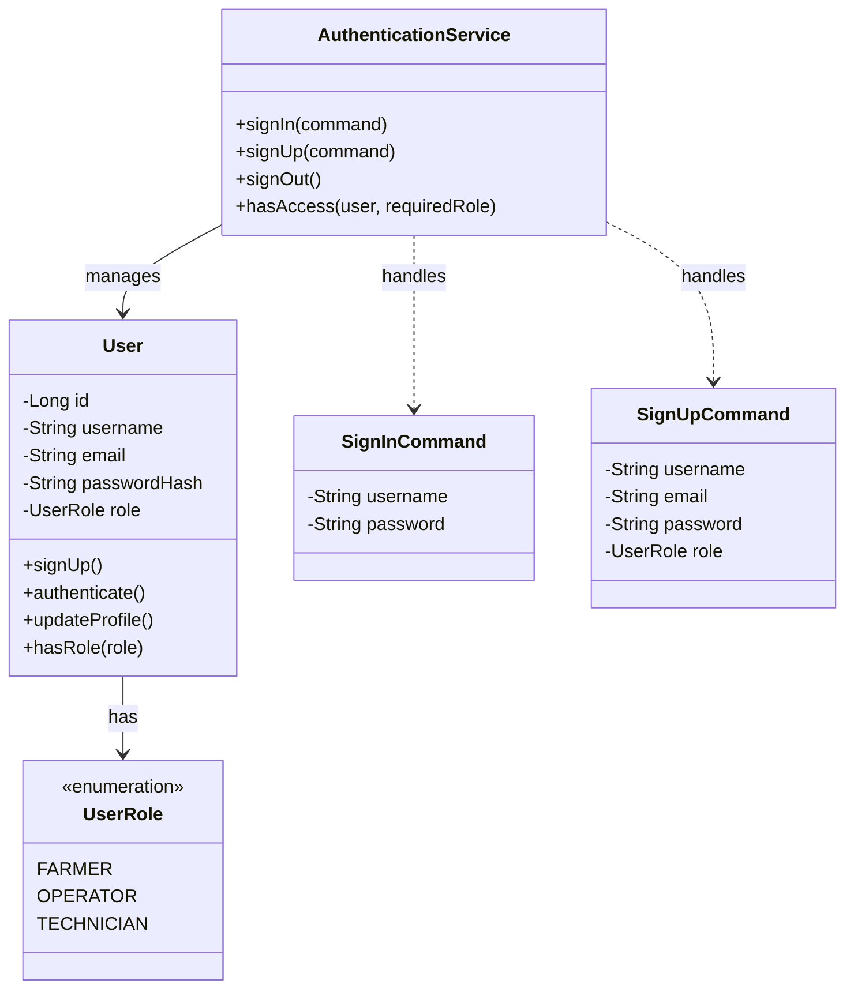

### 4.7.1.3. Field Management

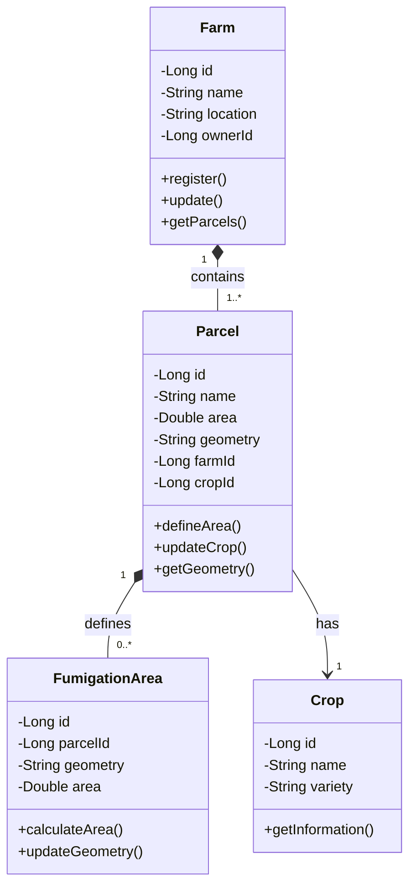

### 4.7.1.4. Flight Operations

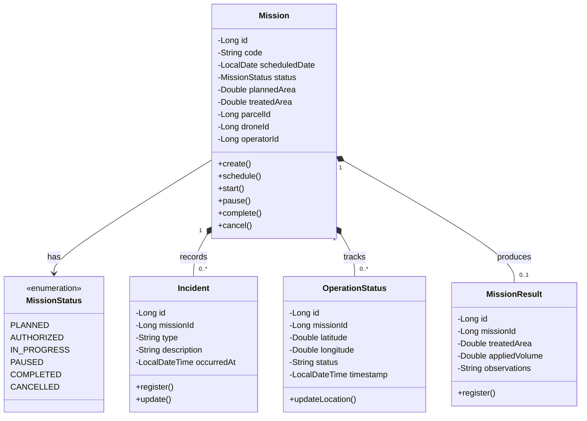

### 4.7.1.5. Weather Integration

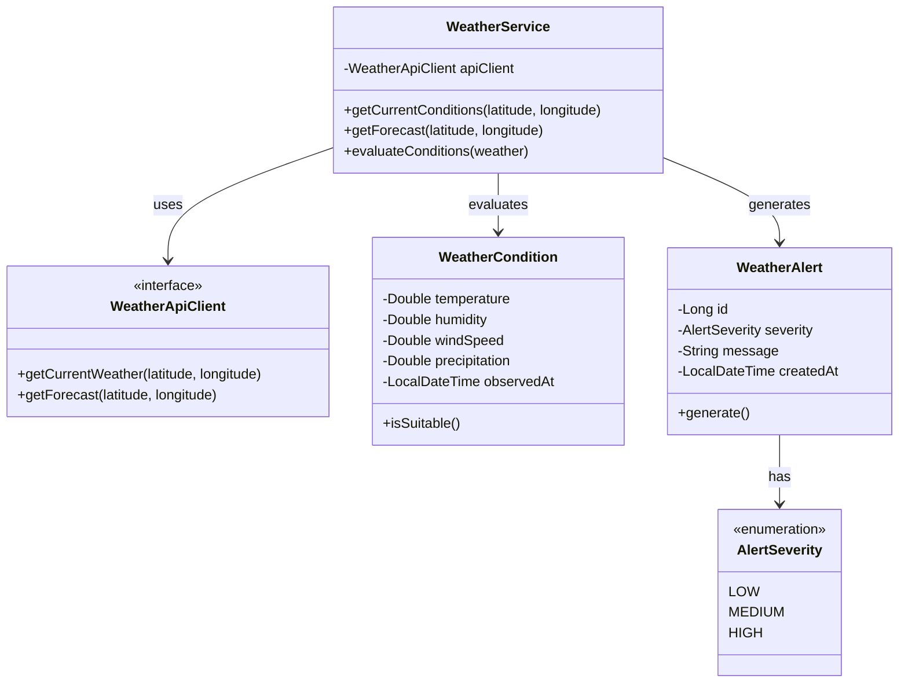

### 4.7.1.6. Analytics & Reporting

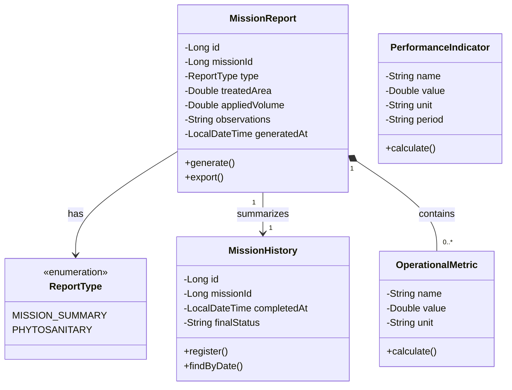

### 4.7.1.7. Inventory & Resource Management

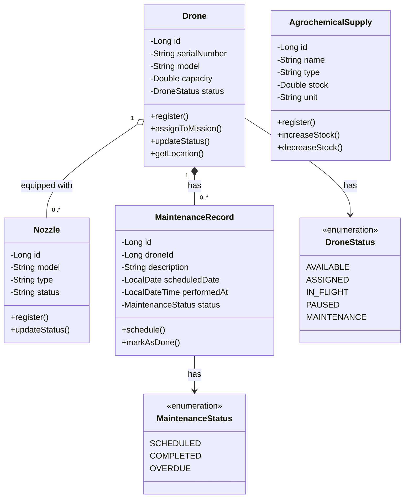

### 4.7.1.8. Shared

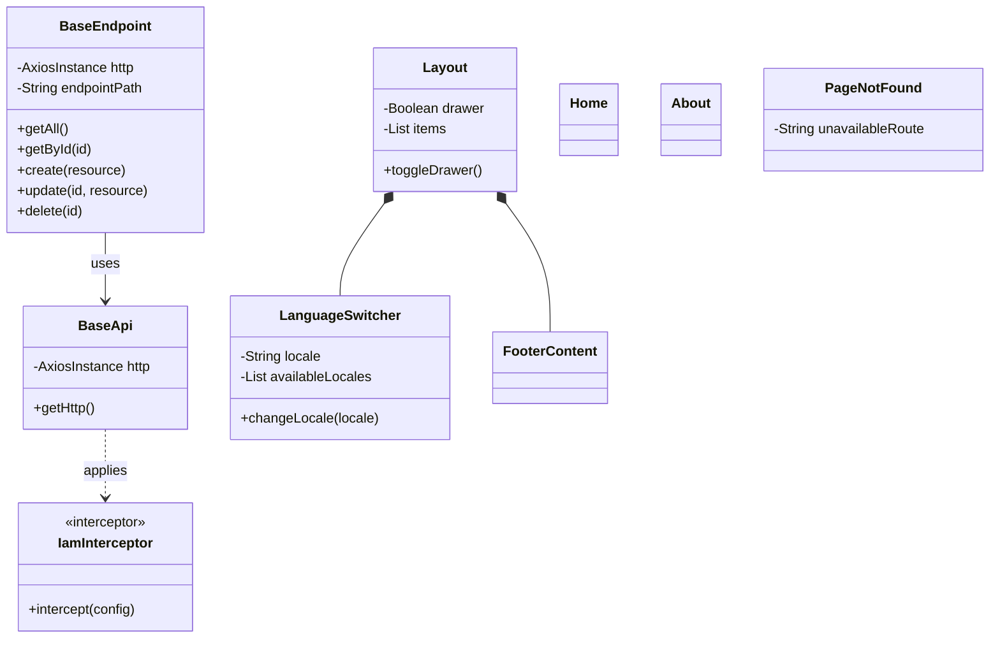


## 4.8. Database Design
El diseño de base de datos define la persistencia necesaria para los objetos de cada Bounded Context. Para almacenamiento relacional se especifican tablas, columnas, claves primarias, claves foráneas y relaciones entre tablas. Esto corresponde a lo solicitado por el Project Statement. La solución se organiza en seis Bounded Contexts (Identity & Access Management, Field Management, Flight Operations, Weather Integration, Analytics & Reporting e Inventory & Resource Management); cada diagrama muestra las tablas propias del contexto y, cuando es necesario, las tablas de otros contextos que referencia mediante claves foráneas.

### 4.8.1. Database Diagrams

### 4.8.1.1. Identity & Access Management

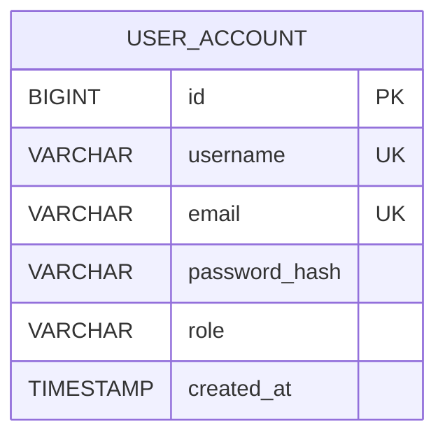

**Restricciones principales:** `USER_ACCOUNT.id` es PK; `username` y `email` son únicos; `role` solo admite los valores `FARMER`, `OPERATOR` y `TECHNICIAN`; `password_hash` nunca almacena la contraseña en texto plano. Esta tabla es referenciada por los demás contextos mediante FK (`FARM.owner_id`, `MISSION.operator_id`).

### 4.8.1.2. Field Management

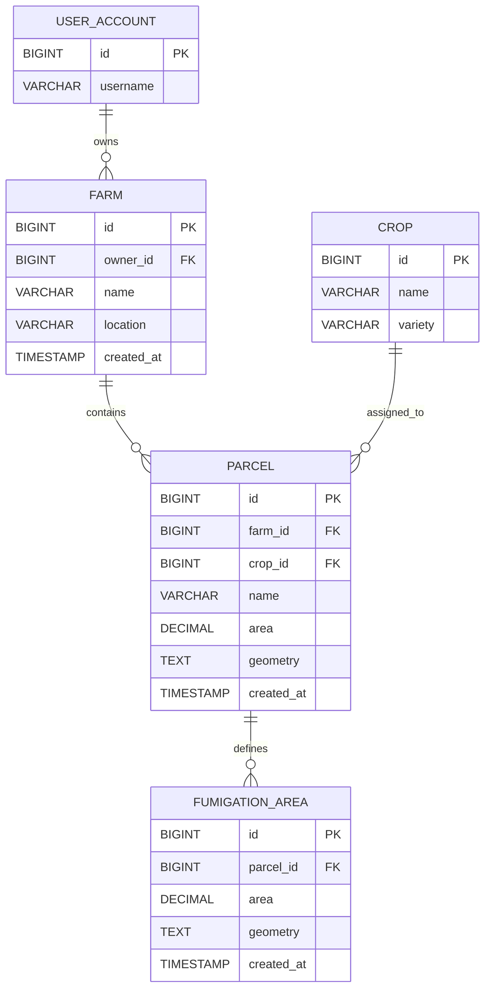

**Restricciones principales:** `FARM.id`, `PARCEL.id`, `FUMIGATION_AREA.id` y `CROP.id` son PK; las FK mantienen las relaciones indicadas (`FARM.owner_id` referencia `USER_ACCOUNT.id`); `area` debe ser mayor que cero.

### 4.8.1.3. Flight Operations

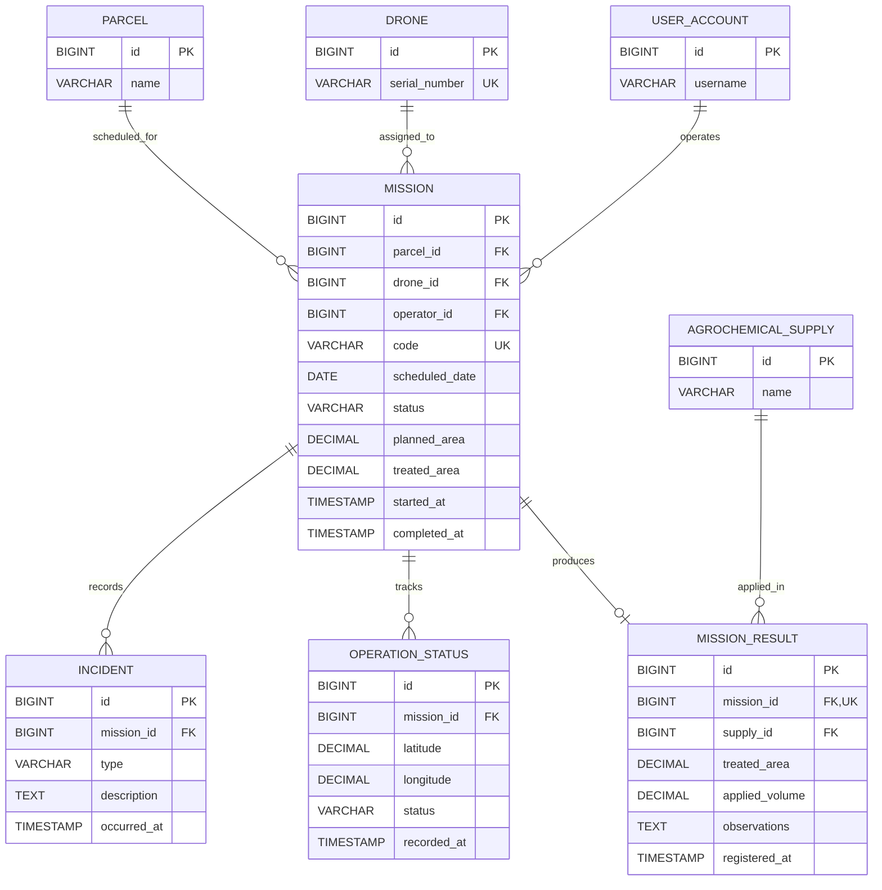

**Restricciones principales:** `MISSION.parcel_id`, `MISSION.drone_id` y `MISSION.operator_id` son FK hacia Field Management, Inventory & Resource Management e Identity & Access Management respectivamente; `MISSION.code` y `DRONE.serial_number` son únicos; las FK de `INCIDENT` y `OPERATION_STATUS` referencian `MISSION.id`; `MISSION_RESULT.mission_id` es FK y UNIQUE (un resultado por misión); `status` solo admite `PLANNED`, `AUTHORIZED`, `IN_PROGRESS`, `PAUSED`, `COMPLETED` y `CANCELLED`; las áreas y volúmenes no pueden ser negativos.

### 4.8.1.4. Weather Integration

Para el MVP, la información meteorológica puede almacenarse únicamente cuando sea necesaria para mantener trazabilidad de la evaluación asociada a una misión.

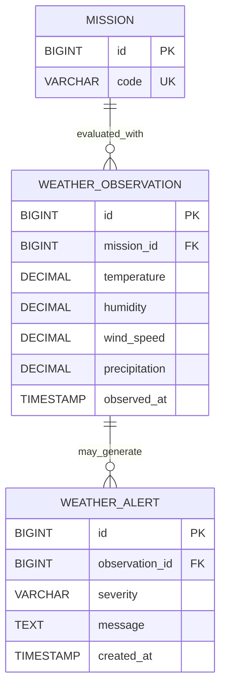

**Restricciones principales:** `WEATHER_OBSERVATION.mission_id` y `WEATHER_ALERT.observation_id` son FK; los valores meteorológicos deben validarse según la fuente; `severity` solo admite `LOW`, `MEDIUM` y `HIGH`; cada observación conserva su fecha y hora.

### 4.8.1.5. Analytics & Reporting

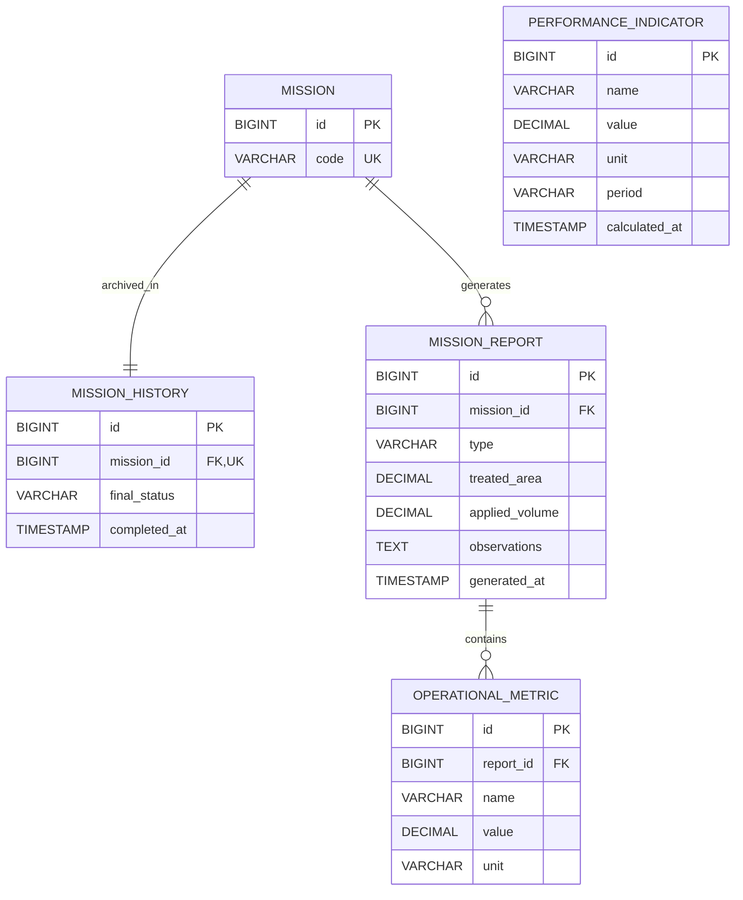

**Restricciones principales:** `MISSION_HISTORY.mission_id` es FK y UNIQUE para mantener una relación uno a uno con la misión; `MISSION_REPORT.mission_id` es FK y la combinación (`mission_id`, `type`) es única; `type` solo admite `MISSION_SUMMARY` y `PHYTOSANITARY`; `OPERATIONAL_METRIC.report_id` referencia `MISSION_REPORT.id`; `PERFORMANCE_INDICATOR` es una tabla independiente que consolida valores por periodo; `treated_area` y `applied_volume` no pueden ser negativos.

### 4.8.1.6. Inventory & Resource Management

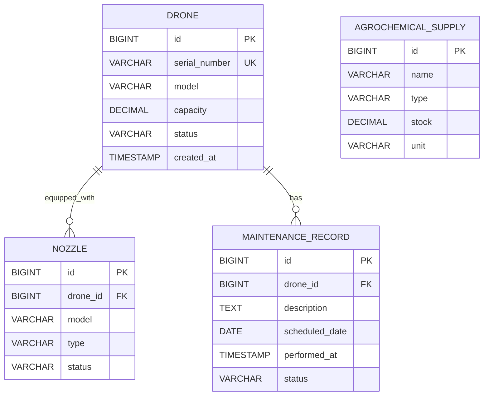

**Restricciones principales:** `DRONE.id`, `NOZZLE.id`, `MAINTENANCE_RECORD.id` y `AGROCHEMICAL_SUPPLY.id` son PK; `DRONE.serial_number` es único; `NOZZLE.drone_id` admite nulo (boquilla en inventario sin dron asignado) y `MAINTENANCE_RECORD.drone_id` es FK obligatoria; `DRONE.status` solo admite `AVAILABLE`, `ASSIGNED`, `IN_FLIGHT`, `PAUSED` y `MAINTENANCE`; `MAINTENANCE_RECORD.status` solo admite `SCHEDULED`, `COMPLETED` y `OVERDUE`; `capacity` debe ser mayor que cero y `stock` no puede ser negativo.

### 4.8.1.7. Vista integrada de persistencia

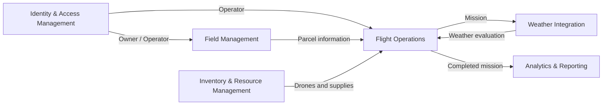

La separación por Bounded Context conserva responsabilidades claras, mientras que las relaciones entre contextos permiten soportar el flujo principal del negocio.

### 4.8.2. Normalización

El modelo relacional se diseñó aplicando hasta la Tercera Forma Normal (3FN) en cada Bounded Context, con algunas excepciones controladas que se justifican más abajo.

**Primera Forma Normal (1FN).** Todas las columnas almacenan valores atómicos y no existen grupos repetitivos. Las colecciones se modelan como tablas hijas con FK en lugar de columnas multivaluadas:
- Las incidencias, estados de operación y resultados de una misión están en `INCIDENT`, `OPERATION_STATUS` y `MISSION_RESULT`, no dentro de `MISSION`.
- Las métricas de un reporte están en `OPERATIONAL_METRIC` (FK a `MISSION_REPORT`), no como columnas `metric_1`, `metric_2`, etc.
- Las boquillas de un dron están en `NOZZLE` (FK a `DRONE`) y los mantenimientos en `MAINTENANCE_RECORD`.
- La geometría de parcelas y áreas se guarda como un único valor (`geometry`, en formato GeoJSON/WKT), tratado como dato atómico.

**Segunda Forma Normal (2FN).** Todas las tablas usan una PK simple (`id`), por lo que no existen dependencias parciales: cada atributo no clave depende de la clave completa. Las únicas claves compuestas son restricciones UNIQUE, no PK (por ejemplo, `MISSION_REPORT` con (`mission_id`, `type`)).

**Tercera Forma Normal (3FN).** No hay dependencias transitivas entre atributos no clave: los datos descriptivos se separan en su propia tabla y se referencian por FK.
- El cultivo (`name`, `variety`) está en `CROP` y `PARCEL` solo guarda `crop_id`.
- Los datos del propietario están en `USER_ACCOUNT` y `FARM` solo guarda `owner_id`; lo mismo para `MISSION.operator_id`.
- Los datos del dron (`model`, `capacity`, `serial_number`) están en `DRONE` y `MISSION` solo guarda `drone_id`.
- Los datos de la parcela se consultan desde `PARCEL` mediante `MISSION.parcel_id`.
- Las observaciones meteorológicas (`WEATHER_OBSERVATION`) y sus alertas (`WEATHER_ALERT`) se separan porque una observación puede generar varias alertas o ninguna.

**Desnormalización controlada.** Algunos atributos se duplican a propósito, por trazabilidad o rendimiento de consulta:
- `MISSION_REPORT.treated_area` y `applied_volume` guardan una copia de lo registrado en `MISSION` y `MISSION_RESULT` al momento de generar el reporte, de modo que el reporte sea un registro histórico que no cambie si después se corrige la misión.
- `MISSION_HISTORY.final_status` conserva el estado final de la misión en el historial.
- `PARCEL.area` y `FUMIGATION_AREA.area` son valores derivables de `geometry`, pero se almacenan para evitar recalcularlos en cada consulta.
- `MISSION.treated_area` resume el resultado de la operación y puede coincidir con `MISSION_RESULT.treated_area`.

Estas duplicaciones se mantienen sincronizadas desde la capa de aplicación al momento de registrar o finalizar una misión, y están limitadas a atributos de solo lectura una vez generado el reporte o historial.

---

# Capítulo V: Product Implementation, Validation & Deployment

## 5.1. Software Configuration Management

El **Software Configuration Management (SCM)** de AgriDron Solutions establece las herramientas, convenciones y procedimientos que permitirán mantener la consistencia del producto durante su ciclo de vida. Esta configuración cubre el entorno de desarrollo, la gestión del código fuente, las convenciones de programación y el despliegue de los productos de software.

De acuerdo con el Project Statement, esta sección debe establecer decisiones y convenciones para mantener la consistencia durante el ciclo de vida del producto. Además, se debe considerar el entorno utilizado para actividades de gestión del proyecto, requisitos, UX/UI, desarrollo, despliegue y documentación.

La propuesta de SCM para AgriDron Solutions se alinea con la arquitectura definida previamente: **Landing Page**, **Frontend Angular**, **Backend Spring Boot** y **base de datos relacional**, además de la integración con una API meteorológica externa.

### 5.1.1. Software Development Environment Configuration

#### 5.1.1.1. Propósito

El entorno de desarrollo define las herramientas que utilizará el equipo para implementar, documentar, probar y desplegar AgriDron Solutions. Se busca que todos los integrantes trabajen con una configuración homogénea, reduciendo problemas de compatibilidad y facilitando la colaboración.

El Project Statement indica que esta sección debe especificar el nombre de cada producto de software, su propósito y la ruta de referencia o descarga correspondiente, considerando las actividades de Project Management, Requirements Management, UX/UI Design, Software Development, Software Deployment y Software Documentation.

#### 5.1.1.2. Herramientas del proyecto

La siguiente tabla indica, para cada actividad del ciclo de vida del producto, los productos de software que utiliza el equipo, su propósito de uso en el proyecto y su ruta de referencia (productos SaaS) o de descarga (productos que se ejecutan en el computador de cada integrante).

| Actividad               | Producto                         | Propósito de uso en el proyecto                                                   | Tipo  | Ruta de referencia o descarga                                                                 |
|-------------------------|----------------------------------|-----------------------------------------------------------------------------------|-------|-----------------------------------------------------------------------------------------------|
| Project Management      | Trello                           | Organización de los Sprint Backlogs y seguimiento de las tareas del equipo.       | SaaS  | https://trello.com/                                                                           |
| Requirements Management | Trello                           | Gestión del Product Backlog y de los User Stories.                                | SaaS  | https://trello.com/                                                                           |
| Requirements Management | UXPressia                        | Elaboración de User Personas, Empathy Maps, User Journey Maps e Impact Mapping.   | SaaS  | https://uxpressia.com/                                                                        |
| Requirements Management | Miro                             | Elaboración del Big Picture EventStorming y de los User Flows.                    | SaaS  | https://miro.com/                                                                             |
| Product UX/UI Design    | Figma                            | Diseño de wireframes, wireflows, mock-ups y prototipos del Landing Page y de la Web Application. | SaaS  | https://www.figma.com/                                                                    |
| Product UX/UI Design    | Lucidchart                       | Elaboración del Design-Level EventStorming.                                       | SaaS  | https://www.lucidchart.com/                                                                   |
| Software Development    | Git                              | Control de versiones local del código fuente.                                     | Local | https://git-scm.com/downloads                                                                 |
| Software Development    | GitHub                           | Hospedaje de repositorios y colaboración mediante GitFlow, Pull Requests y Conventional Commits. | SaaS  | https://github.com/                                                         |
| Software Development    | HTML5, CSS3 y JavaScript         | Implementación del Landing Page.                                                  | Local | https://developer.mozilla.org/                                                                |
| Software Development    | Visual Studio Code               | Editor para el desarrollo del Landing Page y del Frontend Web Application.        | Local | https://code.visualstudio.com/download                                                        |
| Software Development    | Node.js y npm                    | Instalación de dependencias y ejecución de las herramientas de Angular.           | Local | https://nodejs.org/en/download                                                                |
| Software Development    | Angular                          | Framework del Frontend Web Application.                                           | Local | https://angular.dev/                                                                          |
| Software Development    | TypeScript                       | Lenguaje de programación del Frontend Web Application.                            | Local | https://www.typescriptlang.org/download                                                       |
| Software Development    | Angular Material                 | Biblioteca de componentes de UI basada en Material Design.                        | Local | https://material.angular.dev/                                                                 |
| Software Development    | Java (JDK)                       | Lenguaje de programación de los Web Services.                                     | Local | https://jdk.java.net/                                                                         |
| Software Development    | Spring Boot y Spring Data JPA    | Implementación del RESTful API y acceso a datos de los Web Services.              | Local | https://spring.io/projects/spring-boot y https://spring.io/projects/spring-data-jpa           |
| Software Development    | Maven                            | Gestión de dependencias y construcción del proyecto de los Web Services.          | Local | https://maven.apache.org/download.cgi                                                         |
| Software Development    | IntelliJ IDEA                    | IDE para el desarrollo de los Web Services.                                       | Local | https://www.jetbrains.com/idea/download/                                                      |
| Software Development    | PostgreSQL                       | Base de datos relacional para la persistencia de la información.                  | Local | https://www.postgresql.org/download/                                                          |
| Software Development    | Postman                          | Pruebas manuales de los endpoints del RESTful API.                                | Local | https://www.postman.com/downloads/                                                            |
| Software Deployment     | GitHub Actions                   | Automatización de la integración continua y del despliegue desde los repositorios. | SaaS  | https://github.com/features/actions                                                          |
| Software Documentation  | Markdown                         | Elaboración del informe del proyecto en el archivo README.md.                     | Local | https://www.markdownguide.org/                                                                |
| Software Documentation  | Mermaid                          | Diagramas como código (C4 Model, diagramas de clases y de base de datos) renderizados en GitHub. | SaaS  | https://mermaid.js.org/                                                       |
| Software Documentation  | Swagger / OpenAPI                | Documentación de los endpoints de los Web Services.                               | Local | https://swagger.io/specification/                                                             |


#### 5.1.1.3. Configuración base

Todos los integrantes deberán mantener una configuración equivalente para evitar diferencias entre ambientes locales.

##### Frontend

```text
Node.js
npm
Angular CLI
Angular
TypeScript
```

##### Backend

```text
Java JDK
Maven
Spring Boot
IDE compatible con Java
```

##### Base de datos

```text
PostgreSQL
Cliente gráfico de base de datos
```

##### Control de versiones

```text
Git
GitHub
GitFlow
Conventional Commits
Semantic Versioning
```

#### 5.1.1.4. Estructura de repositorios

Para mantener separadas las responsabilidades de los productos, se propone trabajar con repositorios independientes:

```text
AgriDron Solutions
│
├── agridron-landing
│   └── Landing Page
│
├── agridron-frontend
│   └── Frontend Angular
│
└── agridron-backend
    ├── Backend Spring Boot
    ├── Unit Tests
    └── Integration / Acceptance Tests
```

Esta organización sigue la indicación del Project Statement de considerar los productos **Landing Page, Web Services y Frontend Web Applications** y, en el caso de Web Services, incluir también los archivos de pruebas.


### 5.1.2. Source Code Management

#### 5.1.2.1. Plataforma y repositorios

El control de versiones del proyecto se realizará mediante **Git gestionado desde GitHub**. El Project Statement establece explícitamente GitHub como plataforma de control de versiones y solicita aplicar **GitFlow Workflow, Conventional Commits y Semantic Versioning**.

Los repositorios considerados para AgriDron Solutions son:

| Producto                 | Repositorio                   | Contenido                                                     | Link de Github                                                |
|--------------------------|-------------------------------|---------------------------------------------------------------|---------------------------------------------------------------|
| Report                  | `1ASI0729-2620-7760-G3-Agridron-Report` | Documento en Markdown                                        | https://github.com/Opensource-UPC/1ASI0729-2620-7760-G3-Agridron-Report |
| Landing Page             | `AgiDron-LandingPage-7760-G3` | HTML, CSS y JavaScript                                        | https://github.com/Opensource-UPC/AgiDron-LandingPage-7760-G3 |
| Frontend Web Application | `AgiDron-FrontEnd-7760-G3`    | Angular y TypeScript                                          | https://github.com/Opensource-UPC/Agridron-frontend           |
| Web Services             | `AgiDron-BackEnd-7760-G3`     | Java, Spring Boot, pruebas unitarias e integración/aceptación | https://github.com/Opensource-UPC/Agridron-backend            |

#### 5.1.2.2. GitFlow Workflow

Se utilizará **GitFlow** como estrategia de organización de ramas.

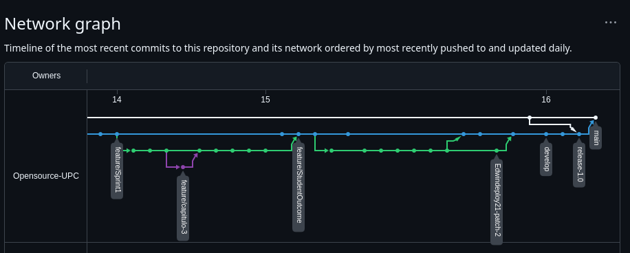

##### Ramas principales

| Branch      | Propósito                                                     |
|-------------|---------------------------------------------------------------|
| `main`      | Contiene versiones estables listas para entrega o producción. |
| `develop`   | Rama de integración de funcionalidades terminadas.            |
| `feature/*` | Desarrollo aislado de una funcionalidad específica.           |
| `release/*` | Preparación de una nueva versión estable.                     |
| `hotfix/*`  | Corrección urgente de errores encontrados en producción.      |

#### 5.1.2.3. Convención para Feature Branches

Cada funcionalidad debe desarrollarse en una rama independiente.


Se utilizarán nombres en **inglés**, en minúsculas y separados mediante guiones.

#### 5.1.2.4. Convención para Release Branches

Formato:

```text
release/<major>.<minor>.<patch>
```

Ejemplos:

```text
release/1.0.0
release/1.1.0
release/1.1.1
```

Las release branches permiten realizar ajustes finales antes de integrar una versión estable a `main`.

#### 5.1.2.5. Convención para Hotfix Branches

Formato:

```text
hotfix/<descripcion>
```

Ejemplos:

```text
hotfix/weather-api-error
hotfix/mission-status-fix
hotfix/login-validation
```

Los hotfixes estarán destinados exclusivamente a correcciones urgentes de versiones publicadas.

#### 5.1.2.6. Pull Requests

Las modificaciones realizadas en `feature/*`, `release/*` y `hotfix/*` deberán integrarse mediante Pull Requests.

Flujo recomendado:

```text
feature/*
    ↓
Pull Request
    ↓
Code Review
    ↓
Tests
    ↓
Merge
    ↓
develop
```

Para una versión estable:

```text
develop
    ↓
release/x.y.z
    ↓
Validation
    ↓
main
    ↓
Tag vX.Y.Z
```

Se recomienda que ningún integrante trabaje directamente sobre `main` para funcionalidades nuevas.

#### 5.1.2.7. Conventional Commits

Los mensajes de commit seguirán la especificación de **Conventional Commits**.

Formato:

```text
<type>[optional scope]: <description>
```

Ejemplos:

```text
feat(field): add parcel registration
feat(mission): add mission planning
fix(weather): handle unavailable API response
docs(api): update endpoint documentation
test(mission): add mission service tests
refactor(report): simplify report generation
chore(deps): update project dependencies
```

Tipos principales:

| Tipo       | Uso                                                       |
|------------|-----------------------------------------------------------|
| `feat`     | Nueva funcionalidad.                                      |
| `fix`      | Corrección de un error.                                   |
| `docs`     | Cambios en documentación.                                 |
| `test`     | Creación o modificación de pruebas.                       |
| `refactor` | Reestructuración sin cambiar el comportamiento funcional. |
| `style`    | Cambios de formato que no modifican la lógica.            |
| `chore`    | Tareas de mantenimiento o configuración.                  |

Conventional Commits relaciona `feat` con incrementos **MINOR**, `fix` con incrementos **PATCH** y los cambios incompatibles con incrementos **MAJOR**, facilitando su integración con Semantic Versioning.

#### 5.1.2.8. Semantic Versioning

Las versiones del producto seguirán el formato:

```text
MAJOR.MINOR.PATCH
```

Ejemplo:

```text
1.0.0
```

Reglas:

- **MAJOR:** cambios incompatibles con versiones anteriores.
- **MINOR:** nuevas funcionalidades compatibles.
- **PATCH:** correcciones compatibles.

Ejemplos:

```text
1.0.0 → primera versión estable
1.1.0 → incorporación del módulo de monitoreo
1.1.1 → corrección de un error
2.0.0 → cambio incompatible de la API
```

Las versiones estables serán identificadas mediante tags de Git:

```text
v1.0.0
v1.1.0
v1.1.1
```

### 5.1.3. Source Code Style Guide & Conventions

#### 5.1.3.1. Principios generales

El Project Statement establece que para los lenguajes utilizados en la solución debe aplicarse nomenclatura en **inglés**. Para AgriDron Solutions se aplicará esta regla a HTML, CSS, JavaScript, TypeScript y Java.

Principios:

1. Utilizar nombres descriptivos.
2. Mantener una nomenclatura consistente.
3. Evitar abreviaturas innecesarias.
4. Mantener métodos y clases con responsabilidades específicas.
5. Evitar duplicación de código.
6. Mantener funciones pequeñas y legibles.
7. Documentar únicamente la lógica que requiera contexto adicional.
8. Mantener las pruebas junto con el código correspondiente.
9. No incluir credenciales ni secretos dentro del código fuente.

#### 5.1.3.2. HTML

Convenciones:

- Utilizar HTML5 semántico.
- Utilizar elementos semánticos como `header`, `nav`, `main`, `section` y `footer`.
- Utilizar atributos `aria-*` cuando sean necesarios para accesibilidad.
- Utilizar nombres descriptivos para clases e identificadores.
- Mantener los atributos en minúsculas.

Ejemplo:

```html
<section class="mission-summary" aria-labelledby="mission-title">
  <h2 id="mission-title">Mission Summary</h2>
</section>
```

#### 5.1.3.3. CSS

Convenciones:

- Utilizar nombres de clases en inglés.
- Utilizar `kebab-case` para clases CSS.
- Evitar estilos inline cuando no sean necesarios.
- Agrupar reglas relacionadas.
- Evitar selectores excesivamente específicos.

Ejemplo:

```css
.mission-card {
  display: flex;
  gap: 1rem;
}

.mission-card__status {
  font-weight: 600;
}
```

#### 5.1.3.4. JavaScript

Convenciones:

- Variables y funciones: `camelCase`.
- Constantes: `UPPER_SNAKE_CASE` cuando representen valores constantes globales.
- Clases: `PascalCase`.
- Utilizar `const` por defecto y `let` cuando sea necesario.
- Evitar variables globales.

Ejemplo:

```javascript
const DEFAULT_MISSION_STATUS = "PLANNED";

function createMission(missionData) {
  // implementation
}
```

#### 5.1.3.5. TypeScript / Angular

Convenciones:

| Elemento   | Convención       | Ejemplo              |
|------------|------------------|----------------------|
| Clase      | PascalCase       | `MissionService`     |
| Interface  | PascalCase       | `Mission`            |
| Variable   | camelCase        | `missionStatus`      |
| Método     | camelCase        | `createMission()`    |
| Constante  | UPPER_SNAKE_CASE | `API_BASE_URL`       |
| Archivo    | kebab-case       | `mission.service.ts` |
| Componente | kebab-case       | `mission-list`       |

Ejemplo:

```typescript
export interface Mission {
  id: number;
  parcelId: number;
  requestedDate: string;
  status: MissionStatus;
}

export class MissionService {
  createMission(mission: Mission): void {
    // implementation
  }
}
```

#### 5.1.3.6. Java / Spring Boot

Convenciones:

| Elemento | Convención       | Ejemplo                |
|----------|------------------|------------------------|
| Class    | PascalCase       | `MissionService`       |
| Method   | camelCase        | `createMission()`      |
| Variable | camelCase        | `missionStatus`        |
| Constant | UPPER_SNAKE_CASE | `MAX_MISSION_DURATION` |
| Package  | lowercase        | `com.agridron.mission` |
| DTO      | PascalCase + DTO | `MissionResponseDTO`   |
| Entity   | PascalCase       | `Mission`              |

La estructura del backend seguirá la organización por Bounded Context y, dentro de cada uno, por capas (TU-001):

```text
<bounded-context>/
  domain/
  application/
  infrastructure/
  interfaces/
```

Ejemplo:

```java
@RestController
@RequestMapping("/api/v1/missions")
public class MissionController {

  @GetMapping("/{id}")
  public MissionResponseDTO getMission(@PathVariable Long id) {
    return missionService.getMission(id);
  }
}
```

#### 5.1.3.7. API REST

Los endpoints utilizarán nombres de recursos en plural y en inglés.

Ejemplos:

```text
GET    /api/v1/farms
GET    /api/v1/parcels
POST   /api/v1/parcels
GET    /api/v1/missions
POST   /api/v1/missions
PUT    /api/v1/missions/{id}
PATCH  /api/v1/missions/{id}/status
GET    /api/v1/weather
GET    /api/v1/mission-reports
```

Se utilizarán los verbos HTTP según la operación:

| Verbo  | Uso                                 |
|--------|-------------------------------------|
| GET    | Consultar recursos.                 |
| POST   | Crear recursos.                     |
| PUT    | Actualizar un recurso.              |
| PATCH  | Actualizar parcialmente un recurso. |
| DELETE | Eliminar un recurso.                |

#### 5.1.3.8. Documentación y lenguaje

El idioma por defecto definido para los mensajes, interfaz de usuario e interfaz de documentación de los productos de la solución es **inglés**.

Por lo tanto:

- Variables: inglés.
- Clases: inglés.
- Métodos: inglés.
- Endpoints: inglés.
- Mensajes de API: inglés.
- Documentación técnica: inglés.
- Textos visibles para el usuario: inglés, salvo que una decisión posterior de UX establezca otro idioma.

### 5.1.4. Software Deployment Configuration

#### 5.1.4.1. Objetivo

El despliegue permitirá publicar los productos de AgriDron Solutions en plataformas cloud y automatizar progresivamente el proceso de entrega.

El Project Statement establece que esta configuración debe contemplar la creación de cuentas, configuración de recursos en proveedores cloud y configuración de proyectos de desarrollo para integración o automatización del deployment. El proceso debe considerar los productos **Landing Page, Web Applications y Web Services**.

#### 5.1.4.2. Arquitectura de despliegue

Se propone separar los componentes desplegables de acuerdo con la arquitectura del sistema:

```mermaid
flowchart TB
  User["User"]
  GitHub["GitHub Repository"]

  subgraph Cloud["Cloud Environment"]
    Landing["Landing Page"]
    Frontend["Angular Frontend"]
    Backend["Spring Boot REST API"]
    Database[("Relational Database")]
  end

  Weather["External Weather API"]

  User --> Landing
  User --> Frontend
  Frontend --> Backend
  Backend --> Database
  Backend --> Weather

  GitHub -->|"CI/CD"| Landing
  GitHub -->|"CI/CD"| Frontend
  GitHub -->|"CI/CD"| Backend
```

#### 5.1.4.3. Ambientes

Se utilizarán tres ambientes conceptuales:

| Ambiente    | Propósito                                     |
|-------------|-----------------------------------------------|
| Development | Desarrollo local y validaciones iniciales.    |
| Staging     | Integración y validación antes de producción. |
| Production  | Versión disponible para los usuarios.         |

Flujo:

```text
feature/*
    ↓
Development
    ↓
develop
    ↓
Staging
    ↓
release/*
    ↓
main
    ↓
Production
```

#### 5.1.4.4. Integración continua

El repositorio podrá utilizar **GitHub Actions** para automatizar las tareas de integración y despliegue.

Pipeline conceptual:

```mermaid
flowchart LR
  Commit["Push / Pull Request"]
  Checkout["Checkout"]
  Build["Build"]
  Test["Automated Tests"]
  Package["Package"]
  DeployStaging["Deploy Staging"]
  Validate["Validation"]
  DeployProd["Deploy Production"]

  Commit --> Checkout
  Checkout --> Build
  Build --> Test
  Test --> Package
  Package --> DeployStaging
  DeployStaging --> Validate
  Validate --> DeployProd
```

##### Backend

```text
Checkout
↓
Install dependencies
↓
Run unit tests
↓
Run integration tests
↓
Build Spring Boot application
↓
Package application
↓
Deploy
```

##### Frontend

```text
Checkout
↓
Install npm dependencies
↓
Run lint
↓
Run tests
↓
Build Angular application
↓
Deploy
```

##### Landing Page

```text
Checkout
↓
Validate files
↓
Build / prepare static assets
↓
Deploy
```

#### 5.1.4.5. Variables y secretos

Las credenciales, API keys, tokens y contraseñas no deberán almacenarse directamente en el repositorio.

Se utilizarán variables de entorno y secretos administrados por la plataforma de CI/CD.

Ejemplos:

```text
DB_HOST
DB_USER
DB_PASSWORD
WEATHER_API_KEY
JWT_SECRET
```

Los valores reales no se incluirán en archivos versionados.

GitHub permite asociar secretos y variables a ambientes de despliegue. Además, los ambientes pueden restringir qué branches o tags tienen autorización para realizar deployments y pueden aplicar reglas de protección.

#### 5.1.4.6. Configuración de base de datos

La base de datos relacional se desplegará como un servicio administrado o recurso equivalente dentro del proveedor cloud seleccionado.

La configuración deberá considerar:

- Nombre de base de datos.
- Usuario de aplicación.
- Contraseña almacenada como secreto.
- Host.
- Puerto.
- SSL/TLS cuando sea requerido.
- Variables de conexión.
- Backups.
- Restricción de acceso desde servicios autorizados.

El Backend consumirá la configuración mediante variables de entorno, por ejemplo:

```text
DB_HOST
DB_PORT
DB_NAME
DB_USER
DB_PASSWORD
```

#### 5.1.4.7. Configuración de la API meteorológica

La API meteorológica será consumida exclusivamente desde el Backend.

```text
Frontend
   ↓
Backend
   ↓
Weather API
```

La clave de acceso de la API meteorológica deberá almacenarse como secreto:

```text
WEATHER_API_KEY
```

El Frontend no deberá contener directamente la clave privada del proveedor meteorológico.

#### 5.1.4.8. Estrategia de deployment

La estrategia propuesta es:

1. Los desarrolladores trabajan en `feature/*`.
2. Se crea un Pull Request hacia `develop`.
3. Se ejecutan las pruebas automáticas.
4. La funcionalidad aprobada se integra en `develop`.
5. Una `release/*` prepara la versión.
6. La versión se valida en staging.
7. Se integra en `main`.
8. Se crea el tag correspondiente a Semantic Versioning.
9. El pipeline despliega la versión en production.

```mermaid
flowchart TD
  A["feature/*"] --> B["Pull Request"]
  B --> C{"Tests pass?"}
  C -->|"No"| A
  C -->|"Yes"| D["develop"]
  D --> E["release/x.y.z"]
  E --> F["Staging"]
  F --> G{"Validation approved?"}
  G -->|"No"| E
  G -->|"Yes"| H["main"]
  H --> I["Tag vX.Y.Z"]
  I --> J["Production"]
```

#### 5.1.4.9. Trazabilidad del deployment

Cada versión desplegada deberá poder relacionarse con:

```text
Git Commit
    ↓
Pull Request
    ↓
Branch
    ↓
Release
    ↓
Semantic Version
    ↓
Deployment
```

Esto permite identificar qué cambios forman parte de una versión determinada y facilita la recuperación ante errores.

---

## 5.2. Landing Page, Services & Applications Implementation

### 5.2.1. Sprint 1

#### 5.2.1.1. Sprint Planning 1

| Campo                            | Detalle                                                                                                                                                                                                                                        |
|:---------------------------------|:-----------------------------------------------------------------------------------------------------------------------------------------------------------------------------------------------------------------------------------------------|
| Sprint #                         | 1                                                                                                                                                                                                                                              |
| Sprint Planning Background       | En este sprint se definió la base funcional de AgriDron Solutions con foco en la propuesta de valor del producto, la navegación inicial de la landing page y la estructura inicial del ecosistema web para agricultores y operadores técnicos. |
| Date                             | 15/09/2026                                                                                                                                                                                                                                     |
| Time                             | 18:30 PM                                                                                                                                                                                                                                       |
| Location                         | Reunión virtual (Google Meet / Zoom)                                                                                                                                                                                                           |
| Prepared By                      | Edwin Noe Nicho Huillcañahui                                                                                                                                                                                                                   |
| Attendees (to planning meeting)  | Italo Gianfranco Damacen Galindo, Edwin Noe Nicho Huillcañahui, Gabriel Ramírez Gutiérrez, Sebastián Leonardo Sayago Vidal, Alexander Felipe Vásquez Roncal                                                                                    |
| Sprint 1 - Review Summary        | Se validó la estructura inicial del producto, la claridad del valor para los agricultores, y la necesidad de crear una primera versión funcional de la landing page y la gestión básica de usuarios y fincas.                                  |
| Sprint 1 - Retrospective Summary | Se identificaron oportunidades para mejorar la coordinación del equipo, definir mejor la distribución de tareas y acelerar la integración entre frontend y backend en los siguientes sprint.                                                   |

#### Sprint Goal & User Stories

| Aspecto             | Descripción                                                                                                                                                                                              |
|:--------------------|:---------------------------------------------------------------------------------------------------------------------------------------------------------------------------------------------------------|
| Sprint 1 Goal       | Definir la base del producto AgriDron para que el usuario pueda entender la propuesta de valor, registrarse, iniciar sesión y gestionar los primeros datos de una finca y la programación de una misión. |
| Velocity            | 18                                                                                                                                                                                                       |
| Sum of Story Points | 18                                                                                                                                                                                                       |

#### 5.2.1.2. Aspect Leaders and Collaborators
Esta distribución permite definir responsabilidades claras dentro del equipo y facilita la coordinación durante el desarrollo del proyecto. Asimismo, la organización de líderes y colaboradores mantiene relación directa con la posterior selección de tareas, ya que el líder de cada aspecto tiene la responsabilidad principal de coordinar y dar seguimiento al trabajo correspondiente.

| Team Member (Last Name, First Name) | GitHub Username | Identity & Access Management | Field Management | Flight Operations | Weather Integration | Analytics & Reporting | Inventory & Resource Management |
|---|---|---|---|---|---|---|---|
| Ramírez Gutiérrez, Gabriel | GabrielRamirez06 | **L** | C | C | C | C | C |
| Vásquez Roncal, Alexander Felipe | Dev-AlexanderVasquez | C | **L** | **L** | C | C | C |
| Damacen Galindo, Italo Gianfranco | Ital0Dmc | C | C | C | **L** | C | C |
| Sayago Vidal, Sebastián Leonardo | SSayag0V | C | C | C | C | **L** | C |
| Nicho Huillcañahui, Edwin Noe | Edwindeploy21 | C | C | C | C | C | **L** |

**Leyenda:**

- **L (Leader):** integrante responsable de liderar y coordinar el trabajo relacionado con el aspecto asignado.
- **C (Collaborator):** integrante que participa como colaborador y brinda apoyo en el desarrollo del aspecto.

#### 5.2.1.3. Sprint Backlog 1

En esta sección se registra y explica el avance en términos de producto y trabajo colaborativo para el Sprint 1. Incluye las secciones internas de Sprint Planning 1, Aspect Leaders and Collaborators, Sprint Backlog 1, Development Evidence for Sprint Review, Execution Evidence for Sprint Review, Services Documentation Evidence for Sprint Review y Team Collaboration Insights during Sprint.

**Link del trello:** https://trello.com/invite/b/6aac1a270d8f45bc33ecd592/ATTIbc784176eb8dc497a26da32a3c554ea69211FF0D/agridron


| Sprint # | Story Id | Story Title | Task Id | Task Title | Task Description | Estimation (Hours) | Assigned To | Status |
|---|---|---|---|---|---|---:|---|---|
| Sprint 1 | LP-001 | Como visitante, quiero visualizar la propuesta de valor de AgriDron para entender rápidamente qué ofrece la solución. | T01 | Definir el mensaje principal y el público objetivo. | Definir el mensaje principal de la Landing Page y establecer el público objetivo al que se dirige la propuesta de valor de AgriDron. | 2 | Italo Damacen | Done |
| Sprint 1 | LP-001 | Como visitante, quiero visualizar la propuesta de valor de AgriDron para entender rápidamente qué ofrece la solución. | T02 | Diseñar la composición visual del hero section y seleccionar la imagen principal. | Diseñar la estructura visual del hero section y seleccionar los recursos gráficos principales para comunicar la propuesta de valor. | 3 | Sebastián Sayago | Done |
| Sprint 1 | LP-001 | Como visitante, quiero visualizar la propuesta de valor de AgriDron para entender rápidamente qué ofrece la solución. | T03 | Implementar el hero section, el CTA principal y la navegación hacia las secciones. | Implementar el hero section de la Landing Page, incluyendo el CTA principal y los elementos de navegación hacia las demás secciones. | 4 | Sebastián Sayago | Done |
| Sprint 1 | LP-001 | Como visitante, quiero visualizar la propuesta de valor de AgriDron para entender rápidamente qué ofrece la solución. | T04 | Validar la visualización del hero y el CTA en desktop y mobile. | Verificar la correcta visualización y adaptación responsive del hero section y del CTA principal en dispositivos desktop y mobile. | 2 | Edwin Nicho | Done |
| Sprint 1 | LP-002 | Como visitante, quiero observar los servicios principales de la plataforma para evaluar si responde a mis necesidades. | T05 | Definir los servicios y beneficios que se comunicarán al visitante. | Identificar y definir los principales servicios y beneficios de AgriDron que serán presentados en la Landing Page. | 2 | Italo Damacen | Done |
| Sprint 1 | LP-002 | Como visitante, quiero observar los servicios principales de la plataforma para evaluar si responde a mis necesidades. | T06 | Diseñar las tarjetas, iconos y jerarquía visual de la sección. | Diseñar las tarjetas, iconos y jerarquía visual necesarios para presentar los servicios de manera clara y organizada. | 3 | Alexander Vásquez | Done |
| Sprint 1 | LP-002 | Como visitante, quiero observar los servicios principales de la plataforma para evaluar si responde a mis necesidades. | T07 | Implementar la sección de servicios con al menos tres opciones. | Implementar la sección de servicios de la Landing Page incorporando al menos tres opciones representativas de la plataforma. | 4 | Sebastián Sayago | Done |
| Sprint 1 | LP-002 | Como visitante, quiero observar los servicios principales de la plataforma para evaluar si responde a mis necesidades. | T08 | Comprobar la legibilidad, orden y adaptación responsive de las tarjetas. | Verificar la legibilidad, distribución visual y comportamiento responsive de las tarjetas de servicios. | 2 | Edwin Nicho | Done |
| Sprint 1 | LP-003 | Como visitante, quiero conocer los planes de precios y suscripción para tomar una decisión informada sobre la contratación del servicio. | T09 | Definir los planes, precios y características que se mostrarán. | Definir los planes de suscripción, precios y principales características que serán presentados al visitante. | 2 | Italo Damacen | Done |
| Sprint 1 | LP-003 | Como visitante, quiero conocer los planes de precios y suscripción para tomar una decisión informada sobre la contratación del servicio. | T10 | Diseñar la tabla o tarjetas comparativas de planes. | Diseñar la estructura visual de las tarjetas o tabla comparativa para facilitar la evaluación de los planes disponibles. | 3 | Alexander Vásquez | Done |
| Sprint 1 | LP-003 | Como visitante, quiero conocer los planes de precios y suscripción para tomar una decisión informada sobre la contratación del servicio. | T11 | Implementar la sección de planes y destacar la opción recomendada. | Implementar la sección de planes de suscripción y destacar visualmente la alternativa recomendada para el visitante. | 4 | Sebastián Sayago | Done |
| Sprint 1 | LP-003 | Como visitante, quiero conocer los planes de precios y suscripción para tomar una decisión informada sobre la contratación del servicio. | T12 | Verificar la claridad de precios, beneficios y CTA de cada plan. | Comprobar que los precios, beneficios y llamados a la acción de cada plan sean claros y correctamente visualizados. | 2 | Edwin Nicho | Done |
| Sprint 1 | LP-004 | Como visitante, quiero registrarme en la plataforma proporcionando mis datos básicos para acceder a las funcionalidades de la Web Application. | T13 | Definir el CTA de registro y su ubicación dentro de la landing page. | Definir el llamado a la acción para el registro y establecer las ubicaciones donde será presentado dentro de la Landing Page. | 2 | Italo Damacen | Done |
| Sprint 1 | LP-004 | Como visitante, quiero registrarme en la plataforma proporcionando mis datos básicos para acceder a las funcionalidades de la Web Application. | T14 | Diseñar el formulario o modal de registro y sus estados visuales. | Diseñar la interfaz del formulario o modal de registro considerando sus principales estados visuales. | 3 | Alexander Vásquez | Done |
| Sprint 1 | LP-004 | Como visitante, quiero registrarme en la plataforma proporcionando mis datos básicos para acceder a las funcionalidades de la Web Application. | T15 | Implementar el enlace y la navegación hacia el flujo de registro. | Implementar el enlace correspondiente y la navegación desde la Landing Page hacia el flujo de registro de la Web Application. | 3 | Gabriel Ramírez | Done |
| Sprint 1 | LP-004 | Como visitante, quiero registrarme en la plataforma proporcionando mis datos básicos para acceder a las funcionalidades de la Web Application. | T16 | Validar el CTA y la navegación de registro desde desktop y mobile. | Verificar que el CTA y la navegación hacia el registro funcionen correctamente y se adapten a dispositivos desktop y mobile. | 2 | Edwin Nicho | Done |
| Sprint 1 | LP-005 | Como visitante registrado, quiero iniciar sesión con mis credenciales para acceder a la Web Application. | T17 | Definir el CTA de inicio de sesión en la navegación y en las secciones relevantes. | Definir las ubicaciones del llamado a la acción de inicio de sesión dentro de la navegación y las secciones relevantes de la Landing Page. | 2 | Italo Damacen | Done |
| Sprint 1 | LP-005 | Como visitante registrado, quiero iniciar sesión con mis credenciales para acceder a la Web Application. | T18 | Diseñar el acceso visual al formulario de inicio de sesión. | Diseñar el acceso visual hacia el formulario de inicio de sesión manteniendo la consistencia con la interfaz de la Landing Page. | 3 | Alexander Vásquez | Done |
| Sprint 1 | LP-005 | Como visitante registrado, quiero iniciar sesión con mis credenciales para acceder a la Web Application. | T19 | Implementar el enlace y la navegación hacia el flujo de inicio de sesión. | Implementar el enlace y la navegación desde la Landing Page hacia el flujo de inicio de sesión de la Web Application. | 3 | Gabriel Ramírez | Done |
| Sprint 1 | LP-005 | Como visitante registrado, quiero iniciar sesión con mis credenciales para acceder a la Web Application. | T20 | Comprobar que el CTA sea visible, accesible y responsive. | Verificar la visibilidad, accesibilidad y adaptación responsive del CTA de inicio de sesión en los diferentes tamaños de pantalla. | 2 | Edwin Nicho | Done |
| Sprint 1 | LP-006 | Como visitante, quiero acceder a los términos y condiciones de servicio para conocer las políticas de uso y privacidad. | T21 | Redactar y organizar el contenido de términos, condiciones y privacidad. | Redactar y estructurar el contenido correspondiente a términos, condiciones de servicio y políticas de privacidad. | 3 | Italo Damacen | Done |
| Sprint 1 | LP-006 | Como visitante, quiero acceder a los términos y condiciones de servicio para conocer las políticas de uso y privacidad. | T22 | Diseñar los enlaces legales y la estructura del footer. | Diseñar la estructura visual del footer y los enlaces correspondientes a la información legal de la plataforma. | 2 | Alexander Vásquez | Done |
| Sprint 1 | LP-006 | Como visitante, quiero acceder a los términos y condiciones de servicio para conocer las políticas de uso y privacidad. | T23 | Implementar el footer y la navegación a las páginas legales. | Implementar el footer de la Landing Page y la navegación hacia las páginas o secciones con información legal. | 3 | Sebastián Sayago | Done |
| Sprint 1 | LP-006 | Como visitante, quiero acceder a los términos y condiciones de servicio para conocer las políticas de uso y privacidad. | T24 | Verificar los enlaces, el contraste y la lectura en dispositivos móviles. | Comprobar el funcionamiento de los enlaces legales, el contraste visual y la legibilidad del contenido en dispositivos móviles. | 2 | Edwin Nicho | Done |
#### 5.2.1.4. Development Evidence for Sprint Review

Durante este sprint se desarrolló la base del producto AgriDron con una landing page informativa, una estructura visual clara para servicios y un primer flujo de autenticación. Además, se inició la definición de los principales módulos de gestión de fincas y misiones, de acuerdo con la arquitectura propuesta en el proyecto.

La siguiente tabla presenta los commits de implementación realizados durante el Sprint 1 en los repositorios de los productos.

| Repository | Branch | Commit Id | Commit Message | Commit Message Body | Committed on (Date) |
|---|---|---|---|---|---|
| Opensource-UPC/AgiDron-LandingPage-7760-G3 | main | 394d481 | Initial commit | — | 10/09/2026 |
| Opensource-UPC/AgiDron-LandingPage-7760-G3 | main | b9cb5b7 | Add project title to README | — | 10/09/2026 |
| Opensource-UPC/AgiDron-LandingPage-7760-G3 | main | efa1777 | Update README.md | — | 10/09/2026 |
| Opensource-UPC/AgiDron-LandingPage-7760-G3 | feature/landing | bbdc638 | First Version of the Landing Page | — | 10/09/2026 |
| Opensource-UPC/AgiDron-LandingPage-7760-G3 | feature/landing | 38d29a3 | Update | — | 10/09/2026 |
| Opensource-UPC/AgiDron-LandingPage-7760-G3 | feature/landing | e6e7063 | Add login and register pages | — | 13/09/2026 |
| Opensource-UPC/AgiDron-LandingPage-7760-G3 | feature/landing | 1962f70 | Create README.md | — | 13/09/2026 |
| Opensource-UPC/AgiDron-LandingPage-7760-G3 | develop | f50296b | feature/cambio de elementos y agregar un integrante | — | 15/09/2026 |
| Opensource-UPC/Agridron-frontend | main | e19388c | Initial commit | — | 17/09/2026 |


La evidencia de desarrollo incluye la versión inicial del landing page, la propuesta visual del producto y la estructura base del sistema para registro, autenticación y gestión de misiones. En paralelo, se validó la consistencia con la propuesta de valor y los segmentos objetivo, reforzando la dirección de diseño del producto.

#### 5.2.1.5. Execution Evidence for Sprint Review

La ejecución del sprint se apoyó en reuniones de coordinación semanales, revisión de avances por módulo y validación de tareas cumplidas por cada miembro del equipo. Se utilizó la división por áreas para mantener flujo de trabajo constante y reducir bloqueos en frontend, backend y documentación.


Se evidenció avance continuo en la implementación de la landing page, la estructura de la aplicación web y la definición del backend base. Además, el equipo registró avances parciales en el flujo de autenticación y en la gestión inicial de misiones, con seguimiento directo del estado de cada story.


**Link LandingPage:** [https://agridronlandingpage.web.app](https://agridronlandingpage.web.app)


#### 5.2.1.6. Services Documentation Evidence for Sprint Review

Se documentó la arquitectura inicial del sistema, sus componentes principales y el alcance funcional del primer sprint. La documentación cubrió los servicios propuestos para la solución, así como la relación entre la landing page, la aplicación web y el backend.

La evidencia documental del sprint se centra en:

- Definición del alcance del producto en la landing page.
- Arquitectura de componentes del sistema AgriDron.
- Reglas base de gestión para autenticación y gestión de fincas.
- Descripción de servicios web previstos para la lógica de negocio inicial.

#### 5.2.1.7. Software Deployment Evidence for Sprint Review

La primera entrega del sprint contempló la preparación de la infraestructura base del proyecto y la configuración inicial para la publicación del producto. Se establecieron los repositorios y la estructura de trabajo para permitir la evolución del proyecto en sprints posteriores.

La evidencia de despliegue inicial incluye la preparación del entorno de desarrollo, la estructura del código por módulos y la base para publicación de la landing page y los servicios web de la aplicación.


En esta imagen podemos apreciar la configuración inicial de despliegue, nos hubicamos en settings/pages.


**Link del landing page:** https://opensource-upc.github.io/AgiDron-LandingPage-7760-G3/

#### 5.2.1.8. Team Collaboration Insights during Sprint

La colaboración del equipo se desarrolló con un enfoque distribuido por responsabilidades, pero con coordinación constante y revisión cruzada de entregables. La comunicación fue clave para mantener alineado el producto con la misión de AgriDron, especialmente en la definición del valor para el usuario y la priorización de funcionalidades del primer sprint.

El equipo trabajó de forma complementaria en tres dimensiones: la propuesta de valor y UX, la implementación técnica del sistema y la documentación del proyecto. Esta organización permitió avanzar en paralelo, reducir tiempos de espera y mantener una cultura de colaboración abierta, donde cada integrante asumió responsabilidades claras y contribuyó a la entrega del primer ciclo incremental.


### 5.2.2. Sprint 2

#### 5.2.2.1. Sprint Planning 2

| Campo | Detalle |
|:---|:---|
| Sprint # | 2 |
| Sprint Planning Background | En este sprint se continuó con la evolución funcional y arquitectónica de AgriDron Solutions, tomando como base las User Stories priorizadas del Product Backlog. El trabajo se orientó principalmente a desarrollar y especificar las capacidades relacionadas con la gestión de usuarios, gestión territorial, planificación y ejecución de misiones, integración meteorológica, generación de información analítica y gestión de recursos de fumigación. |
| Date |  |
| Time |  |
| Location | Reunión virtual (Google Meet / Zoom) |
| Prepared By |  |
| Attendees (to planning meeting) | Italo Gianfranco Damacen Galindo, Edwin Noe Nicho Huillcañahui, Gabriel Ramírez Gutiérrez, Sebastián Leonardo Sayago Vidal, Alexander Felipe Vásquez Roncal |
| Sprint 1 - Review Summary | Se revisó el avance alcanzado durante el Sprint 1, principalmente en la construcción de la Landing Page y en la definición inicial de la propuesta de valor, servicios, planes, registro, inicio de sesión y contenido legal. |
| Sprint 1 - Retrospective Summary | Se identificó la necesidad de continuar con una distribución clara de responsabilidades y mejorar la coordinación entre las actividades de análisis, diseño y desarrollo, manteniendo una comunicación constante para integrar los avances individuales. |

#### Sprint Goal & User Stories

| Aspecto | Descripción |
|:---|:---|
| Sprint 2 Goal | Avanzar en la definición y construcción de las funcionalidades principales de AgriDron Solutions, cubriendo la gestión de usuarios, parcelas, recursos, misiones, condiciones meteorológicas y resultados de las operaciones de fumigación. |
| Velocity |  |
| Sum of Story Points |  |

El Sprint Goal del segundo sprint se centra en avanzar desde la base informativa construida durante el Sprint 1 hacia las funcionalidades centrales de la plataforma. Para ello, el equipo trabajará sobre User Stories relacionadas con la gestión de usuarios, terrenos, recursos, misiones, condiciones meteorológicas y generación de información sobre las operaciones realizadas.

El objetivo es que las funcionalidades seleccionadas mantengan coherencia con la propuesta de valor de AgriDron Solutions y permitan construir progresivamente una plataforma orientada a la planificación y monitoreo de operaciones de fumigación mediante drones.

---

#### 5.2.2.2. Aspect Leaders and Collaborators

En el Sprint 2 los aspectos de trabajo son los seis Bounded Contexts de la solución: Identity & Access Management, Field Management, Flight Operations, Weather Integration, Analytics & Reporting e Inventory & Resource Management. Cada aspecto tiene un líder, que coordina y da seguimiento a su trabajo, y dos colaboradores. Esta distribución se refleja en la asignación de tareas del Sprint Backlog 2.

| Team Member (Last Name, First Name) | GitHub Username | Identity & Access Management | Field Management | Flight Operations | Weather Integration | Analytics & Reporting | Inventory & Resource Management |
|---|---|---|---|---|---|---|---|
| Ramírez Gutiérrez, Gabriel | GabrielRamirez06 | **L** | | | C | C | |
| Vásquez Roncal, Alexander Felipe | Dev-AlexanderVasquez | | **L** | **L** | C | | C |
| Damacen Galindo, Italo Gianfranco | Ital0Dmc | | C | C | **L** | | C |
| Sayago Vidal, Sebastián Leonardo | SSayag0V | C | C | | | **L** | |
| Nicho Huillcañahui, Edwin Noe | Edwindeploy21 | C | | C | | C | **L** |

**Leyenda:**

- **L (Leader):** integrante responsable de liderar y coordinar el trabajo relacionado con el aspecto asignado.
- **C (Collaborator):** integrante que participa como colaborador y brinda apoyo en el desarrollo del aspecto.

---

#### 5.2.2.3. Sprint Backlog 2

En esta sección se registra el trabajo planificado para el Sprint 2 a partir de las User Stories seleccionadas del Product Backlog. Las tareas representan las actividades necesarias para cumplir con los criterios de aceptación de cada User Story y se distribuyen entre los integrantes del equipo de acuerdo con los aspectos trabajados durante el sprint.

| Sprint # | Story Id | Story Title | Task Id | Task Title | Task Description | Estimation (Hours) | Assigned To | Status |
|---|---|---|---|---|---|---:|---|---|
| Sprint 2 | AU-001 | Registro de usuario agricultor | T01 | Definir datos requeridos para el registro | Identificar y estructurar los datos personales necesarios para registrar un usuario con rol de agricultor. | 2 | Gabriel Ramírez | Done |
| Sprint 2 | AU-001 | Registro de usuario agricultor | T02 | Implementar flujo de registro de agricultor | Implementar el flujo de registro y validación de los datos proporcionados por el agricultor. | 4 | Gabriel Ramírez | Done |
| Sprint 2 | AU-001 | Registro de usuario agricultor | T03 | Validar creación del perfil | Verificar que el registro genere correctamente el perfil asociado al rol de agricultor. | 2 | Edwin Nicho | Done |
| Sprint 2 | AU-003 | Inicio de sesión seguro | T04 | Implementar autenticación de usuarios | Implementar el flujo de autenticación mediante las credenciales registradas por el usuario. | 4 | Gabriel Ramírez | Done |
| Sprint 2 | AU-003 | Inicio de sesión seguro | T05 | Validar acceso según rol | Comprobar que el usuario autenticado pueda acceder al panel correspondiente a su rol. | 3 | Sebastián Sayago | Done |
| Sprint 2 | AU-006 | Selección de rol en el registro | T06 | Definir roles y permisos | Establecer los roles de usuario y los permisos asociados dentro de la plataforma. | 2 | Gabriel Ramírez | Done |
| Sprint 2 | AU-006 | Selección de rol en el registro | T07 | Implementar selección de rol | Implementar la selección de rol en el formulario de registro y su asignación a la cuenta creada. | 4 | Gabriel Ramírez | Done |
| Sprint 2 | FM-001 | Registro de finca agrícola | T08 | Implementar registro de fincas | Implementar el registro del nombre y la ubicación de una finca agrícola. | 4 | Alexander Vásquez | Done |
| Sprint 2 | FM-002 | Delimitación geográfica de parcela | T09 | Implementar delimitación de parcela | Implementar la selección de vértices sobre el mapa para definir el polígono de una parcela. | 5 | Alexander Vásquez | Done |
| Sprint 2 | FM-002 | Delimitación geográfica de parcela | T10 | Calcular superficie de parcela | Implementar el cálculo del área de la parcela y registrar el resultado en hectáreas. | 4 | Alexander Vásquez | Done |
| Sprint 2 | FM-004 | Asignación de tipo de cultivo y fenología | T11 | Registrar información del cultivo | Implementar el registro del tipo de cultivo y etapa fenológica asociada a una parcela. | 3 | Alexander Vásquez | Done |
| Sprint 2 | FM-005 | Consulta y filtrado de parcelas | T12 | Implementar consulta y filtros | Permitir la consulta de parcelas y aplicar filtros según los criterios definidos por el usuario. | 3 | Alexander Vásquez | Done |
| Sprint 2 | DR-001 | Registro de nuevo dron en inventario | T13 | Registrar información técnica del dron | Implementar el registro del modelo, número de serie y capacidad del tanque del dron. | 3 | Edwin Nicho | Done |
| Sprint 2 | DR-002 | Consulta del estado operativo de flota | T14 | Mostrar disponibilidad de drones | Implementar la consulta del estado de los drones disponibles, en vuelo, en mantenimiento o fuera de servicio. | 3 | Edwin Nicho | Done |
| Sprint 2 | DR-003 | Registro de agroquímicos e insumos | T15 | Registrar insumos agrícolas | Implementar el registro de productos agroquímicos y sus principales características. | 3 | Edwin Nicho | Done |
| Sprint 2 | DR-005 | Programación de mantenimiento preventivo | T16 | Registrar mantenimiento de drones | Implementar el registro de fechas y horas de mantenimiento preventivo de los drones. | 3 | Edwin Nicho | Done |
| Sprint 2 | MI-001 | Solicitud de misión de fumigación | T17 | Crear solicitud de misión | Implementar el flujo para crear una solicitud indicando parcela, fecha estimada y producto a aplicar. | 4 | Alexander Vásquez | Done |
| Sprint 2 | MI-002 | Asignación de dron e insumos a la misión | T18 | Asignar recursos a la misión | Implementar la selección de un dron disponible y los insumos requeridos para una misión. | 4 | Alexander Vásquez | Done |
| Sprint 2 | MI-003 | Asignación de operador técnico a la misión | T19 | Asignar operador a la misión | Implementar la asignación del operador técnico responsable de ejecutar la misión. | 3 | Alexander Vásquez | Done |
| Sprint 2 | MI-004 | Configuración de parámetros de vuelo | T20 | Configurar parámetros operativos | Implementar la configuración de altura, velocidad y tasa de pulverización de la misión. | 4 | Alexander Vásquez | Done |
| Sprint 2 | MI-005 | Consulta de calendario de misiones | T21 | Implementar calendario de misiones | Implementar la visualización de las misiones programadas y sus estados en un calendario. | 3 | Alexander Vásquez | Done |
| Sprint 2 | TR-001 | Visualización de posición de dron en tiempo real | T22 | Mostrar posición del dron | Implementar la visualización de la posición y trayectoria del dron durante la ejecución de una misión. | 4 | Alexander Vásquez | Done |
| Sprint 2 | TR-002 | Monitoreo de indicadores de vuelo | T23 | Mostrar telemetría de vuelo | Implementar la visualización de indicadores como batería y volumen de tanque durante la operación. | 4 | Alexander Vásquez | Done |
| Sprint 2 | TR-005 | Registro de finalización de misión | T24 | Registrar finalización de operación | Implementar el cambio de estado de la misión a Completada y registrar los resultados de la operación. | 3 | Alexander Vásquez | Done |
| Sprint 2 | CL-001 | Consulta de condiciones climáticas actuales | T25 | Integrar consulta meteorológica | Implementar la consulta de temperatura, humedad y velocidad del viento para la ubicación seleccionada. | 4 | Italo Damacen | Done |
| Sprint 2 | CL-002 | Alerta por exceso de velocidad de viento | T26 | Implementar validación de viento | Implementar la evaluación de la velocidad del viento y generación de una alerta cuando supere el límite establecido. | 3 | Italo Damacen | Done |
| Sprint 2 | CL-003 | Identificación de ventana óptima de pulverización | T27 | Evaluar condiciones meteorológicas | Analizar las condiciones meteorológicas para identificar rangos adecuados para la aplicación. | 4 | Italo Damacen | Done |
| Sprint 2 | CL-005 | Configuración de umbrales meteorológicos por cultivo | T28 | Configurar umbrales climáticos | Implementar la configuración de condiciones meteorológicas aceptables según el tipo de cultivo. | 3 | Italo Damacen | Done |
| Sprint 2 | RP-001 | Generación de informe de servicio fitosanitario | T29 | Consolidar resultados de misión | Integrar los datos obtenidos de una misión completada para generar un resumen de servicio. | 4 | Sebastián Sayago | Done |
| Sprint 2 | RP-002 | Exportación de informes en formato PDF | T30 | Implementar exportación de reportes | Implementar la generación y exportación del informe de fumigación en formato PDF. | 4 | Sebastián Sayago | Done |
| Sprint 2 | RP-003 | Visualización de panel con métricas generales | T31 | Implementar dashboard de métricas | Implementar la visualización de métricas generales de hectáreas tratadas y horas de vuelo. | 4 | Sebastián Sayago | Done |
| Sprint 2 | RP-004 | Historial de misiones con filtros avanzados | T32 | Implementar historial de misiones | Implementar la consulta del historial de operaciones y sus filtros por fecha y parcela. | 4 | Sebastián Sayago | Done |
| Sprint 2 | RP-005 | Balance de consumo de productos agroquímicos | T33 | Consolidar consumo de insumos | Implementar el cálculo y presentación del volumen acumulado de productos utilizados por finca. | 4 | Sebastián Sayago | Done |
| Sprint 2 | TU-001 | Configuración de arquitectura limpia base | T34 | Estructurar backend por capas | Configurar la estructura base del backend siguiendo la separación entre Domain, Application, Infrastructure e Interfaces. | 4 | Gabriel Ramírez | Done |
| Sprint 2 | TU-005 | Integración de cliente de servicio meteorológico | T35 | Implementar cliente de clima | Implementar el cliente encargado de consumir la API meteorológica externa y normalizar su respuesta. | 4 | Italo Damacen | Done |
| Sprint 2 | TU-008 | Documentación interactiva de API con OpenAPI/Swagger | T36 | Documentar endpoints | Configurar la documentación de los servicios mediante OpenAPI/Swagger. | 3 | Gabriel Ramírez | Done |

---

#### 5.2.2.4. Development Evidence for Sprint Review

Durante el Sprint 2 se implementó la primera versión de la Web Application en Angular, organizada por Bounded Context y por capas (domain, application, infrastructure y presentation). Los principales avances son los siguientes:

- **Identity & Access Management:** inicio de sesión con nombre de usuario y contraseña, registro con selección de rol y vista de perfil con cierre de sesión.
- **Field Management:** registro, edición y eliminación de fincas, parcelas, cultivos y zonas de fumigación, con el filtro de parcelas por finca y de zonas de fumigación por parcela, y el detalle de cada parcela.
- **Weather Integration:** estado del clima en la vista Inicio, con temperatura, humedad, viento, precipitación y alertas por nivel.
- **Analytics & Reporting:** vista Reportes e Historial con las pestañas Misiones, Uso de insumos e Indicadores, el filtro por rango de fechas, el detalle de cada reporte y su exportación en JSON y CSV.
- **Inventory & Resource Management:** flota de drones con su estado, batería, boquilla y próximo servicio, y el detalle de cada dron.
- **Shared:** barra lateral de navegación, selector de idioma (español e inglés), vista Inicio con indicadores y accesos rápidos, y página de ruta no encontrada.

La Web Application consume un Fake RESTful API: json-server en el entorno local y MockAPI en la versión desplegada.

La siguiente tabla presenta los commits de implementación realizados durante el Sprint 2 en los repositorios de la Landing Page y de la Web Application.

| Repository | Branch | Commit Id | Commit Message | Commit Message Body | Committed on (Date) |
|---|---|---|---|---|---|
| Opensource-UPC/AgiDron-LandingPage-7760-G3 | main | 3aece7e | initial commit | — | 21/09/2026 |
| Opensource-UPC/AgiDron-LandingPage-7760-G3 | main | 24b2bbf | se modifico el landingPage y se paso al lenguaje angular | — | 05/10/2026 |
| Opensource-UPC/AgiDron-LandingPage-7760-G3 | main | 7e67dfa | cambios del router | — | 05/10/2026 |
| Opensource-UPC/Agridron-frontend | feature/startProyect | 5600264 | se creo el proyecto Agridron en Angular y se agrego la base de header,footer y language switcher | — | 30/09/2026 |
| Opensource-UPC/Agridron-frontend | feature/fieldManagement | f16409f | se agrego archivos shared/infraestructure/base-[archivo] | — | 01/10/2026 |
| Opensource-UPC/Agridron-frontend | feature/fieldManagement | 51f92f8 | se agrego infraestructura, aplication | — | 01/10/2026 |
| Opensource-UPC/Agridron-frontend | feature/analyticsAndReporting | 4b31a65 | chore(env): add analytics and reporting endpoint paths | — | 02/10/2026 |
| Opensource-UPC/Agridron-frontend | feature/analyticsAndReporting | b6e1490 | feat(analytics): add domain model for reports, history, metrics and indicators | — | 02/10/2026 |
| Opensource-UPC/Agridron-frontend | feature/analyticsAndReporting | 9e38370 | feat(analytics): add assemblers, endpoints and api facade | — | 02/10/2026 |
| Opensource-UPC/Agridron-frontend | feature/analyticsAndReporting | faee758 | feat(analytics): add mission report, history and indicator stores | — | 02/10/2026 |
| Opensource-UPC/Agridron-frontend | feature/analyticsAndReporting | 70804ff | chore(server): add sample data for analytics json-server | — | 02/10/2026 |
| Opensource-UPC/Agridron-frontend | feature/weatherIntegration | 47cbbaa | Se realizó el avance de la weather API. Ahora existe un &lt;app-weather-widget&gt; para que el equipo pueda hacer un llamado al widget del clima en cualquier parte del frontend. La api es funcional y tiene diferentes mensajes de alertas. | — | 02/10/2026 |
| Opensource-UPC/Agridron-frontend | feature/fieldManagement | 1806f7c | se agrego fieldmanagement/components and se modifico app.route.ts | — | 02/10/2026 |
| Opensource-UPC/Agridron-frontend | feature/analyticsAndReporting | 198d012 | feat(analytics): register analytics route, menu option and i18n | — | 02/10/2026 |
| Opensource-UPC/Agridron-frontend | feature/analyticsAndReporting | 7372c28 | chore: add json-server for local development | — | 02/10/2026 |
| Opensource-UPC/Agridron-frontend | feature/bc1-login-view | a3f38d5 | first commit | — | 02/10/2026 |
| Opensource-UPC/Agridron-frontend | feature/fieldManagement | 9a89a38 | se agregaron componentes nuevos, side-bar y estilos para ello | — | 02/10/2026 |
| Opensource-UPC/Agridron-frontend | feature/bc1-login-view | 26761f8 | feat(iam-domain): add user entity, role enum and auth commands | — | 02/10/2026 |
| Opensource-UPC/Agridron-frontend | feature/bc1-login-view | 3b6d7cd | feat(iam-infra): implement auth api client, response dtos and assembler | — | 02/10/2026 |
| Opensource-UPC/Agridron-frontend | feature/bc1-login-view | 7f75752 | feat(iam-app): implement authentication service with reactive session signals | — | 02/10/2026 |
| Opensource-UPC/Agridron-frontend | feature/bc1-login-view | 5b379e5 | feat(iam-app): implement authentication service with reactive session signals | — | 02/10/2026 |
| Opensource-UPC/Agridron-frontend | feature/bc1-login-view | eb36667 | feat(iam-ui): create sign-in, sign-up and profile standalone components | — | 02/10/2026 |
| Opensource-UPC/Agridron-frontend | feature/inventoryAndResourceManagement | 4bb7cb9 | feat(inventory): drones and maintenance records | — | 03/10/2026 |
| Opensource-UPC/Agridron-frontend | feature/inventoryAndResourceManagement | a3c7896 | feat(inventory): register drones route, menu option, i18n and environment | — | 03/10/2026 |
| Opensource-UPC/Agridron-frontend | feature/inventoryAndResourceManagement | 7250706 | feat(inventory): register drones route and menu option | — | 03/10/2026 |
| Opensource-UPC/Agridron-frontend | feature/fieldManagement | 3ce6b34 | se agrego el BC de login, y drones | — | 05/10/2026 |
| Opensource-UPC/Agridron-frontend | feature/inventoryAndResourceManagement | 2e500e9 | fix(inventory): ultima puesta a prueba | — | 06/10/2026 |
| Opensource-UPC/Agridron-frontend | feature/fieldManagement | 02bbc7a | se modifico el readme | — | 06/10/2026 |
| Opensource-UPC/Agridron-frontend | feature/fieldManagement | 8ccd013 | cambios en enviroment | — | 06/10/2026 |


---

#### 5.2.2.5. Execution Evidence for Sprint Review

La ejecución del Sprint 2 se realizó mediante coordinación entre los integrantes del equipo y seguimiento de las tareas asociadas a las User Stories seleccionadas. Cada integrante trabajó sobre los aspectos asignados, manteniendo comunicación con los demás miembros para validar la integración de los avances.

Durante el sprint se revisaron progresivamente las funcionalidades relacionadas con usuarios, parcelas, recursos, misiones, condiciones meteorológicas y resultados de las operaciones.


**Link de la plataforma:** [https://agridronwebapp.web.app](https://agridronwebapp.web.app) 

**Link de la Landing Page (versión en Angular):** [https://agridronlandingpage.web.app](https://agridronlandingpage.web.app)

---

#### 5.2.2.6. Services Documentation Evidence for Sprint Review

En el Sprint 2 la Web Application se integró con un Fake RESTful API. En el entorno local se usa json-server (`server/db.json`), que expone las colecciones bajo la ruta base `http://localhost:3000/api/v1` mediante `server/routes.json`. La siguiente tabla documenta los endpoints que consume la Web Application, con las acciones HTTP que utiliza en cada uno.

| Endpoint | Verbo HTTP | Sintaxis de llamada | Parámetros | Acción y respuesta |
|---|---|---|---|---|
| Users | GET | `/api/v1/users` | — | Lista los usuarios. Se usa para validar el inicio de sesión. |
| Users | POST | `/api/v1/users` | Body: `username`, `email`, `password`, `role` | Registra un usuario y devuelve el usuario creado con su `id`. |
| Farms | GET | `/api/v1/farms` | — | Lista las fincas. |
| Farms | GET | `/api/v1/farms/{id}` | `id` de la finca | Devuelve una finca. |
| Farms | POST | `/api/v1/farms` | Body: `name`, `location`, `ownerId`, `image` | Registra una finca y la devuelve con su `id`. |
| Farms | PUT | `/api/v1/farms/{id}` | `id` y body completo | Actualiza una finca y la devuelve. |
| Farms | DELETE | `/api/v1/farms/{id}` | `id` de la finca | Elimina una finca. |
| Parcels | GET, POST | `/api/v1/parcels` | Body (POST): `name`, `area`, `geometry`, `farmId`, `cropId`, `image` | Lista o registra parcelas. |
| Parcels | GET, PUT, DELETE | `/api/v1/parcels/{id}` | `id` de la parcela | Consulta, actualiza o elimina una parcela. |
| Crops | GET, POST | `/api/v1/crops` | Body (POST): `name`, `variety` | Lista o registra cultivos. |
| Crops | GET, PUT, DELETE | `/api/v1/crops/{id}` | `id` del cultivo | Consulta, actualiza o elimina un cultivo. |
| Fumigation Areas | GET, POST | `/api/v1/fumigation-areas` | Body (POST): `parcelId`, `geometry`, `area` | Lista o registra zonas de fumigación. |
| Fumigation Areas | GET, PUT, DELETE | `/api/v1/fumigation-areas/{id}` | `id` de la zona | Consulta, actualiza o elimina una zona de fumigación. |
| Weather | GET | `/api/v1/weather` | — | Lista las condiciones meteorológicas por ubicación, con sus alertas. |
| Mission Reports | GET | `/api/v1/mission-reports` y `/api/v1/mission-reports/{id}` | `id` del reporte | Lista los reportes de misión o devuelve uno. |
| Mission Histories | GET | `/api/v1/mission-histories` | — | Lista el historial de misiones con su estado final. |
| Operational Metrics | GET | `/api/v1/operational-metrics` | — | Lista las métricas operativas de cada reporte. |
| Performance Indicators | GET | `/api/v1/performance-indicators` | — | Lista los indicadores de desempeño por periodo. |
| Drones | GET | `/api/v1/drones` | — | Lista los drones con su estado, batería y fechas de mantenimiento. |
| Nozzles | GET | `/api/v1/nozzles` | — | Lista las boquillas. |

Ejemplo de llamada y respuesta (`GET /api/v1/farms/1`):

```json
{
  "id": 1,
  "name": "Finca San Rafael",
  "location": "Ica, Peru",
  "ownerId": 1,
  "image": "https://images.unsplash.com/photo-1500382017468-9049fed747ef?w=600"
}
```

Si el `id` no existe, json-server responde `404 Not Found`. Las respuestas de las colecciones (`GET` sin `id`) devuelven un arreglo de objetos con la misma estructura.

---

#### 5.2.2.7. Software Deployment Evidence for Sprint Review

Durante el Sprint 2 se desplegó la primera versión de la Web Application en Firebase Hosting. El repositorio del frontend incluye la configuración del despliegue: `firebase.json` publica la carpeta `dist/Agridron-frontend/browser` y `.firebaserc` apunta al proyecto `agridronwebapp`. Los pasos realizados fueron los siguientes:

1. Instalar las dependencias del proyecto con `npm install`.
2. Generar la versión de producción con `npm run build` (`ng build`). Esta versión usa `environment.ts`, que apunta al Fake API publicado en MockAPI. En el entorno de desarrollo Angular lo reemplaza por `environment.development.ts`, que apunta al json-server local.
3. Iniciar sesión en Firebase con `firebase login`.
4. Publicar con `firebase deploy --only hosting`, que sube el contenido de `dist/Agridron-frontend/browser` al proyecto `agridronwebapp`.
5. Verificar la versión publicada en [https://agridronwebapp.web.app](https://agridronwebapp.web.app).


---

#### 5.2.2.8. Team Collaboration Insights during Sprint

Durante el Sprint 2, el equipo trabajó de manera distribuida de acuerdo con los aspectos funcionales y técnicos definidos para la iteración. La asignación de responsabilidades permitió que cada integrante se enfocara en un conjunto específico de funcionalidades, manteniendo coordinación con los demás miembros para asegurar la consistencia del producto.

La distribución de los aspectos principales fue la siguiente:

- **Identity & Access Management:** Gabriel Ramírez Gutiérrez.
- **Field Management:** Alexander Felipe Vásquez Roncal.
- **Flight Operations:** Alexander Felipe Vásquez Roncal.
- **Weather Integration:** Italo Gianfranco Damacen Galindo.
- **Analytics & Reporting:** Sebastián Leonardo Sayago Vidal.
- **Inventory & Resource Management:** Edwin Noe Nicho Huillcañahui.

La coordinación entre los integrantes permitió relacionar las User Stories con las responsabilidades de cada área del dominio y mantener una visión integrada del sistema. Además, la revisión cruzada de los avances ayudó a identificar dependencias entre funcionalidades, especialmente entre la gestión territorial, la planificación de misiones, las condiciones meteorológicas y el análisis de los resultados obtenidos.


---

## 5.3. Validation Interviews

### 5.3.1. Interview Design

[DESCRIBIR EL DISEÑO DE LAS ENTREVISTAS DE VALIDACIÓN.]

### 5.3.2. Interview Registry

[REGISTRAR LAS ENTREVISTAS DE VALIDACIÓN.]

### 5.3.3. Heuristic Evaluations

[PEGAR AQUÍ LOS RESULTADOS DE LAS EVALUACIONES HEURÍSTICAS.]

---

## 5.4. Video About-the-Product

**Enlace al video:**

[PEGAR AQUÍ EL ENLACE AL VIDEO]

**Descripción:**

[DESCRIBIR BREVEMENTE EL CONTENIDO DEL VIDEO.]

---

## Conclusiones y recomendaciones
 
<p align="justify">
 
Esta sección presenta una <strong>primera versión (avance AV1)</strong> de las conclusiones del proyecto. En esta etapa del ciclo de vida, el equipo ha completado el Capítulo I (Introducción y Lean UX Process), el Capítulo II (Requirements Elicitation & Analysis), el Capítulo III (Requirements Specification) y el Capítulo IV (Product Design), además de iniciar el Capítulo V con la configuración del entorno de desarrollo y el primer Sprint. Dado que aún no se han ejecutado las Validation Interviews (5.3) ni se cuenta con una versión funcional completa de la Web Application y el RESTful API, las conclusiones aquí presentadas son de carácter <strong>preliminar y de diseño</strong>, contrastando los artefactos elaborados contra los Problem Statements, Assumptions e Hypothesis Statements definidos en el Lean UX Process (1.2.2), y no todavía contra resultados de uso real. Esta sección se expandirá en las siguientes entregas (TB1, AV2, TB2) con hallazgos provenientes de las entrevistas de validación y del producto desplegado.
 
</p>
 
<p align="justify">
 
Respecto a los <strong>Problem Statements</strong> (1.2.2.1), el proceso de Needfinding (2.2 y 2.3) confirmó que los cuatro problemas planteados —gestión dispersa de fincas y parcelas, ausencia de sustento técnico para decisiones climáticas, falta de visibilidad del estado del dron durante el vuelo y dificultad para consultar el historial de operaciones— corresponden a fricciones reales identificadas en las entrevistas y representadas en el User Journey Map (2.3.3) y el Empathy Map (2.3.4) de Diego Mendoza Ríos. Esto es consistente con la literatura revisada: García-Munguía et al. (2024) documentan que la adopción de drones agrícolas aún enfrenta brechas operativas en la planificación y el control de las aplicaciones de fumigación, mientras que la FAO (s. f.) enmarca la protección vegetal como un proceso que requiere información oportuna para la toma de decisiones, lo cual respalda la necesidad identificada en el Problem Statement 2 sobre la consulta de condiciones meteorológicas antes de una misión.
 
</p>
 
<p align="justify">
 
Respecto a las <strong>Assumptions</strong> (1.2.2.2), estas se mantienen como creencias no validadas al cierre de esta entrega. El equipo tradujo dichas suposiciones en decisiones concretas de diseño: la gestión de fincas y parcelas se refleja en el modelo de dominio de Field Management (4.7.1.1), la consulta meteorológica en el componente de Weather Integration (4.6.4.3), y el monitoreo del dron en el Wireflow y los Mock-ups de la sección 4.4. Sin embargo, ninguna de estas decisiones ha sido puesta a prueba frente a usuarios reales fuera de las entrevistas de needfinding, por lo que la validación formal de estas asunciones queda pendiente para la sección 5.3 (Validation Interviews).
 
</p>
 
<p align="justify">
 
Respecto a los <strong>Hypothesis Statements</strong> (1.2.2.3), los cuatro enunciados definidos —reducción del tiempo y costo de fumigación, menor tiempo de respuesta ante infestaciones, mayor adopción por facilidad de uso, y mejor toma de decisiones a partir de reportes automatizados— dependen de features que a la fecha de esta entrega están diseñadas (User Stories, Wireframes, Mock-ups, Class Diagrams y Database Diagrams) pero no implementadas ni medidas. Cabe precisar que, dado el alcance académico del curso, el monitoreo de drones se sustentará en datos simulados y no en telemetría real, tal como se indicó en las Assumptions (1.2.2.2); por ello, hipótesis como la reducción del 40% en tiempo y costo de fumigación —cifra de referencia contrastada con estudios como el de Safaeinejad et al. (2025), quienes reportan reducciones de huella ambiental y energética al comparar la fumigación con drones frente a métodos convencionales— no podrán validarse con datos operativos reales dentro del ciclo de vida del curso, sino que se tratarán como una meta de referencia para el diseño de las funcionalidades.
 
</p>
 
<p align="justify">
 
En cuanto al <strong>trabajo de diseño</strong> (Capítulos II a IV), se logró trazabilidad entre los distintos artefactos: los hotspots identificados en el Big Picture EventStorming (2.4) se resolvieron como rutas alternativas explícitas en el User Flow Diagram (4.4.4), y el Design-Level EventStorming (4.6.1) junto con los Class Diagrams (4.7.1) se tradujeron de forma consistente en el Database Diagram (4.8.1). Esta trazabilidad de extremo a extremo —desde la necesidad detectada en needfinding hasta el modelo de base de datos— es el principal resultado tangible de esta primera entrega.
 
</p>

<p align="justify">
Esta sección presenta la consolidación de conclusiones correspondiente a la <strong>entrega TB1</strong> del proyecto AgriDron Solutions. Tras el primer avance (AV1), el equipo incorporó las observaciones y críticas constructivas brindadas por el docente, optimizando la coherencia y exhaustividad de la documentación técnica en Markdown. Para esta entrega, el hito principal consistió en dar el salto del diseño preliminar con el objetivo de acercase a implementar la logica de negocio complea y luego pasar al backend, donde cada integrante asumió la responsabilidad de modelar e implementar un Bounded Context (BC) específico aplicando los patrones y principios de Domain-Driven Design (DDD), estructurado rigurosamente en cuatro capas de software.
</p>
<p align="justify">
Respecto a la <strong>trazabilidad de requisitos y supuestos (Lean UX y Needfinding)</strong>, las mejoras aplicadas en esta entrega permitieron cerrar la brecha entre los artefactos de análisis (EventStorming y User Stories) y el código fuente. Las entidades identificadas en cada Bounded Context (por ejemplo, drones, boquillas, o la delimitación geográfica en Field Management) responden directamente a los puntos de dolor detectados durante las entrevistas de campo. La estandarización de convenciones en idioma inglés, GitFlow, Conventional Commits y la separación por paquetes facilitaron la integración paralela de los servicios desarrollados por cada integrante sin presentar colisiones arquitectónicas críticas.
</p>

<p align="justify">
Como <strong>recomendaciones para las siguientes entregas</strong>, el equipo concluye que resulta indispensable:
</p>

<ol>
  <li><strong>Profundizar en la integración entre Bounded Contexts:</strong> Se recomienda afinar la comunicación intercontexto para asegurar consistencia transaccional cuando eventos críticos se disparen (por ejemplo, validar disponibilidad de insumos y dron antes de autorizar el despegue de una misión).</li>
  <li><strong>Conectar el Frontend Angular con los Web Services desplegados:</strong> Avanzar en el consumo integral de los endpoints RESTful implementados en Spring Boot desde la aplicación web interactiva, reemplazando progresivamente los datos emulados por la persistencia real del backend.</li>
  <li><strong>Ejecutar la validación con usuarios (Validation Interviews):</strong> Proceder con la planificación y aplicación de las entrevistas de validación (5.3) sobre el producto interactivo desplegado, con el fin de medir la usabilidad heurística y contrastar las hipótesis operativas (reducción de tiempos de planificación y control de derivas climáticas) frente a agricultores y operadores técnicos en campo.</li>
</ol>

---

# Bibliografía

> Fuentes utilizadas, registradas siguiendo el formato APA 7ª edición, en orden alfabético por apellido del primer autor.

1. García-Munguía, A., Guerra-Ávila, P. L., Islas-Ojeda, E., Flores-Sánchez, J. L., Vázquez-Martínez, O., García-Munguía, A. M., & García-Munguía, O. (2024). A review of drone technology and operation processes in agricultural crop spraying. *Drones*, *8*(11), 674. https://doi.org/10.3390/drones8110674

2. Organización de las Naciones Unidas para la Alimentación y la Agricultura. (s. f.). *Acerca de producción y protección vegetal*. FAO. Recuperado el 21 de febrero de 2025, de https://www.fao.org/plant-production-protection/about/es

3. Safaeinejad, M., Karami, H., Ranjbar, S., Bakhoda, H., & Ahmadi, E. (2025). Reducing energy and environmental footprint in agriculture: A study on drone spraying vs conventional methods. *PLOS ONE*, *20*(9), e0323779. https://doi.org/10.1371/journal.pone.0323779

4. Zhang, Y., Li, H., Torres-Sánchez, J., & García, C. (2024). Drones in precision agriculture: A comprehensive review of applications, technologies, and challenges. *Drones*, *8*(11), 686. https://doi.org/10.3390/drones8110686

---

# Anexos

## Anexo A: Evidencias adicionales

**Enlace de miro:** [https://miro.com/app/board/uXjVHnbT8O4=/?share_link_id=43911574677](https://miro.com/app/board/uXjVHnbT8O4=/?share_link_id=43911574677)

**Link LandingPage:** [https://agridronlandingpage.web.app](https://agridronlandingpage.web.app)

**Link Repositorio FrontEnd:** [https://github.com/Opensource-UPC/Agridron-frontend](https://github.com/Opensource-UPC/Agridron-frontend)

**Link de la plataforma:** [https://agridronwebapp.web.app](https://agridronwebapp.web.app) 

**Link GitHub:** [https://github.com/Opensource-UPC/1ASI0729-2620-7760-G3-Agridron-Report](https://github.com/Opensource-UPC/1ASI0729-2620-7760-G3-Agridron-Report)

## Anexo B: Videos de Exposiciones

**Video de exposición AV1:** [https://docs.google.com/videos/d/1pFbq_PH-J9PrqSZVFdPyGlMX81-q0QI6ukJ0s55ZgIQ/edit?usp=sharing](https://docs.google.com/videos/d/1pFbq_PH-J9PrqSZVFdPyGlMX81-q0QI6ukJ0s55ZgIQ/edit?usp=sharing)

**Video de exposición TB1:** [https://drive.google.com/file/d/1loJ4L6oNWmI1wZwD3GjeU7jel-wB317I/view?usp=sharing](https://drive.google.com/file/d/1O-s9MigZWVFCFA8_S-THkAxQdRwtlqxj/view?usp=drive_link)
## Anexo C: Otros

